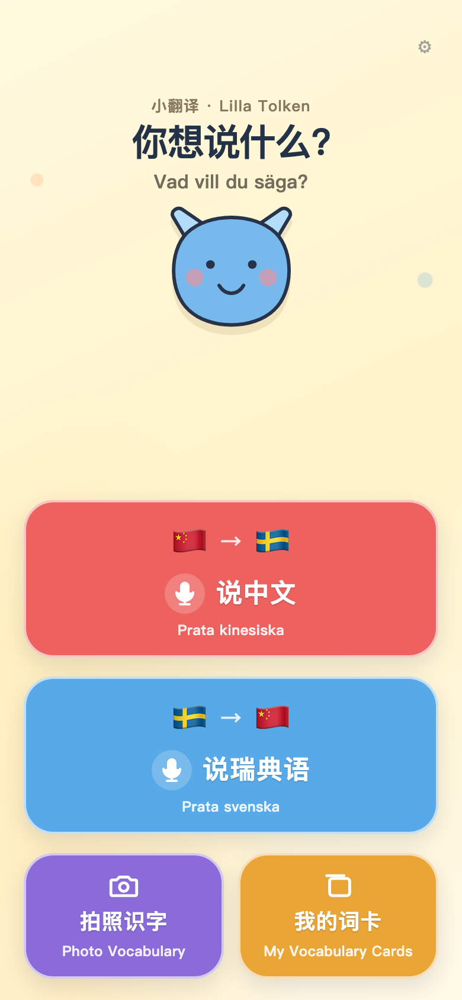
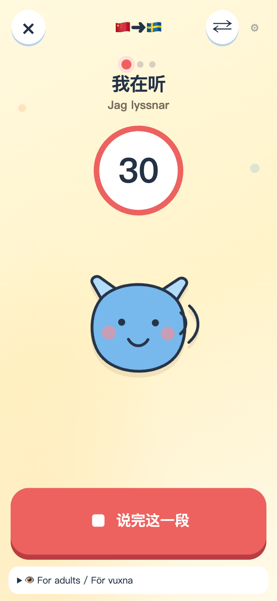
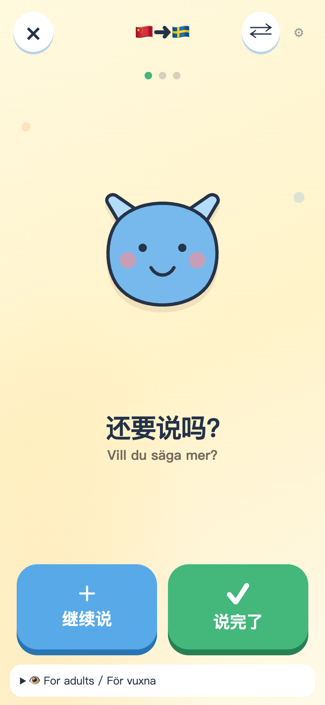
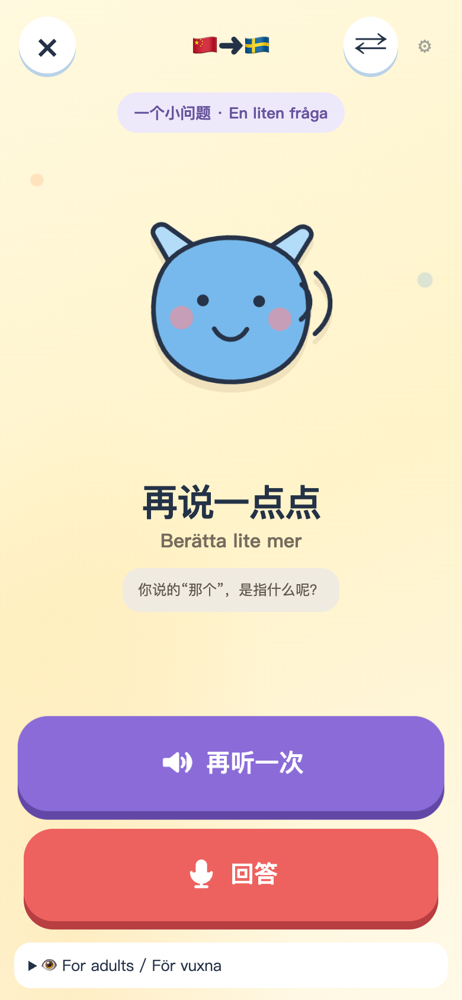
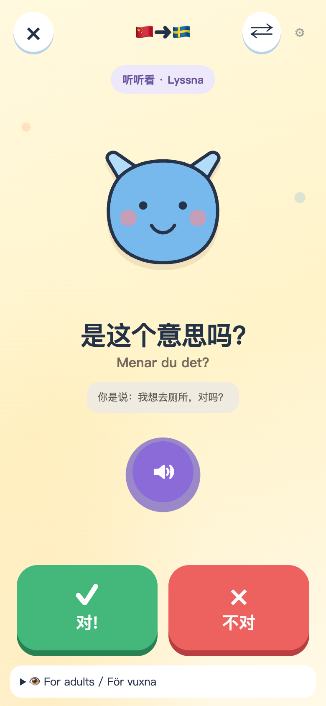
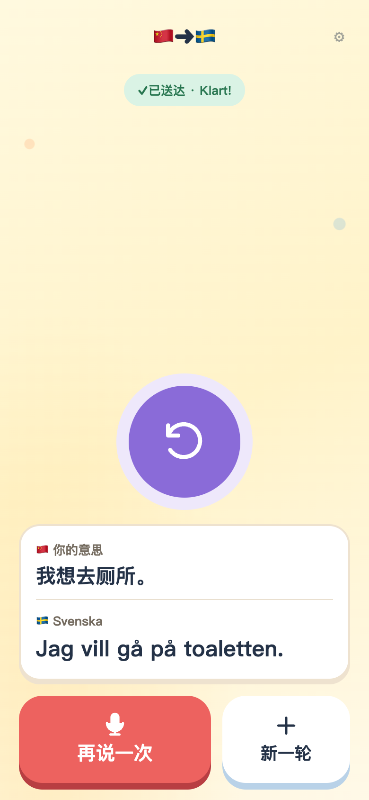
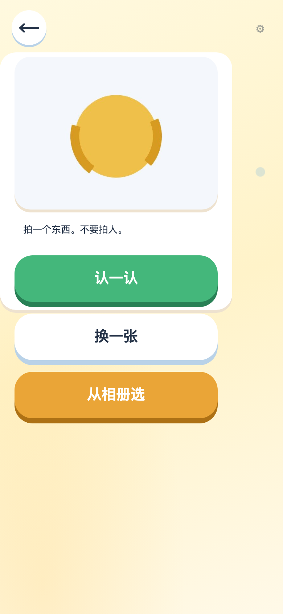
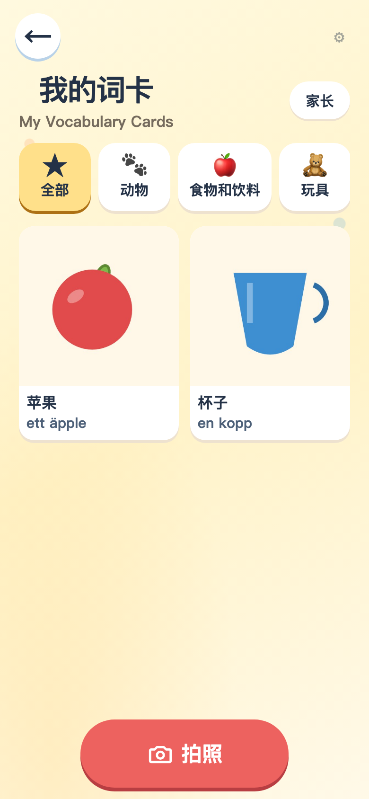
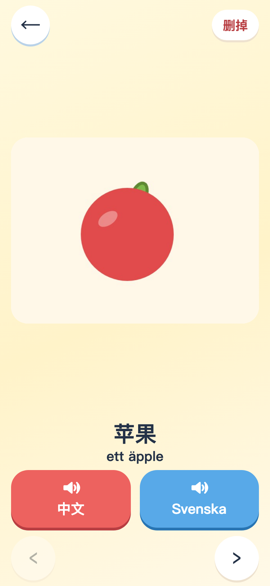
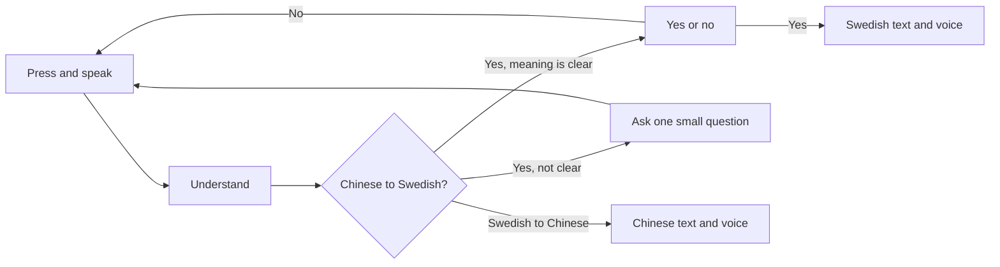

[中文](README.md) | **English**

# 小翻译 · Lilla Tolken

A push-to-talk translator between **Chinese and Swedish**, made for preschool children. A child presses a large button, speaks, and hears the other language. An adult nearby can read the text and help when something was not understood.

This is an **adult feasibility prototype**. It is for trying the conversation flow and the speech pipeline. It is not a study with children, and it does not use real children's voices.

## The screens

One thing at a time. The main buttons sit in the lower half of the screen, and icons, color, and sound are enough to use them. Chinese and Swedish are shown together, mainly for the adult nearby.

These frames are the current screens. The spoken ones use a built-in example, 「我想去厕所」, not a real recording. The apple and the cup on the cards are drawings made to show the screen.

<table>
  <tr>
    <td align="center" width="33%">
       
      <b>Choose a direction</b> 
      Speak Chinese, speak Swedish, or take a photo
    </td>
    <td align="center" width="33%">
       
      <b>I'm listening</b> 
      Stop when this short turn is done
    </td>
    <td align="center" width="33%">
       
      <b>Anything more?</b> 
      Keep speaking, or finish
    </td>
  </tr>
  <tr>
    <td align="center">
       
      <b>One small question</b> 
      If it is unclear, ask only once more
    </td>
    <td align="center">
       
      <b>Confirm first</b> 
      Translate only after a yes
    </td>
    <td align="center">
       
      <b>Say it aloud</b> 
      Text and voice together
    </td>
  </tr>
</table>

Photo vocabulary is for an object. After it is named, it goes into the card library, and a tap plays it.

<table>
  <tr>
    <td align="center" width="33%">
       
      <b>Name it</b> 
      Photograph an object, not a person
    </td>
    <td align="center" width="33%">
       
      <b>My cards</b> 
      Grouped by category
    </td>
    <td align="center" width="33%">
       
      <b>Tap to hear</b> 
      Chinese and Swedish, separately
    </td>
  </tr>
</table>

## How one conversation goes

The child chooses a direction first. Speaking Chinese for a Swedish listener, and speaking Swedish for a Chinese listener, do not follow the same steps.

**Chinese → Swedish**

1. Press the button and speak. One thought can be split into a few short turns, each up to about 30 seconds.
2. When speaking stops, the app works out the meaning.
3. If the meaning is clear, the child confirms yes or no.
4. If it is not clear, the app asks **one** short question, at most three times. If it is still unclear, the turn stops and can start over. It does not keep asking.
5. Only after a yes does it translate into Swedish and read the result aloud.

**Swedish → Chinese**

Once the speech is understood, it translates directly. The screen shows the original Swedish and the Chinese together, and reads the Chinese aloud. This direction does not ask a follow-up question and does not ask for confirmation.

If something was said wrong, not heard, or the direction should change, the turn can stop and start again. The translation can be replayed, or spoken once more in the same direction.

## Photo vocabulary

The home screen also has **Photo Vocabulary** and **My Vocabulary Cards**. Photo Vocabulary opens the camera directly. Photograph an object, not a person. The result is a card with Chinese and Swedish, and a tap plays either one. Cards are grouped into categories such as animals, food, and toys.

A card is stored on this device first. To show the same library on another device in the household, press and hold **家长** on the card page for about two seconds, then pair with a household passphrase of at least 8 characters. That passphrase is not the monitoring password. Deleting a card asks for confirmation first.

In the on-Mac mode, identifying the photo also stays on this computer. Cloud mode and Try it send that one photo to a cloud service, only to name the object. Do not photograph a face or personal information.

## Three ways to run it, one interface

| | What it is for | Where the audio goes |
|---|---|---|
| **Try it** | Walk through the screens with fixed examples, no API key | Stays on this computer |
| **On this Mac** | Speech recognition, understanding, and translation all run locally | Stays on this computer |
| **In the cloud** | Connect a speech service and try real speech | Audio is sent to the cloud, for adult or synthetic speech only |

The same page opens in Safari on a phone. Cloud mode sends recordings off this computer. Do not use it with children, and do not say personal information.

Setup, phone access, the on-Mac engines, and the monitoring panel are in the [developer guide](docs/DEVELOPER_GUIDE.md) (Chinese).

## What this version cares about

- A child does not need to read. Large buttons and sound are enough.
- Chinese is translated into Swedish only after the meaning is confirmed, so an unclear phrase is not spoken out.
- If it still is not clear, the turn stops instead of asking question after question.
- Records kept for review store only things like timing and success. They do not store audio, what was said, or the translation. A vocabulary card does keep its photo and the two words. That is separate from the monitoring record.
- A photo is only for an object. A face or a full-body picture does not become a card, and no personal name is written.

## Read on

- [Developer guide](docs/DEVELOPER_GUIDE.md) (Chinese): how to run it, try it on a phone, and open monitoring
- [System design](docs/SYSTEM_DESIGN.md) (Chinese): the full product and technical design

## License

This repository is under the [PolyForm Noncommercial License 1.0.0](https://polyformproject.org/licenses/noncommercial/1.0.0). Personal study, research, experiments, and hobby projects are allowed. Schools, charities, and public research organizations may use it under the license as well.

Commercial use is not covered. Using it in a product, a paid service, or a company's business needs separate permission from the author first. The full terms are in [LICENSE](LICENSE).

Required Notice: Copyright 2026 seansha30 (https://github.com/SeanSha/LillaTolken)
