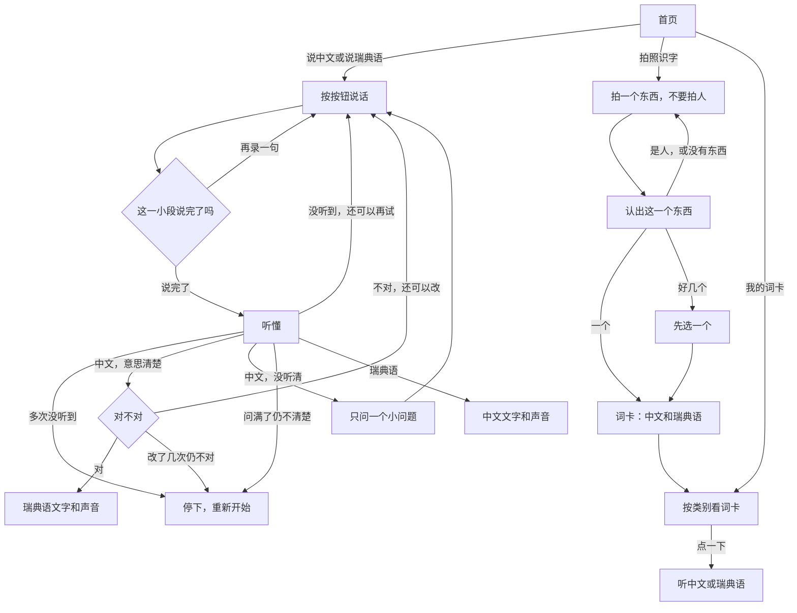

**中文** | [English](README.en.md)

# 小翻译 · Lilla Tolken

给学龄前孩子用的 **中文 ↔ 瑞典语** 按键说话翻译器。孩子按下大按钮说话，再听到另一种语言；旁边的成人可以看文字、处理听不清的情况。

这是一个 **成人可行性原型**。用来试对话流程和语音链路，不是儿童可用性研究，也不使用真实儿童的声音。

## 界面

一次只做一件事。主按钮在屏幕下半部，靠图标、颜色和声音就能操作；中文和瑞典语写在一起，主要给旁边的成人看。

下面是现在的界面。说话那几张来自内置的合成例子「我想去厕所」，不是真实录音。词卡上的苹果和杯子是画来展示界面的。

<table>
  <tr>
    <td align="center" width="33%">
       
      <b>选一个方向</b> 
      说中文、说瑞典语，或拍照识字
    </td>
    <td align="center" width="33%">
       
      <b>我在听</b> 
      说完这一小段就停
    </td>
    <td align="center" width="33%">
       
      <b>还要说吗</b> 
      可以接着说，也可以说完
    </td>
  </tr>
  <tr>
    <td align="center">
       
      <b>一个小问题</b> 
      没听清时，只再问一句
    </td>
    <td align="center">
       
      <b>先确认意思</b> 
      对了才翻译出去
    </td>
    <td align="center">
       
      <b>说给对方听</b> 
      文字和声音一起给出
    </td>
  </tr>
</table>

拍照识字拍的是一个东西。认出来以后放进我的词卡，点开就能听。

<table>
  <tr>
    <td align="center" width="33%">
       
      <b>认一认</b> 
      拍一个东西，不要拍人
    </td>
    <td align="center" width="33%">
       
      <b>我的词卡</b> 
      按类别排开
    </td>
    <td align="center" width="33%">
       
      <b>点一下就听</b> 
      中文和瑞典语分开读
    </td>
  </tr>
</table>

## 一次对话怎么走

孩子先选方向。中文说给瑞典语的人听，和瑞典语说给中文的人听，后面的步骤不一样。

**中文 → 瑞典语**

1. 按按钮说话。一句话可以分成几小段，每段最多大约 30 秒。
2. 说完后，程序先理解意思。
3. 意思清楚，就请孩子确认「对」或「不对」。
4. 意思不清楚，就只问 **一个** 很短的问题，最多问 3 次。仍然不清楚，就停下来重新开始，不会一直追问。
5. 只有确认「对」之后，才翻译成瑞典语，并读出来。

**瑞典语 → 中文**

听懂之后直接翻译。屏幕上同时有瑞典语原文和中文，并读出中文。这一方向不再追问、也不再确认。

说错了或没听清，可以再试；次数用完就停下，不会猜。中途换成另一个方向时，会先问要不要放弃这一轮。翻译结果可以再听一遍，也可以用同一方向再说一次。

## 拍照识字

首页还有 **拍照识字** 和 **我的词卡**。点拍照识字会直接打开相机。拍一个东西，不要拍人。认出来以后是一张词卡：中文、瑞典语，点一下可以听。词卡按动物、食物、玩具等类别排开。

词卡先存在这台设备上。想让家里另一台设备看到同一份，在词卡页按住 **家长** 大约两秒，再用至少 8 个字符的家庭口令配对。这个口令不是监控后台的密码。删掉一张词卡之前会再问一次。

在 Mac 上翻译时，识图也留在这台电脑上。云端模式和「试一试」会把这一次照片送给云端，只用来认出这个东西。不要拍人脸，也不要拍个人信息。

## 三种用法，同一套界面

| | 适合做什么 | 声音去哪里 |
|---|---|---|
| **试一试** | 不配密钥，用固定例子把界面走一遍 | 不出这台电脑 |
| **在 Mac 上翻译** | 识别、理解和翻译都在本机完成 | 不出这台电脑 |
| **用云端翻译** | 接上语音服务，试真实说话 | 录音会送到云端，只用于成人或合成语音 |

手机用 Safari 打开同一套页面即可。云端模式会把录音送出这台电脑，不要让孩子用，也不要说个人信息。

安装、手机访问、本机引擎和监控面板写在 [开发说明](docs/DEVELOPER_GUIDE.md)。

## 这版在意的几件事

- 孩子不需要识字。看不懂字，也能靠大按钮和声音走完。
- 中文翻成瑞典语之前，必须先确认意思，避免把没听清的话直接说出去。
- 问不清楚就停，不连续追问。
- 用来看效果的记录只保留耗时、是否成功这类信息，不保存音频、孩子说了什么，或翻译结果。词卡本身会留下照片和两个词，这和监控记录是分开的。
- 拍照只认物品。人脸或全身照不会做成词卡，也不会写出人名。

## 再往下看

- [开发说明](docs/DEVELOPER_GUIDE.md)：怎么跑起来、怎么在手机上试、怎么看监控
- [系统设计](docs/SYSTEM_DESIGN.md)：完整的产品与技术设计

## 许可

本仓库使用 [PolyForm Noncommercial License 1.0.0](https://polyformproject.org/licenses/noncommercial/1.0.0)。个人学习、研究、试验和业余项目可以用。学校、公益机构和公共研究机构也可以按许可证使用。

商业用途不在这份许可里。拿它做成产品、提供收费服务，或放进公司业务里使用，需要先另外取得作者同意。完整条款见 [LICENSE](LICENSE)。

Required Notice: Copyright 2026 seansha30 (https://github.com/SeanSha/LillaTolken)
