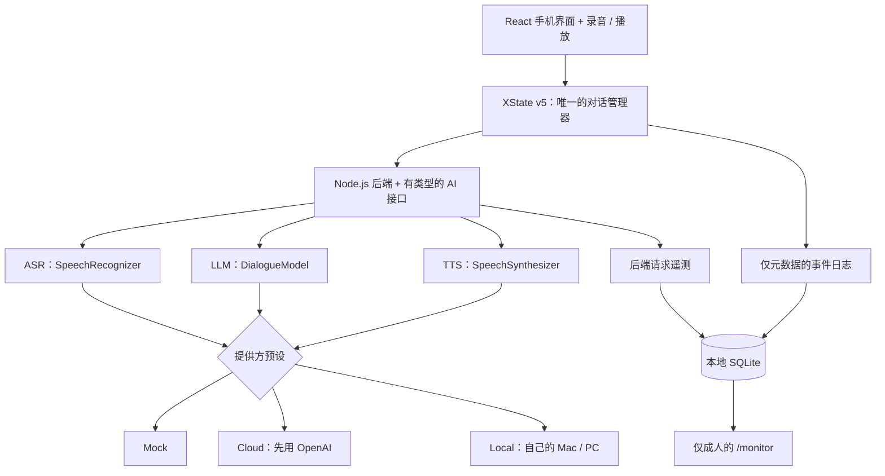
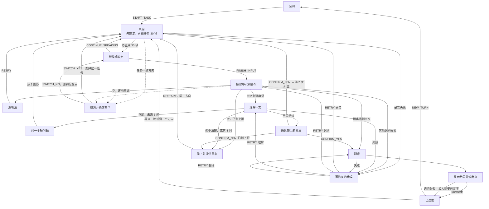
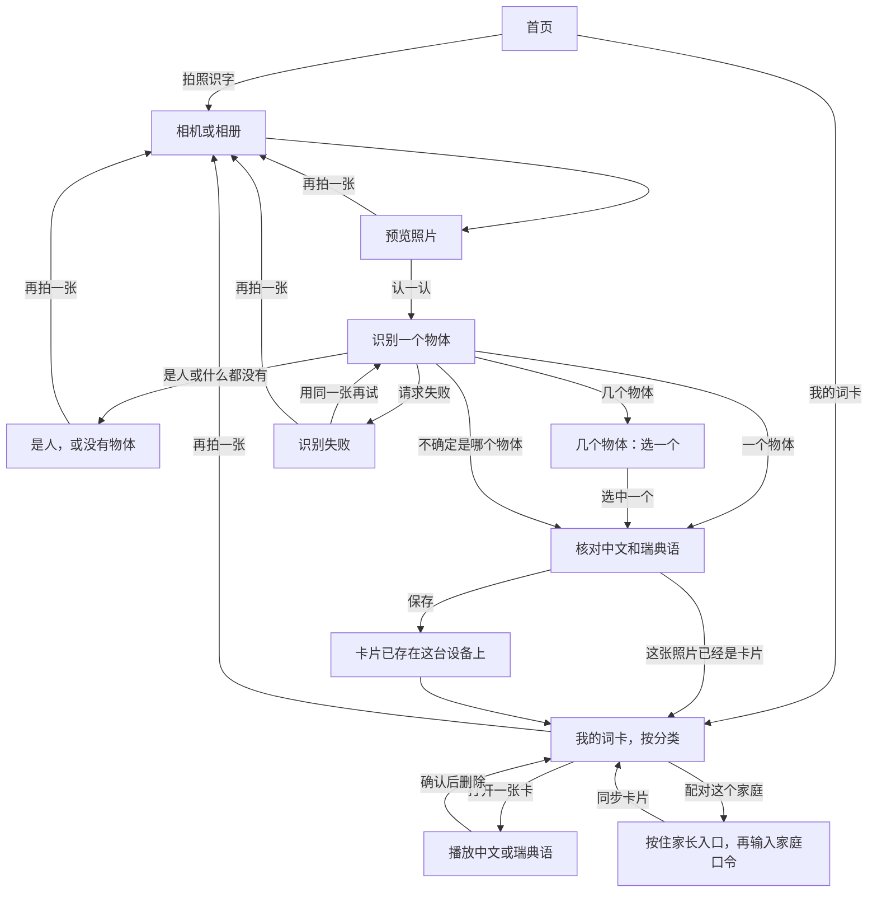
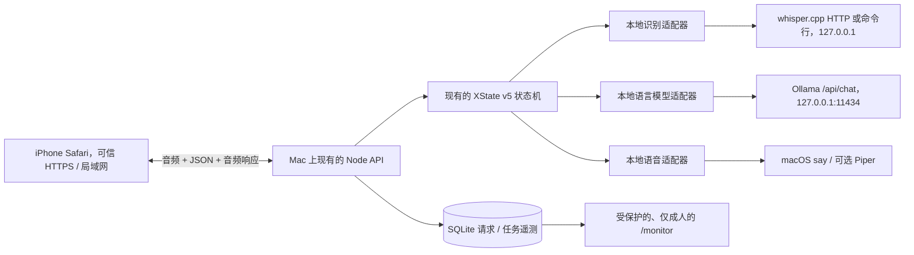

# 01 系统设计

本系列：**01 系统设计** · [02 开发说明](02-开发说明.md) · [03 界面设计需求](03-界面设计需求.md) · [04 Tab5 迁移可行性](04-Tab5迁移可行性.md) · [05 代码导读](05-代码导读.md) · [06 研究提示词](06-研究提示词.md)

英文在 [`docs/02-en`](../02-en/01-system-design.md)。

**面向儿童的中文–瑞典语语音翻译器。** Minimal V1 系统设计 — 与提供方无关的实现说明。

**版本：** 1.2 — 2026 年 10 月 18 日  
**取代：** `Child_Translator_Minimal_V1_System_Design_Updated_EN.md`（v1.1）  
**范围：** **仅成人使用的可运行原型**，同时包含云端和完全在 Mac 上的本地推理，以及一个私有监控页。不采集真实儿童录音或个人数据。  
**目标：** iPhone Safari、React/TypeScript、XState v5、Node.js 后端  
**架构：** **一个界面 + 一个对话状态机 + 可互换的 Mock、Cloud、Local 提供方。**

> **给实现者（在已经能跑的应用上增量扩展）：** 保留现有 React 界面、Cloud 提供方、XState v5 状态机和对话规则。实现新的 Mac 本地 ASR + LLM + TTS 路径，以及共用的监控页。按集成层自行测试；除非硬件、凭证或某个决定确实挡住了，不要在内部步骤之间停下来等人批准。不要再做第二个应用或第二份状态机。

---

## 1. 目标与已定的设计

做一个面向儿童的 **一对一、按键说话的中文 ↔ 瑞典语语音翻译器**，先用 **成人说话** 来试。界面按还不识字的学龄前儿童来设计，但 V1 **不** 证明真实儿童能用，也 **不** 证明儿童语音识别准。

**两个方向：**

- **中文 → 瑞典语（主流程）：** 录音 → 识别 → 理解 → 必要时澄清 → **始终确认中文意思** → 翻译 → 显示并播放瑞典语。
- **瑞典语 → 中文（辅助流程）：** 录音 → 识别 → 直接翻译 → 显示 **识别出的瑞典语原文和中文译文** → 播放中文。

**从初始设计 v0.2 沿用的决定：**

1. **每一次中文 → 瑞典语翻译都要对最新提出的意思明确点「是」**，即使句子看起来已经清楚。
2. 每个任务最多 **三个语义澄清问题**。录音段、识别重试和最后一次确认不占用这个次数。
3. 未完成的任务不能直接被换方向打断。必须单独问 **取消并切换？是 / 否**。
4. 会话里只保留 **上一条成功送达的消息**，跨方向可用。默认不保留完整历史。

**另外观察到的界面需要：** 每一段录音一个 **30 秒** 计时；一句说不完整可以分成多段继续录；图标要很大，并配很短的语音提示（操作不依赖认字）；成人要能读到瑞典语原文。

**不做：** 儿童测试、硬件设备、学校部署、声音匿名化、一直开着的录音、训练模型、公开托管、把对话或音频内容写进分析日志、以及生产级合规认证。一个仅本地、要登录的监控页 **在范围内**。以后若做儿童研究，需要单独审查。

---

## 2. 总体架构



**不要按提供方各写一套** 界面状态、XState 守卫、澄清规则、记忆规则或评估规则。状态机做对话决定；模型只返回结构化的提议和译文。

| 预设 | 识别 | 理解 / 翻译 | 语音 | 用途 |
|---|---|---|---|---|
| `mock` | 固定的假结果 | 固定的假结果 | 准备好的片段 / 假播放 | 先验证界面和对话流程 |
| `cloud` | 云端语音接口 | 云端语言模型 | 云端语音接口 | 仅成人的真实 AI 试点 |
| `local` | Mac 上的多语言 Whisper | Mac 上的 Ollama 多语言模型 | Mac 上的普通话 / 瑞典语语音 | v1.2 要求的完整本地成人语音流程 |

把识别、语言模型和语音合成做成 **三个独立接口**，以后才可能混用。**V1 不要做完整的「任意组合提供方」选择器。** 开发者设置只在 **空闲** 时选一个预设，并在整个任务期间冻结它。

**隐私边界：** 所有真实 AI 测试只用成人语音和非身份信息 / 合成输入。本地服务器避免把内容发给模型厂商，但不会自动解决适用的研究或隐私责任。

---

## 3. 五个面向儿童的屏幕

| 屏幕 | 核心界面 | 行为 |
|---|---|---|
| **首页** | 两个很大的方向按钮 + 麦克风 | 选中文 → 瑞典语，或瑞典语 → 中文 |
| **录音** | 大麦克风 / 停止，会动的 **30 秒倒计时** | 手动停止或超时只结束 **这一段**，不是整个任务 |
| **继续 / 说完** | 🎤➕ 继续，✅ 说完 | 再录一段，或提交整句 |
| **澄清 / 确认** | 🔊 重播；🎤 回答 **或** ✅ 是 / ❌ 否 | 一次只问一个短问题或做一个决定 |
| **结果** | 大 🔊 播放 / 重播，新一轮 / 再录，给成人看的文字 | 显示原文和译文；播放目标语言 |

界面规则：

- 主按钮要很大（目标约 80 px）；图标简单，用形状和颜色区分，字很少。
- 孩子操作 **不依赖认字**。语音提示包括「现在可以说啦」「还想继续说吗？」「你是说……，对吗？」。
- 问出的问题要能重播。麦克风录到的声音和程序自己说的声音不要叠在一起。
- 确认的是 / 否，和换方向的是 / 否，看起来可以相近，但必须是 **不同的状态机事件**。
- 不要假设 Safari 总能自动播放。要有一个明确的播放按钮。
- **中文 → 瑞典语的结果：** 已确认的中文意思 + 瑞典语文字 + 瑞典语音频。
- **瑞典语 → 中文的结果：** 识别出的瑞典语原文 + 中文译文 + 中文音频。说瑞典语的成人可以核对识别结果；这 **不** 等于中文译文是对的。

---

## 4. 录音与对话流程

### 4.1 分段录音

1. 一个翻译 **任务** 可以包含多段音频。每一段有一个 **30 秒** 倒计时。
2. 停顿和静音 **不会** 自动结束这一段。停止或超时只结束当前这一段。
3. 每一段之后选择 **继续**（同一任务里再录 30 秒）或 **说完**（提交全部段落）。
4. 说完之后，按 **顺序** 识别各段，并保留段落边界。不要在碎片之间编造词语。
5. 澄清的回答或纠正，复用同一套录音界面，但在同一任务里标成另一种 **输入用途**。
6. 音频暂时放在内存里，完成、取消或会话结束时丢掉。不要把音频或转写写进评估日志。

**例子：** 「老师……」/「他把我的……」/「水壶拿走了。」→ 三段，**一条** 消息，**一个** 翻译任务。

**Safari 要检查的：** 麦克风权限和安全的 HTTPS；`MediaRecorder` 是否支持、MIME 探测（不要假设是 WebM）；后端能接受的音频格式；在真机 iPhone 上试。

### 4.2 概念状态图



首页是分叉。**说中文** 或 **说瑞典语** 进入上面这台对话状态机。**拍照识字** 和 **我的词卡** 进入下面这条屏幕流程。它不是第二台 XState 机器，也不共用对话任务、计数器或评估事件。



对话图是 `apps/web/src/dialogue/machine.ts` 里那一台 XState v5 机器。第一次说话、澄清的回答、纠正，都是同一个录音状态。提问、确认和结果，都先合成语音再让孩子回答；语音失败时，文字留在屏幕上。可恢复错误上的 `RETRY` 回到失败的那一阶段：识别、理解、翻译；如果什么都没留下，就回到录音。未完成任务上的 `CANCEL` 回到空闲，并且不更新上一条已送达的消息。任务进行中换方向，总是先问。空闲和已送达可以直接开始新方向，不再问那一句。

拍照图跟着 `apps/web/src/vocabulary/VocabularyShell.tsx`。相机从首页打开。一个具体物体变成一张卡片：中文名词、瑞典语名词、冠词、学前分类。人或没有物体的照片会被拒绝，也不写人名。几个显眼的物体要等用户选一个。不确定的照片不编造词语。卡片先存在这台设备上。同一张照片打开已有卡片，不再新建。朗读用现有的语音合成，第一次播放后缓存在卡片上。配对和删除在家长页，按住小圆点大约两秒打开。返回箭头回到首页，对话状态机保持空闲。

### 4.3 必须遵守的规则

**中文 → 瑞典语：**

- 语言模型提出一个短问题，或一个暂定的意思。XState 决定哪一种转移被允许。
- 只在缺失的信息 **会实质改变意思** 时才问。问题要短、中性、不认字也能懂。
- 计数器在语义问题 **真正被展示** 时加一。永远不显示第 4 个问题。三个问题仍没解决，就重来或取消，不要猜。
- **始终** 播放提出的中文意思，并在最终翻译前等「是」。
- 确认选「否」会使那条意思作废，然后收集一次纠正。起初限制为 **两次纠正**（暂定），然后重来或取消。
- 原始输入和问答轮次分开保留。澄清的回答不是一个新任务。

**瑞典语 → 中文：** 识别成人瑞典语，直接译成清楚的中文，显示识别出的瑞典语和中文结果，并播放中文。不进入儿童的意思确认流程。

**换方向：** 任务进行中，单独确认是否取消。**否** 回到一个安全检查点，保留已有段落和计数器；被打断的录音可能要重录。**是** 取消未完成的任务，并按请求的方向开始一个新任务，只保留上一条成功送达的消息。

**异步安全：** 每个请求带 `taskId` 和 `requestId`。切换或取消之后，过期的完成结果要丢掉，即使网络取消失败也一样。未完成的任务从不更新会话记忆。

**送达：** 不要因为接口返回了译文就记住这条消息。只有结果已经显示、并且目标语言播放结束，或者语音失败后成人测试者明确接受了纯文字结果，才记住它。记录这次送达是音频还是纯文字。`END_SESSION` 时清空记忆。上一条消息只是可选上下文，不是事实。Cloud 和 Local 对比时使用 **同一套提示词记忆设置**。

**失败：** 识别为空 → 再录（暂定 **两次识别重试**）。模型 JSON 不合法、网络失败或超时 → 重试或取消。语音失败 → 保留可读文字，允许手动重播，或由成人接受纯文字。失败的任务永远不要标成成功。

### 4.4 精简的信息状态

```typescript
type Direction = 'ZH_TO_SV' | 'SV_TO_ZH';
type InputPurpose = 'INITIAL' | 'CLARIFICATION' | 'CORRECTION';
type ProviderPreset = 'mock' | 'cloud' | 'local';

type DialogueInput = {
  purpose: InputPurpose;
  textParts: string[];        // 按顺序的段落；易失
  inReplyTo?: string;         // 澄清问题，如果有
};
type LastDelivered = {
  taskId: string;
  direction: Direction;
  source: string;             // 已确认的中文意思，或瑞典语识别结果
  translation: string;
};
type Task = {
  id: string;
  direction: Direction;
  preset: ProviderPreset;     // 任务期间冻结
  inputPurpose: InputPurpose;
  segmentInfo: { id: string; durationMs: number; purpose: InputPurpose }[];
  dialogueInputs: DialogueInput[];
  proposedMeaning: string | null;
  currentQuestion: string | null;
  confirmedMeaning: string | null;
  translatedText: string | null;
  clarificationCount: number;
  correctionCount: number;
  asrRetryCount: number;
};
type MachineContext = {
  sessionId: string;
  task: Task | null;
  lastDelivered: LastDelivered | null;
  pendingDirection: Direction | null;
  safeReturnState: string | null;
  activeRequestId: string | null;
};
const LIMITS = {
  segmentSeconds: 30,
  semanticClarifications: 3,
  correctionAttempts: 2,
  asrRetries: 2,
};
```

音频块放在单独的 **易失音频库** 里，不要放进持久的 XState 快照。真正的状态机应定义有类型的界面事件（`START_TASK`、`STOP_SEGMENT`、`SEGMENT_TIMEOUT`、`CONTINUE_SPEAKING`、`FINISH_INPUT`、`CONFIRM_YES`、`CONFIRM_NO`、`SWITCH_REQUESTED`、`SWITCH_YES`、`SWITCH_NO`、`DELIVERY_FINISHED`、`RETRY`、`CANCEL`、`END_SESSION`），以及有类型的异步完成 / 错误事件。

---

## 5. 提供方契约 — 可互换的识别、语言模型、语音

下面是 **设计层** 的 TypeScript 契约。浏览器和 Node 之间的传输编码可以调整，语义不要改。

```typescript
type Language = 'zh' | 'sv';
type AudioData = { bytes: Uint8Array; mimeType: string; durationMs?: number };
type RequestMeta = { taskId: string; requestId: string; signal?: AbortSignal };

type InterpretationResult =
  | { kind: 'ASK_CLARIFICATION'; questionZh: string; reasonCode: string }
  | { kind: 'PROPOSE_MEANING'; meaningZh: string }
  | { kind: 'UNRESOLVED'; reasonCode: string };

interface SpeechRecognizer {
  transcribe(audio: AudioData, language: Language, meta: RequestMeta): Promise<string>;
}
interface DialogueModel {
  interpretChinese(input: {
    dialogueInputs: DialogueInput[];
    remainingClarifications: number;
    previousDelivered?: LastDelivered | null;
  }, meta: RequestMeta): Promise<InterpretationResult>;
  translate(input: {
    text: string;
    direction: Direction;
    previousDelivered?: LastDelivered | null;
  }, meta: RequestMeta): Promise<string>;
}
interface SpeechSynthesizer {
  synthesize(text: string, language: Language, meta: RequestMeta): Promise<AudioData>;
}
type ProviderBundle = {
  asr: SpeechRecognizer;
  dialogue: DialogueModel;
  tts: SpeechSynthesizer;
};
```

**必须：** 任何语言模型返回的 JSON 和 schema，都要在派发 XState 事件之前校验。模型不能改计数器、跳过必须的确认，或绕过守卫。后端检查体积、文本长度、超时和错误。浏览器看不到任何提供方密钥或私有推理地址。

### 5.1 Mock（先做）

固定的假识别、假理解、假翻译和假音频。要覆盖：清楚的中文、含糊、澄清的回答、确认选否、瑞典语输入、可恢复错误、过期响应。**要走真正的状态机**，不要走捷径。

### 5.2 Cloud（第二）

在 Node 侧用一个 Cloud 包（最初的例子是 OpenAI）做识别、结构化理解和翻译、以及语音。固定模型标识和提示词版本，以便成人测试可以复现。保留按顺序的段落转写，密钥只放服务端，并支持重试和超时。**只用成人声音和非身份信息。** 接入时核对厂商当时的端点、格式、限额和使用条件。不要单凭代码假设数据保留设置。

### 5.3 本地 Mac AI 包 — 这一版要完整实现

**目标：** 用 **同一套** iPhone 界面和 **同一组** Node 路由，在空闲时选择 `local`，然后只用用户自己 Mac 上的服务跑完 **整圈：识别、理解、澄清、翻译、语音。** 本地推理在运行时不得联系模型厂商的云。安装时下载一次模型文件是可以的。本地组件缺失或失败时，**不要** 悄悄改调 OpenAI。

#### 部署图和边界



Node 后端是浏览器面对的 **唯一** API。Ollama、Whisper 和语音进程只听 `127.0.0.1`（或作为子进程）。不要把它们自己的 HTTP 端口暴露给 iPhone、局域网、互联网或浏览器。**Ollama 本地模式不是 Ollama 云模式：** 要核对模型名、地址，以及模型是否已安装。一台放在 Mac 上的 Node 可以同时提供 iPhone 应用、API 和监控页。

#### 先看这台 Mac，再决定模型大小

增加 `npm run local:doctor`（或同等脚本），报告下面这些，不要包含密钥或音频内容：

- CPU 架构（`arm64` Apple 芯片或 Intel）、macOS 版本、Apple 芯片型号（如果能读到）、总内存、剩余磁盘、GPU / Metal。
- Ollama、`ffmpeg`、`cmake`、`whisper.cpp` 服务、`say`，以及可选的 Piper 是否已安装。
- 实际已安装的 Ollama 模型（`ollama list`）、本机可用的普通话和瑞典语 macOS 语音（`say -v '?'`），以及每个引擎的监听 / 健康状态。
- **在下载任何大文件之前** 给出模型体积和内存 / 磁盘风险。不要假设是 M 系列芯片、32 GB 内存或 CUDA GPU。不要购买硬件，也不要安装无关服务。
- 缺什么就打印可执行的安装步骤，并给出一份不含敏感信息的本地就绪摘要，供监控健康面板使用。

**起步模型策略（候选，不保证质量或延迟）：**

| 组件 | 实用的第一次尝试 | 降级 / 升级 |
|---|---|---|
| 识别 | Mac 上的 `whisper.cpp` 多语言 **small 或 medium**（不要 `.en`）；能用 Metal 就用 | 内存紧先用 `small`；测过成人中文 / 瑞典语的准确率和延迟之后，再试 `medium` / `large-v3-turbo` |
| 语言模型 | **Ollama，本地 `qwen3:8b`**（量化）；内存紧则用 `qwen3:4b` 这一档 | 只有资源够、并且瑞典语或澄清质量不够时，才试 **14B 这一档**；核对真实可下载的标签 |
| 语音 | **macOS `say`**，已安装的 `zh_*` 和 `sv_*` 声音，生成可播放的音频文件 | 任一声音缺失或不合适，再试离线 **Piper** 的中文 `zh_CN` 和瑞典语 `sv_SE`；核对照许可、安装，以及在这台 Mac 上能否真的播出 |
| 翻译 | 起初理解和两个方向都用同一个本地模型 | 只有双语人工测试证明质量不够时，才另装专用翻译引擎；没有具体失败案例就不要装多个模型 |

**Whisper：** 文档中的 `whisper.cpp` HTTP 服务通过 `POST /inference` 接收 WAV。如果 iPhone Safari 录的是 AAC/M4A 或其他受支持的格式，Node 在推理前用 ffmpeg **在本地** 转成 PCM 16 kHz 单声道 WAV。每一段保留一条转写，按顺序。按所选 Whisper 构建支持的方式使用 `language=zh` 或 `sv`。不要在识别内部自动翻译。命令行参数和服务载荷以安装的版本为准，不要猜端点。只在解析 JSON 所必需时裁剪模型输出，不要悄悄改孩子的话。临时输入和转码文件按请求隔离，并在 `finally` 里安全删除，包括出错和取消。基于文件的音频不要留在应用日志里。

**Ollama：** Node 调用 `POST http://127.0.0.1:11434/api/chat`。设置 `stream:false`，固定 `model`，理解使用 JSON schema 的 `format`，并用与 Cloud **同一套** Zod/TypeScript schema **校验** 结果。选择短而确定的输出，在支持的地方避免生成冗长的内部推理。Ollama 返回生成计数和纳秒时长（例如 `prompt_eval_count`、`eval_count`、`total_duration`、`load_duration`）。存进监控前换算成毫秒。不要把模型计算时长和 Node 的端到端请求时长混为一谈。测试时尽量让模型保持热状态，并把冷启动加载时间单独记下。

**语音：** 最初的 macOS `say` 适配器是这台 Mac 上最容易的第一次测试，**前提是两种语言都有可用的已安装声音。** 运行时发现声音 ID，不要把一个可能不存在的声音写死。用参数数组启动子进程（不要把命令拼进 shell），生成唯一的临时 AIFF，再在本地转成 iPhone 能播的 WAV/M4A。校验用户可控文本的长度。如果声称推理不走网络，就要做一次真正的离线测试。内置声音失败时，再试 Piper 当前的 Open Home Foundation 实现和两种语言的声音。Local 预设没有云端回退。改为显示可操作的语音错误，或成人可用的纯文字后备。

**实现清单：**

1. `local:doctor`：硬件、安装、声音、模型检查和说明；结果出现在受保护的监控健康面板。
2. `LocalDialogueModel`：带 schema 约束的理解和双向翻译；两种语言都要有纯文本测试。
3. `LocalSpeechRecognizer`：本地音频格式转换，以及在真实成人 iPhone 录音上用 whisper.cpp 识别。
4. `LocalSpeechSynthesizer`：本地普通话和瑞典语音频，并能在真机 iPhone 上播放。
5. 把它们装进现有的 `ProviderBundle` 契约；`local` 在一个任务里保持选中并冻结。全部对话规则仍在 XState。
6. 每个方向至少用 5 个成人任务跑完整序列，包括一句没说完的中文和必须的确认。
7. 如果这台 Mac 上缺一个引擎或不支持，不要把 Local 标成完全可用。给出能用的安装说明，以及明确状态，例如 `LOCAL_TTS_UNAVAILABLE`。

**真正的端到端成功标准：** 没有配置 Cloud 密钥（安装下载之后最好再断开外网），成人对着 iPhone 说话 → Mac 识别 → 本地模型按未改动的 XState 理解并提问或回答 → 本机生成的目标语言音频在 iPhone 上播放。中文→瑞典语和瑞典语→中文都要能用。不要用纯文字或合成的假演示宣称成功。

### 5.4 现有后端路由、新的诊断和运行控制

保留现有路由：`GET /api/health`、`POST /api/asr`（一段）、`POST /api/interpret`、`POST /api/translate`、`POST /api/tts`，以及现有的事件日志路由。路由语义保持稳定，在处理函数和服务边界加上测量。如果现有实现是一个总编排端点，就测量内部阶段调用，不要为此重写它。

- `GET /api/local/health` **（受保护）**：就绪情况、所选本地模型 / 声音标签、识别 / 语言模型 / 语音是否可达、最后一次错误。不要显示凭证或私有路径。
- `GET /api/monitor/summary?from=&to=&preset=` **（受保护）**：任务、请求、延迟和费用的汇总。
- `GET /api/monitor/requests?...` **（受保护）**：分页的单次后端推理请求，带过滤。
- `GET /api/monitor/tasks?...` **（受保护）**：任务和分段摘要、失败原因。
- `GET /api/monitor/timeseries?...` **（受保护）**：按小时 / 按天的次数、用量、估计费用和延迟。
- `GET /api/monitor/pricing` **（受保护）**：当前模型单价、单位、修订 / 生效日期和来源。只能在服务端修改。
- `POST /api/monitor/annotations` **（受保护）**：可选的、*仅成人* 的任务质量分和观察（没有转写）。
- `GET /api/monitor/export?type=requests|tasks|annotations&format=csv` **（受保护）**：可选的 CSV 后备。正常工作方式是页面本身，不是导出。

不要让浏览器直接请求 Ollama、Whisper 或 Piper。不要把 API 令牌、原文或二进制放进 URL 或浏览器分析。即使在局域网，也用最小的后端认证保护监控路由。不要使用写死的或共享的默认密码，也不要把密钥放进 Vite / 客户端构建。如果带认证的局域网暴露还没准备好，就限制为只听本机。

---

## 6. 新需求：实时的成人监控与评估页

这一节取代 v1.1 里「只有 CSV」的最低期望。监控页是原型的 **一等部分**，Cloud、Local、Mock 共用同一台服务器和同一份 SQLite 遥测。它必须显示真实会话的结果，不能是编造的演示数字。**不要把这些控件放到儿童主界面上。**

### 6.1 必须有的界面：`/monitor`（先适配桌面，同时能缩小）

**A. 概览 — 打开时首先看到，页面开着时大约每 3–5 秒刷新**

- 过滤：**时间范围**（今天 / 近 7 天 / 自定义）、`providerPreset`（全部 / Cloud / Local / Mock）、语言方向、API 阶段、模型、状态，以及可选的场景 ID。
- 卡片：任务尝试数、成功送达的任务、**AI 请求数**（含重复调用）、录下的音频分钟、Cloud 已计费或估计的美元费用、错误数 / 错误率、任务时长的平均 / 中位数、后端阶段延迟的平均和 p95。样本很小时，把 p95 标成描述性统计；**不要假装精度很高**。
- 时间序列：按小时 / 按天的请求；按天的估计 Cloud 花费；阶段时长随时间的变化；可选的 Cloud 与 Local 延迟对比。
- 阶段分解：**ASR**、**INTERPRET**、**TRANSLATE**、**TTS** 的次数和延迟；如果有，也显示本地推理的冷启动时间。
- 健康：本地识别 / 语言模型 / 语音的状态和当前模型标签；Cloud 适配器已配置或未配置（永远不显示密钥）。不要在后台探测云端并因此产生计费调用。

**B. 请求浏览器 — 每一次真实的后端模型调用一行**

必有列：时间戳、`requestId`、`taskId`、提供方、**阶段**、引擎 / 模型、方向、输入录音秒数（适用时）、墙上时钟请求延迟毫秒、状态 / 错误、返回了才有的输入 / 输出 token、**美元价格**、计价类型（`reported_usage`、`estimated`、`unknown` 或 `not_applicable`），以及可选的本地模型加载时间。点一行可以看到时长分解、重试和计价输入，**不能** 看到音频、转写、提示词或译文。支持排序、过滤和每页条数。

**C. 任务浏览器 — 每个翻译任务一行**

显示方向、任务期间冻结的提供方、**录了几段**、各段录音时长之和、ASR 调用次数、理解 / 翻译调用次数、TTS 调用次数、澄清次数、确认次数、总处理时间、任务总耗时、目标语言是否播放完成、结果（送达 / 失败 / 取消），以及 **已知或估计的 Cloud 费用之和**。用 `taskId` 连到它的请求和非内容事件。任务费用是所有关联请求之和，包括重试。不要假设一个任务只有一次模型调用。

**D. 评估 — 轻量的、可选的人工标注**

对成人控制的任务显示 `scenarioId`、提供方、意思分数（0/1/2）、接收方是否听懂（是 / 否 / 未评估）、识别问题（无 / 有 / 未评估）、界面问题次数，以及很短的 **不含身份信息的观察**。人工分数不是从语言模型输出推出来的。显示按提供方分组的基本平均和分布。不要对儿童做推断性结论。技术上完成的任务，不等于人工评估过的成功沟通。

**E. 费用明细**

- 能算的地方，显示每次请求的 **Cloud 美元** 费用。用版本化的、只在服务端的价格表，按具体提供方 / 模型 / 端点 **和计价单位** 计算，不要用一个笼统的 token 公式。单价可以是输入 token、缓存 token、输出 token、识别分钟、音频 token，或其他端点自己的计费单位。
- 优先使用提供方返回的真实用量。如果响应里没有用量，只在存在说得通的计价单位时，用测到的时长或已知数量做 **明确标注的估计**。否则显示 `Unknown`，**永远不要显示 $0.00**。
- 在请求详情里显示计算方法、单位、价格修订 / 来源和所用单价。Cloud 遥测是 **估计和归因视图**，不是厂商账单。货币是美元。可选的瑞典克朗换算以后再做（需要汇率数据）。
- 本地提供方：**外部推理 API 费用 = $0**，但电费、Mac 折旧、磁盘和开发时间 **不算在内**。显示 `Local API: $0（不含硬件和电）`，不要写成「免费」。Mock 是 `N/A`。
- 在小计旁边显示 **未知 / 未标价的 Cloud 请求数**，避免把不完整的合计说成全部费用。只加总已知和已估计的金额，并标明合计是部分的。
- 提供一个可配置的、仅成人的 **软预算提醒**（例如一次会话或一天的美元上限）。在继续使用前提醒，但不要把它宣传成精确的停费保证。不要自动去轮询会产生费用的提供方。

### 6.2 测量定义 — 不要把这些时钟混在一起

| 字段 | 定义 / 在哪里记 | 谁记 |
|---|---|---|
| `segmentRecordedMs` | 浏览器从 `RECORDING_STARTED` 到 `RECORDING_STOPPED` 的墙上时钟录音时长；**每一段都存** | 客户端事件发给后端 |
| `taskRecordedMs` | 初次 + 澄清 + 纠正各段时长之和；可选显示初次输入的小计 | 数据库汇总 |
| `inferenceRequestMs` | 包住 **一次** HTTP 或子进程调用的后端计时；需要时包含网络和转码，并给各部分打标签 | 后端 `performance.now()` 或单调时钟 |
| `asrConversionMs` | 本地识别延迟里 ffmpeg / 输入转换的那一部分 | 后端 |
| `engineInferenceMs` | 引擎报告的模型侧时长（如果有），或测到的子步骤 | 适配器 |
| `modelLoadMs` | Ollama 的模型加载时长，或可测的服务冷启动 | 本地适配器 |
| `taskProcessingMs` | 从 `INPUT_FINISHED` 到最终结果就绪的墙上时钟；有澄清时按阶段或汇总处理时间定义，不含用户说话的时间 | 对话事件 / 后端 |
| `taskElapsedMs` | `TASK_STARTED` 到 `TASK_COMPLETED` / 失败 / 取消；包含用户停顿、提示、回答录音和目标语言播放 | 对话事件时间戳 |
| `targetPlaybackMs` | iPhone 上从播放开始到播放完成；和语音生成分开 | 客户端 |
| `ttsGeneratedAudioMs` | 生成出来的音频本身的时长（不是模型处理延迟） | 后端或媒体元数据 |
| `requestCostUsd` | 能算就算基于用量的费用，否则为 null；不要把未知和零混在一起 | 后端价格计算 |

**请求数 ≠ 任务数 ≠ 音频段数。** 一整次中文→瑞典语任务可能有很多段录音、多次识别、为了澄清多次理解、一次最终翻译，以及多次语音提示。监控页必须把这个关系显示出来。

### 6.3 只持久化元数据：SQLite 存储契约

在 Mac 上的 Node 应用里使用一个本地 **SQLite** 数据库。对单个成人的小型原型，SQLite 足够。不要引入 Prometheus、Grafana、Kafka、Redis、Elasticsearch 或外部遥测服务。顺着仓库里已有的方式，不要为了换库重写。

建议的规范化实体（加上迁移和 schema 版本；按现有 Node 版本选择 SQLite 库）：

```typescript
// 示例：只有元数据。所有带内容的字段都故意不在这里。
type AIRequestTelemetry = {
  requestId: string; taskId: string; sessionId: string;
  segmentId?: string | null;
  startedAt: string; endedAt: string; // ISO 时间戳
  preset: 'mock' | 'cloud' | 'local';
  stage: 'ASR' | 'INTERPRET' | 'TRANSLATE' | 'TTS';
  direction: 'ZH_TO_SV' | 'SV_TO_ZH';
  providerName: string; modelTag: string;
  durationMs: number;                // Node 墙上时钟
  engineInferenceMs?: number | null;  // 不要拿来代替 durationMs
  conversionMs?: number | null;
  modelLoadMs?: number | null;
  inputAudioMs?: number | null;
  outputAudioMs?: number | null;
  promptTokens?: number | null; outputTokens?: number | null;
  cachedPromptTokens?: number | null;
  status: 'succeeded' | 'failed' | 'cancelled' | 'timeout';
  errorCode?: string | null;          // 只保留清洗过的错误分类
  costUsd: number | null;             // null = 算不出来
  costBasis: 'reported_usage' | 'estimated' | 'unknown' | 'not_applicable';
  priceRevision?: string | null;
  retryOfRequestId?: string | null;
};

type TaskTelemetry = {
  taskId: string; sessionId: string; scenarioId?: string | null;
  preset: 'mock' | 'cloud' | 'local';
  direction: 'ZH_TO_SV' | 'SV_TO_ZH';
  startedAt: string; endedAt?: string | null;
  status: 'active' | 'delivered' | 'failed' | 'cancelled';
  clarificationCount: number; confirmationRejectCount: number;
  deliveryMode?: 'audio' | 'text_only' | null;
};

type SegmentTelemetry = {
  segmentId: string; taskId: string; inputPurpose: 'INITIAL' | 'CLARIFICATION' | 'CORRECTION';
  segmentIndex: number; capturedDurationMs: number; hitTimeout: boolean;
};
```

持久化 `Session`、`Task`、`Segment`、`AIRequest`、`Event`，以及可选的 `AdultAnnotation`。外键连接任务和会话。给 `startedAt`、`taskId`、`preset`、`stage`、`modelTag` 建索引。带上当前版本和迁移。不要只用 localStorage 或只放内存，因为刷新浏览器不能把监控清掉。优先用 **一个服务端遥测包装**，让所有提供方路径（包括重试和错误）写得一致。用量未知或缺少费用字段的旧记录，应安全迁移成 `null`。

**隐私和安全：** 遥测和详细控制台日志里不要有持久的音频、识别文本、澄清文本、译文、提示词、人名、会话记忆或原始 API JSON。错误必须清洗。不要记下授权头。内容只在一个任务的易失工作内存里保留；成功或失败都清掉临时文件。让用户能删除试点遥测，并写明怎么删。用本地管理员认证保护监控和导出端点，避免意外公开。仅成人测试。

### 6.4 请求测量和计价伪代码

**后端** 必须测量每一次真实的推理调用，不能只测浏览器发出的调用。只有客户端的计时抓不到服务端重试，也抓不到提供方的精确用量。

```typescript
// 示意，不是可以直接粘贴的 SDK 集成。
async function observedAIRequest<T>(meta: {
  taskId: string; sessionId: string; requestId: string;
  preset: 'mock'|'cloud'|'local';
  stage: 'ASR'|'INTERPRET'|'TRANSLATE'|'TTS';
  modelTag: string;
}, invoke: () => Promise<{ value: T; usage?: NormalizedUsage }>): Promise<T> {
  const start = performance.now();
  const startedAt = new Date().toISOString();
  let status: 'succeeded'|'failed' = 'succeeded';
  let usage: NormalizedUsage | undefined;
  try {
    const result = await invoke();
    usage = result.usage; // 把该端点实际返回的字段规范化
    return result.value;
  } catch (err) {
    status = 'failed';
    throw err;
  } finally {
    // 每次调用恰好持久化一行，包括失败。
    // elapsed = performance.now() - start。
    // 能用模型 + 端点价格表就算费用。
    // 永远不要存提示词、转写、文本、音频或原始错误正文。
    // 遥测自己失败时，不要把原来的错误吞掉。
  }
}
```

做一个只在服务端的 `PriceRegistry`，例如 JSON 配置，包含 `{provider,model,stage,billingMetric,unitRateUsd,revision,sourceUrl,effectiveDate}`，并可区分输入、输出、缓存单价。这份表可以在不重新部署代码的情况下修改（如果合适），但不能让公网用户来写。**不要把 2026 年 10 月的价格写死成永久常量。** 按计费模型做规范化，不要用字符数去猜 token。如果拿不到精确的 API 用量，只在有兼容的已知计价单位时估计，并标明。让 `unknown` 和 `$0.00` 分开。重试全部计入。

**Ollama 用量：** 把返回的 `prompt_eval_count`、`eval_count` 和 **纳秒** 时长规范化到统一指标（时长除以 1,000,000 得到毫秒）。本地模型的 token 数没有云端费用。**Whisper / Piper / macOS say** 可能不返回 token 用量；改为记录实际时长，以及处理过的输入 / 输出音频时长。

### 6.5 运行要求

- 轮询自动刷新就够了（约 3–5 秒）。不要只为了监控再加流式套接字。页面隐藏时尽量停止轮询，避免推理时把 Mac 打满。
- 请求行的分页和过滤在服务端做。图表只做基本的次数、费用、延迟，不依赖仪表盘 SaaS。
- 成人测试前可以自选场景 ID；翻译器本身不能因此才能用。
- 清楚显示模型和服务是否可用、是否失败。识别或语音的一次失败，不能悄悄从 Local 改走到付费 Cloud。
- 保留已经能用的云端流程和现有录音界面。数据库用增量迁移，不要毁掉应用已经存下的数据。
- 提供一键 **清除成人测试数据**，要确认；CSV 导出作为可选备份。

---

## 7. 评估 — 成人试点加上技术对比

### 7.1 定量系统遥测（自动）

任务数和请求数 **分开** 报告。Cloud 的 token / 音频用量和分类费用。Local 的模型标签和计时。录音时长、段数、每个任务的合计。后端阶段延迟和任务耗时。语义澄清和确认次数。错误、超时、重试。送达方式。零费用和未知费用的说明。成功率只在写明的分母上计算，并把技术送达和人工评估的理解分开。

### 7.2 人工评估（直接在监控里填写）

每个成人脚本任务可以标注：`scenarioId`、`referenceMeaningCode`（不是可识别的语音）、`meaningScore` 0/1/2、`recipientUnderstood` 是 / 否 / 未评估、`asrIssue` 是 / 否 / 未评估、`uiDifficultyCount`，以及很短的、清洗过的观察。标注从不声称自己是语言模型认证的质量。监控按提供方和方向显示组平均和分布。不要用成人会话宣称真实儿童可用性。

### 7.3 可比较的 Cloud 与 Local 可行性运行

用同一组大约 20 个不含身份信息的人造场景做纯文本模型对比：5 个清楚的中文→瑞典语，10 个碎片或含糊的中文，5 个瑞典语→中文。schema、提示词策略、短的上一条消息记忆设置、澄清上限、模型版本记录和任务复杂度保持固定。然后每个方向再跑 5 个以上真实 **成人** 语音任务，测量端到端行为和时间。本地模型预热和正常请求分开计。模型不同，所以比较的是观察到的结果质量和延迟，不要声称这是某个模型更优的受控因果证据。

**额外的实验问题：** 选中 `local` 时，Cloud API 花费是否降到 $0，同时失败或延迟没有超出成人测试者能接受的范围？不要只凭健康检查成功，就推断本地模型已经够用。

---

## 8. 必须的验收与集成测试

**保留 v1.1 的核心测试 T01–T14：** 每段 30 秒、分段输入算一个任务、中文必须确认、澄清最多三次、换方向和取消是单独确认、只保留上一条已送达的记忆、瑞典语转写和结果、忽略过期响应、可恢复错误、提供方冻结。并增加下面这些：

| ID | 测试 | 通过标准 |
|---|---|---|
| L01 | 在 Mac 上跑 `local:doctor` | 报告芯片、内存、工具、语言声音是否可用，以及可执行步骤；没有写死的假设 |
| L02 | 本地识别，成人普通话 | 在真机 iPhone 上录音；ffmpeg / Whisper 在本地转写；段落计时已记录 |
| L03 | 本地识别，成人瑞典语 | 显示出识别出的瑞典语；识别内部没有翻译 |
| L04 | 本地模型，碎片中文 | JSON 已校验；XState 正确发出澄清和必须的最终确认 |
| L05 | 本地模型，瑞典语→中文 | 成人任务里意思保住了；结果显示出来，重播能用 |
| L06 | 本地语音，两种语言 | 瑞典语和普通话都在本地生成，并能在 iPhone 上播放 |
| L07 | 没有 Cloud 密钥，或外网不可用，预设为 local | 安装之后整个成人任务仍能完成；**没有 Cloud 请求**，也没有悄悄回退 |
| L08 | 任务中途停掉一个本地引擎 | 可见的可恢复错误；准确的 `failed` 遥测和 `taskId`；记忆没有被错误更新 |
| M01 | Cloud，三段录音加澄清 | 任务、段落和每一次模型调用连在一起；时间和时长字段准确 |
| M02 | Cloud 一次翻译调用 ASR 2 次、INTERPRET 2 次、TTS 2 次 | 六行请求、一行任务；任务费用加总所有可归因的调用，包括重试 |
| M03 | 提供方没有返回可计费用量 | 标成 `unknown` 或 `estimated`；没有错误地写成 $0 |
| M04 | Cloud 语言模型返回真实 token 用量 | 能看到输入 / 输出数量和美元单价说明，并记下修订 |
| M05 | Ollama 指标以纳秒报告 | 正确换成毫秒；冷启动的模型加载单独显示 |
| M06 | 服务端已经响应之后，TTS 音频才播放完 | 语音生成和客户端播放是两次不同的测量 |
| M07 | 两个成人会话同时进行，并刷新监控 | ID 稳定，请求记录不重复，遥测还在 |
| M08 | 失败或取消的请求，过期响应 | 请求标成失败或取消并计入；不算作成功任务 |
| M09 | 没有管理员认证就访问监控 | 被挡住，包括导出和价格路由 |
| M10 | 导出、清除数据和仪表盘查询 | 能用，并且持久数据库和 CSV 里没有音频、转写或提示词 |

还要有自动化测试：价格函数（有用量、没有用量、输入 / 输出 token 单价、按识别分钟计费、重试汇总、部分合计）、schema 迁移、异常周围的遥测、用假实现测 LocalProvider 适配器，以及每个语言方向至少一次真实成人端到端。**测试默认不得悄悄调用付费 Cloud API。**

---

## 9. 给实现的实际顺序（每一步都做，并验证）

用户 **已经在 iPhone 上成功试过 Cloud API**。把现有项目当作文件路径和已有行为的依据。**不要重建仓库。** 改之前先看现有 API 调用、状态机和服务，并保留本地 `.env` 里已有的 API 密钥，不要把它们打印出来。

1. **盘点：** 找出现有 React 应用、Node 服务、Cloud 识别 / 语言模型 / 语音路由、XState 动作、现有日志、HTTPS 开发设置和包管理器。报告差额，不要写一份重写计划。先跑基线测试。
2. **先给 Cloud 加上测量：** 做一个服务端遥测包装、规范化的用量 / 费用模块，以及 SQLite 迁移。把现有 Cloud 调用包起来，包括重试和错误。确认现在的 iPhone 成人翻译仍然能用。
3. **做 `/monitor`：** 受保护的成人概览、请求浏览器、任务浏览器、费用明细、提供方过滤和本地就绪面板；实时轮询；可选的评估标注；CSV 备份和元数据删除。
4. **在真实的 Mac 上跑 `local:doctor`。** 按检测到的内存和已安装声音选择模型和语音。只有被挡住时才向用户要必要的系统权限或下载。不要猜硬件。
5. **先做 Ollama 本地模型：** 安装或检查本地 Ollama，核对已下载的模型和端点；实现带 schema 约束的理解，以及中文↔瑞典语翻译。接入音频之前，先跑纯文本的人造场景集。
6. **本地 Whisper 识别：** 核对多语言模式；实现 iPhone 格式转换和按请求删除；跑成人中文和瑞典语录音。
7. **本地语音：** 测试内置 `say` 的瑞典语和普通话。任一不合适或缺失，再试当前的 Piper 离线引擎，并明确两种语言都要通过。把输出转成 iPhone 能播的媒体。
8. **接上 `local`：** 同一套有类型的服务和 XState，不要新的界面流程。按任务冻结提供方。开发者只能在空闲时改预设。所有 Local 请求都出现在监控里，并显示 `Local API $0；不含硬件`。
9. **跑全部验收测试：** Mock、现有 Cloud、真正的 Mac Local。修错误。在可信局域网 HTTPS 上验证真实成人 iPhone 测试。按情况更新 README，写上一键启动脚本或手动命令、支持的模型、已知的延迟和内存限制。
10. **收尾：** 如果可能，放上监控页的真实截图或数据。报告实际模型标签、真实请求总数、每个方向测到的成人延迟、已知或估计的 Cloud 花费，以及仍然失败的测试。不要把没验证过的功能说成能用。

### 应提供的脚本和配置

```text
npm run dev                 # 现有应用和 API 的开发环境
npm run local:doctor        # 不含密钥的 Mac 硬件、模型和声音检查
npm run local:start         # 启动本地推理服务，或给出启动说明
npm run local:smoke         # 快速的、非云端的成人 / 合成测试
npm run test                # 单元和集成测试，付费 API 用假实现
```

提供 `.env.example`，默认类似下面（名称按现有项目调整）：

```dotenv
AI_PROVIDER_PRESET=cloud
OLLAMA_BASE_URL=http://127.0.0.1:11434
OLLAMA_MODEL=qwen3:8b
WHISPER_BASE_URL=http://127.0.0.1:8080
LOCAL_TTS_ENGINE=macos_say
MONITOR_DB_PATH=./data/telemetry.sqlite
# MONITOR_ADMIN_PASSWORD=...   # 只由 Node 读取，永远不要打进前端
# OPENAI_API_KEY=...           # 保密；不要出现在浏览器里
```

不要假设 `npm run local:start` 可以安全地安装依赖、悄悄下载几个 GB、再启动一个已经在跑的守护进程，或在没有核对的情况下让脱离的进程一直活着。写明正确命令以及 PID / 健康状态。永远不要自动把本地推理端口暴露出去。

### iPhone Safari 的一个重要细节

`getUserMedia()` 需要可信的 **安全上下文**。iPhone 打开 `http://192.168.x.x` 并不等于 Mac 上的 `http://localhost`。要在局域网上使用 iPhone 信任的 HTTPS，或其他已经理解清楚的安全开发路径。核对 iPhone 上 `MediaRecorder` 的 MIME，不要把 WebM 写死。只做本地隐私测试时，不要引入不必要的第三方隧道。安装说明里要把网络和证书错误写清楚。

---

## 10. 给实现代理的提示词 — 完成这一整次更新

```text
完整阅读 docs/01-zh/01-系统设计.md。这是一个已经能用的儿童翻译器的 v1.2。
成人语音已经能通过 Cloud API 工作。

任务是扩展现有代码（不要重写 React 界面、XState 状态机或已经能用的 Cloud 管线）：

A. 实现完整的 Mac 本地推理：多语言 Whisper 识别、本地 Ollama 理解
   以及中文/瑞典语翻译、完全本地的瑞典语和普通话语音（先试已安装的
   macOS 声音；只有需要时才用 Piper）。全部走现有的 AI 提供方契约。
   iPhone 必须通过可信 HTTPS 连到现有的 Mac 后端。
   本地模式永远不要悄悄调用付费云服务。

B. 在 /monitor 增加一个仅成人的网页监控，Mock、Cloud、Local 共用：
   真实的任务数和请求数、每一段的录音时长、每一阶段的请求延迟、
   提供方返回时的真实模型用量、每次请求的 Cloud 美元费用或明确标注的估计、
   本地模型计时和状态、错误、图表、请求和任务下钻、
   可选的成人评估分数，以及带过滤的 CSV 导出。
   元数据存在本地 SQLite，不要存音频或对话文本。

先检查现有仓库并跑基线。自主完成实现和测试，不要为了里程碑停下来等人批准。
如果关键的 Mac 硬件、麦克风权限、密码设置或模型下载挡住了进度，再问。
检测硬件和声音支持，不要假设是 Apple 芯片或某一条特定声音。
没有检查内存和磁盘之前，不要安装大模型。永远不要粘贴密钥。

补上单元和集成测试、稳妥的错误处理、健康检查和本地安装命令。
严格保留设计中的 30 秒分段、最多 3 次澄清、必须确认中文意思、
安全的换方向，以及只保留一条消息的易失会话记忆。
最后给出诚实的已测 / 未测报告，以及如何让成人用中文和瑞典语
在 iPhone Safari 上测试整条流程。
```

---

## 11. 实现时的参考链接（写代码时再核对兼容性）

- `whisper.cpp` 服务：https://github.com/ggml-org/whisper.cpp/blob/master/examples/server/README.md
- `whisper.cpp` Apple 芯片 / Metal：https://github.com/ggml-org/whisper.cpp
- Ollama 本地 API：https://docs.ollama.com/api/introduction
- Ollama 对话用量指标：https://docs.ollama.com/api/chat
- Ollama 结构化输出：https://docs.ollama.com/capabilities/structured-outputs
- Piper 当前实现：https://github.com/OHF-Voice/piper1-gpl
- Piper 声音：https://github.com/OHF-Voice/piper1-gpl/blob/main/docs/VOICES.md
- OpenAI 价格（核对当前按模型的单价，不要写死）：https://developers.openai.com/api/docs/pricing
- HTTPS 和麦克风的浏览器要求：https://developer.mozilla.org/en-US/docs/Web/API/MediaDevices/getUserMedia

### 相对 v1.1 的变化

- 把「可选的本地可行性」改成 **明确要求完整实现 Mac LocalProvider**：检测模型大小、真正的本地识别 / 语言模型 / 语音，并且没有隐含的 Cloud 回退。
- 增加 **仅成人的实时监控网页**，不只是 CSV 导出。包含请求级费用、音频时长、延迟、模型用量、健康状态，以及可选的人工质量标注。
- 要求持久的 **SQLite 元数据存储**，并严格区分提供方用量、估计花费、本地 API 零费用和未知费用。
- 扩大真实 iPhone / Mac 集成和遥测验收测试，同时保留一台对话状态机和原来的研究范围。
