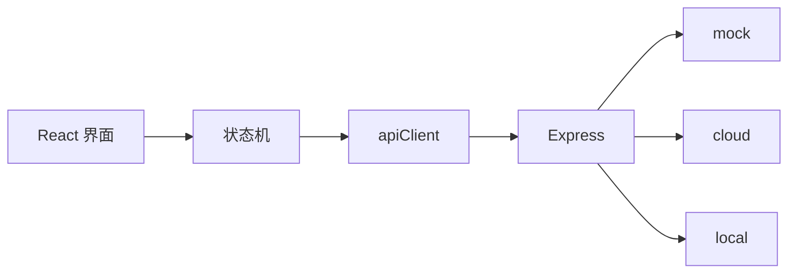

# 05 代码导读

本系列：[01 系统设计](01-系统设计.md) · [02 开发说明](02-开发说明.md) · [03 界面设计需求](03-界面设计需求.md) · [04 Tab5 迁移可行性](04-Tab5迁移可行性.md) · **05 代码导读** · [06 研究提示词](06-研究提示词.md)

英文在 [`docs/02-en`](../02-en/05-code-guide.md)。

从代码读懂这个项目。产品规则看 [01 系统设计](01-系统设计.md)，安装和命令看 [02 开发说明](02-开发说明.md)。

先读第 1 到第 3 节，把一次点击走通。第 4 节以后是查文件时用的地图，不必一次读完。

## 1. 三块代码

界面只显示、只发事件。唯一的对话状态机决定下一步。浏览器把识别、理解、翻译、朗读变成 HTTP。Node 按请求头选择 `mock`、`cloud` 或 `local`。三套引擎实现同一组接口，所以界面不用知道背后是假数据、OpenAI，还是这台 Mac。

密钥只在后端的 `.env`。浏览器里没有。

**`packages/shared`**（包名 `@kt/shared`）

浏览器和 Node 一起用。这里放类型、Zod 校验、限额和错误分类。两边对「一个请求长什么样」用同一份定义。

**`apps/web`**（包名 `@kt/web`）

跑在浏览器里。开发时是 Vite，`https://localhost:5173`。这里有儿童界面、状态机、录音播放、词卡和监控页。

**`apps/server`**（包名 `@kt/server`）

跑在 Node 里，默认 `127.0.0.1:8787`。这里有 HTTP、三套提供方、SQLite 监控和家庭词库。

`npm run dev` 同时启动这两边。Vite 把浏览器的 `/api` 转到 8787，手机只打开网页地址即可。代理写在 `apps/web/vite.config.ts`。

## 2. 建议怎么读

每一遍结束时先回答那个问题，再往下。

### 第 1 遍：跟着一次「说中文」

目标：从首页按钮指到瑞典语被读出来。

1. `apps/web/src/main.tsx`  
   普通地址加载 `App`。`/monitor` 单独加载监控页。

2. `apps/web/src/ui/App.tsx`  
   `useActor` 启动状态机。按钮几乎都是 `send({ type: '...' })`。

3. `apps/web/src/dialogue/selectors.ts`  
   把状态机的状态变成屏幕名。`App` 用 `screenOf(snap)` 决定画哪一屏。

4. `apps/web/src/ui/screens.tsx`  
   每一屏的按钮和文案。它不决定流程。

5. `apps/web/src/dialogue/machine.ts` 里的 `transcribing`  
   听写之后，中文去理解，瑞典语直接去翻译。

6. `apps/web/src/services/runtime.ts`  
   把录音机、播放器和 HTTP 交进状态机。状态机自己不 `fetch`。

7. `apps/web/src/services/apiClient.ts`  
   发出 `POST /api/asr` 等请求，带上预设、任务号和请求号。

8. `apps/server/src/app.ts` 的 `context()`  
   读这些头，选出预设，调用对应的识别、对话或朗读。

孩子点「说完了」之后，谁决定要不要追问？是状态机，不是模型。模型只返回「追问」或「提出意思」。最多问几次，写在状态机里。

### 第 2 遍：三套预设为什么能互换

1. `packages/shared/src/contracts.ts`  
   识别、对话、朗读三个接口。这是整个项目的接缝。

2. `apps/server/src/providers/registry.ts`  
   启动时做出 mock、cloud、local 三份实现。

3. `providers/mock`、`providers/cloud`、`providers/local`  
   各写一份，形状相同。

4. `apps/server/src/providers/dialogueParsing.ts`  
   无论哪套模型，JSON 都过同一套校验。不合格就报错，不会猜。

把预设从 mock 换成 cloud，要改状态机吗？不用。变的是请求头，以及服务器选中的那一份实现。

### 第 3 遍：词卡是旁边的一条路

拍照和「我的词卡」不住在 `machine.ts` 里。`App.tsx` 用 `feature`（`photo` 或 `library`）切换画面，由 `vocabulary/VocabularyShell.tsx` 来画。识别走 `/api/vocabulary/identify`。朗读仍用 `/api/tts`。

删掉一张词卡，会不会影响正在进行的翻译？不会。两边不读写对方的任务。

### 第 4 遍：监控记了什么

1. `telemetry/observe.ts` 给每次模型调用包一层。成功、失败、取消都记一行。
2. `telemetry/db.ts` 写入 SQLite。只有耗时、状态、token 和费用，没有录音原文或译文。
3. `eventLogger.ts` 把界面阶段事件送到 `/api/events`。多出来的字段会被拒绝。
4. `apps/web/src/monitor/` 是 `/monitor` 的成人面板。这些接口要登录。翻译接口不要登录。

监控库里为什么搜不到孩子说的那句话？因为写入路径只接受元数据。

## 3. 一次中文到瑞典语

下面按 mock 来写。换成 cloud 或 local 时，状态机的步骤不变，只有服务器里被选中的那一份实现变了。

1. 首页按钮在 `screens.tsx` 里发送 `START_TASK`，方向是 `ZH_TO_SV`。
2. `machine.ts` 进入 `recording`，调用 `runtime.ts` 交进来的录音机。mock 默认不打开真麦克风，停录时交回场景脚本里的那句话。
3. 停录后是 `segmentDecision`。继续说就再录一段。说完了进入 `transcribing`。
4. 状态机调用 `apiClient`，请求 `POST /api/asr?language=zh`。
5. `app.ts` 检查任务号和请求号，用 `X-Provider-Preset` 选出实现，再由 `observe.ts` 记一行。
6. mock 不看音频，读请求里带来的脚本句子，返回文字。
7. 中文进入 `interpreting`，请求 `POST /api/interpret`。返回「追问」或「提出意思」。
8. 若要追问，并且次数还没到顶，进入 `clarifying`，再回到录音。上限在 `@kt/shared` 的 `LIMITS`，判断在 `machine.ts`。
9. 意思清楚就进入 `confirming`。`dialogue/text.ts` 拼出「你是说：……，对吗？」。点对之后才翻译。
10. `POST /api/translate` 得到瑞典语。`POST /api/tts` 得到音频。`audio/player.ts` 播放。声音真正响起时，`runtime.ts` 记一条延迟。
11. 进入 `delivered`。`selectors.ts` 把这些内部状态收成结果屏。

瑞典语到中文，在听写完成之后直接去 `translating`，不经过理解和确认。条件是方向为 `SV_TO_ZH`。

每个请求带有 `requestId`。状态已经离开时，晚到的结果会被 `isStale` 丢掉。

录音放在 `audio/audioStore.ts`，只在内存里。识别完成后清掉。刷新页面，当前任务消失。这是故意的。

## 4. 查文件

需要看某个文件时再来这里。

### 根目录

- `package.json` — `dev`、`build`、`test`、`check`、桌面启动器都从这里进。
- `.env` — 只给 Node 读。端口、OpenAI、本机引擎、监控密码。
- `.env.example` — 变量说明，可以提交。
- `launcher/start.command` — 桌面按钮真正执行的脚本。拉起本机引擎和开发服务，并打开翻译页和监控页。
- `launcher/install.sh` — 在桌面生成那一个应用，并套上图标。
- `launcher/monitor.command` — 只打开监控页。桌面上没有单独按钮。
- `launcher/stop.command` — 按端口停掉网页、后端和 whisper。
- `launcher/mascot.svg` — 桌面图标的原稿。

### `packages/shared/src`

- `index.ts` — 再导出下面的模块。业务代码从 `@kt/shared` 引入。
- `types.ts` — 方向、语言、任务和请求的基础类型。
- `contracts.ts` — 识别、对话、朗读三个接口。新的提供方必须实现它们。
- `schemas.ts` — Zod。服务器用它拒绝形状不对的 JSON。
- `errors.ts` — 错误类别。HTTP 状态按类别映射。
- `evaluation.ts` — 评估事件允许哪些字段。多一个内容字段就会被拒绝。
- `monitor.ts` — 监控接口和面板共用的类型。
- `vocabulary.ts` — 识图结果、词卡和类别。
- `mockScenarios.ts` — mock 场景。界面上的 T01、T02 读的就是这里。

### `apps/web/src`

入口和接线：

- `main.tsx` — 启动 React。儿童界面和监控页互不加载。
- `services/runtime.ts` — 创建状态机，并注入录音、播放、HTTP 和日志。
- `services/apiClient.ts` — 浏览器侧的三套接口。内部是 `fetch('/api/...')`。
- `services/settings.ts` — 存在这台浏览器里的选项：场景、麦克风、是否确认过云端。
- `services/presetPreference.ts` — 把预设记在地址栏。
- `services/eventLogger.ts` — 把阶段事件批量送到 `/api/events`。
- `services/testSession.ts` — 研究用测试码，以及往返时间探测。

对话：

- `dialogue/machine.ts` — 唯一的对话状态机。流程、次数、方向分叉、过期响应都在这里。
- `dialogue/types.ts` — 状态机的上下文、事件和录音机接口。
- `dialogue/selectors.ts` — 状态变成屏幕名。忙碌时区分识别、理解、翻译、朗读。
- `dialogue/text.ts` — 确认句的中文模板。
- `dialogue/responseLatency.ts` — 从可以听回答，到声音真正响起的计时。

声音：

- `audio/recorder.ts` — 真麦克风，以及 mock 用的脚本录音机。
- `audio/audioStore.ts` — 当前任务的录音片段，只放内存。
- `audio/player.ts` — 播放朗读返回的音频。
- `audio/prompts.ts` — 界面自己说的短句，例如「现在可以说啦」。走浏览器语音，不经过模型。
- `audio/session.ts` — 在 iPhone 上切换播放和录音，避免下一次录音是空的。

儿童界面：

- `ui/App.tsx` — 顶栏、选择当前屏幕、从首页进入词卡。
- `ui/screens.tsx` — 首页、录音、继续或说完、提问、确认、结果、错误、兜底。
- `ui/BigButton.tsx` — 大按钮的外观，不含流程。
- `ui/art.tsx` — 吉祥物和线条图标。
- `ui/hooks.ts` — 30 秒倒计时，以及结果页是否正在播放。
- `ui/DevPanel.tsx` — 齿轮后面的成人面板。
- `styles.css` — 儿童界面的样式。

词卡：

- `vocabulary/VocabularyShell.tsx` — 拍照、预览、确认、学习页。
- `vocabulary/VocabBrowser.tsx` — 词卡格子和单张卡。
- `vocabulary/flow.ts` — 识别结果变成「拦住」「先选一个」或「草稿」。
- `vocabulary/photo.ts` — 一次拍照里的本地步骤。
- `vocabulary/capture.ts` — 打开相机或相册。
- `vocabulary/image.ts` — 检查图片，做缩略图。
- `vocabulary/api.ts` — 发送识图请求。
- `vocabulary/speech.ts` — 词卡朗读，复用 `/api/tts`。
- `vocabulary/library.ts` — 本机词库，存在 IndexedDB。
- `vocabulary/identity.ts` — 用规范化后的两个词判断是不是同一张卡。
- `vocabulary/hash.ts` — 照片的 SHA-256。
- `vocabulary/classify.ts` — 类别图标，以及旧卡片按常见词归类。
- `vocabulary/copy.ts` — 词卡流程里的中瑞文案。
- `vocabulary/gallery.ts` — 词卡墙的筛选、排序和分页。
- `vocabulary/remote.ts` — 家庭词库的配对、列出、上传和删除。
- `vocabulary/sync.ts` — 把本机一张卡拷到家庭库，不删本机那张。
- `vocabulary/actions.ts` — 向监控报告动作。不送词语和照片。

监控页只在 `/monitor` 加载：

- `monitor/MonitorApp.tsx` — 登录和页签。
- `monitor/api.ts` — 监控接口的客户端。
- `monitor/context.tsx` — 时间、预设、方向、阶段等筛选。
- `monitor/hooks.ts` — 轮询。页面不可见时停止。
- `monitor/format.ts` — 毫秒、金额、百分比怎么显示。
- `monitor/parts.tsx` — 表格和抽屉。
- `monitor/charts.tsx` — 概览图。
- `monitor/OverviewTab.tsx` — 请求量、成功率、延迟。
- `monitor/RequestsTab.tsx` — 单次模型调用。
- `monitor/TasksTab.tsx` — 按一轮对话聚合。
- `monitor/TestSessionsTab.tsx` — 测试场次和加入码。
- `monitor/EvaluationTab.tsx` — 人工评分。
- `monitor/CostTab.tsx` — 单价、预算、导出、清空。
- `monitor/monitor.css` — 监控页自己的样式。

### `apps/server/src`

进程和路由：

- `index.ts` — 读 `.env`，建立三套提供方，监听端口。
- `config.ts` — 把环境变量收成一份配置。
- `app.ts` — 全部 HTTP 路由，以及这个请求用哪一套预设。

提供方：

- `providers/registry.ts` — 三套实现的登记表。没有密钥时，cloud 标为不可用。
- `providers/contracts.ts` — 共用接口，加上「是否可用」和模型名。
- `providers/dialogueParsing.ts` — 校验模型 JSON，收成追问、提出意思或无法判断。
- `providers/mock/index.ts` — 固定的假识别、假理解和假翻译。
- `providers/mock/wav.ts` — mock 朗读用的一小段 WAV。
- `providers/cloud/index.ts` — OpenAI 的识别、对话和朗读。
- `providers/cloud/prompts.ts` — 发给模型的系统提示。
- `providers/cloud/realtimeTts.ts` — 实时接口的朗读通道。
- `providers/local/index.ts` — 把本机识别、模型和朗读装成同一份接口。
- `providers/local/config.ts` — 本机引擎地址。不是本机地址会被拒绝。
- `providers/local/whisper.ts` — 调用本机 whisper.cpp。
- `providers/local/ollama.ts` — 调用本机 Ollama。
- `providers/local/tts.ts` — 调用 macOS 的 `say`。
- `providers/local/vision.ts` — 本机识图，只给拍照用。失败不改走云端。
- `providers/local/common.ts` — 请求用的临时目录。请求结束就删。
- `providers/local/exec.ts` — 启动外部程序，不经过 shell。
- `providers/local/probe.ts` — 探测 whisper 和 Ollama 是否就绪。
- `providers/local/doctor.ts` — `npm run local:doctor` 的检查报告。
- `providers/local/exposure.ts` — 发现引擎听在局域网地址时发出警告。

音频和监控：

- `media/transcode.ts` — 用 ffmpeg 把浏览器音频转成 16 kHz 单声道 WAV。iPhone 录的是 AAC。
- `media/duration.ts` — 从 WAV 算出时长，只给监控用。
- `telemetry/observe.ts` — 每次模型调用记一行。记账失败不改变原来的结果。
- `telemetry/db.ts` — SQLite。默认文件是 `apps/server/data/telemetry.sqlite`。
- `telemetry/queries.ts` — 面板上的汇总和筛选。
- `telemetry/pricing.ts` — 按 `config/prices.json` 把 token 算成美元。算不出就保持未知，不会写成 0。
- `telemetry/modelConfig.ts` — 记下这一轮当时用的模型名。
- `telemetry/export.ts` — 导出 CSV。
- `monitor/routes.ts` — `/api/monitor/*`。除登录外都要管理员会话。
- `monitor/auth.ts` — 密码、会话和登录限流。没有默认密码。
- `evaluation/eventStore.ts` — 界面事件的内存列表、`events.ndjson` 和 CSV。

词库：

- `vocabulary/routes.ts` — 配对、列出、上传和删除。
- `vocabulary/store.ts` — SQLite 加媒体文件夹。图片字节不进数据库。
- `vocabulary/identify.ts` — 云端识图。照片只用于这一次请求。
- `vocabulary/image.ts` — 拒绝不像图片的请求体。
- `vocabulary/normalize.ts` — 把模型返回的词收成界面能用的形状。
- `vocabulary/telemetry.ts` — 记下这次识图的耗时和 token。

`local` 不可用时不会悄悄改走 cloud。失败要变成一次看得见的 `LOCAL_*` 错误。

家庭口令不是监控页的管理员密码。

### 命令行脚本

这些文件在 `apps/server/scripts`，不在平时的请求路径上。

- `local-doctor.ts` — 检查这台 Mac 的工具和模型。
- `local-start.ts` — 在本机地址启动 whisper，并预热模型。
- `local-smoke.ts` — 用合成语音走通本机链路。
- `local-eval.ts` — 按场景跑本机评估。
- `local-e2e-http.ts` — 通过真实 HTTP 走本机链路。
- `check-cloud.ts` — 用合成文本打一下 OpenAI，会花少量钱。
- `scenarios.ts` — 评估用的句子。
- `narrativeScenarios.ts` — 较长叙述的句子。
- `eval-narratives.ts` — 跑叙述评估。

### 测试

- `tests/machine` — 确认、最多 3 次追问、切换方向、错误恢复。
- `tests/integration` — 真实 HTTP 下的 mock 全流程、监控登录、云端适配器。
- `tests/local` — 本机适配器对着假的 whisper、Ollama、ffmpeg 和 `say`。
- `tests/telemetry` — 每次调用恰好一行，导出里没有正文。
- `tests/vocabulary` — 识图、词库、同步、图片限制。
- `tests/web` — 录音、播放、预设记忆。
- `tests/media` — ffmpeg 转码。
- `tests/interpretation` — 较长叙述的理解策略。

改了状态机却没改测试，通常是规则改错了。

## 5. 改东西时先看哪里

- 多问一句、少确认一次、换方向的规矩：`dialogue/machine.ts`，然后跑 `tests/machine`。
- 按钮文案、倒计时和颜色：`ui/screens.tsx` 和 `styles.css`。不要把流程判断写进屏幕组件。
- 确认那句中文：`dialogue/text.ts`。
- mock 的例句：`packages/shared/src/mockScenarios.ts`。
- 追问的语气、瑞典语的口语程度：`providers/cloud/prompts.ts`。本机若要分开写，再看 `providers/local/ollama.ts`。
- 换一个 OpenAI 模型名：`.env` 里的 `OPENAI_*_MODEL`。不用改状态机。
- 一种新的错误怎么显示：`packages/shared/src/errors.ts`，再看 `screens.tsx` 的错误屏。
- 监控多一个数字：`telemetry/db.ts`、`observe.ts`，以及对应的监控页。不要把原文写进去。
- 词卡类别，或「这是不是同一张卡」：`vocabulary/classify.ts`、`vocabulary/identity.ts`。

状态机决定做不做。模型只决定这句话是什么意思。追问次数如果只写在提示词里，界面就无法保证最多三问。

## 6. 五次小练习

每项只改一处。用 mock 打开 `https://localhost:5173` 看结果，然后把改动还原。

1. 在 `mockScenarios.ts` 里改 T01 的中文句子，走完这个场景。确认句应出现新句子。
2. 在 `machine.ts` 搜索 `semanticClarifications`，看第 4 次追问为什么到不了界面。测试在 `tests/machine`。
3. 在 `apiClient.ts` 找到 `X-Provider-Preset`，再在 `app.ts` 的 `context()` 看它如何变成 `registry[preset]`。
4. 在 `observe.ts` 看失败时是否仍然记账。打开 `/monitor` 的 Requests，对一次失败看有没有行。
5. 从 `App.tsx` 的 `setFeature('photo')` 跳到 `VocabularyShell.tsx`，再跳到 `flow.ts` 的 `stepAfterIdentify`。认出三个出口：拦住、先选一个、进入草稿。

做完之后，流程、文案和模型各改哪一层就清楚了。必须确认、问满就停这些产品决定，回到 [01 系统设计](01-系统设计.md) 核对。
