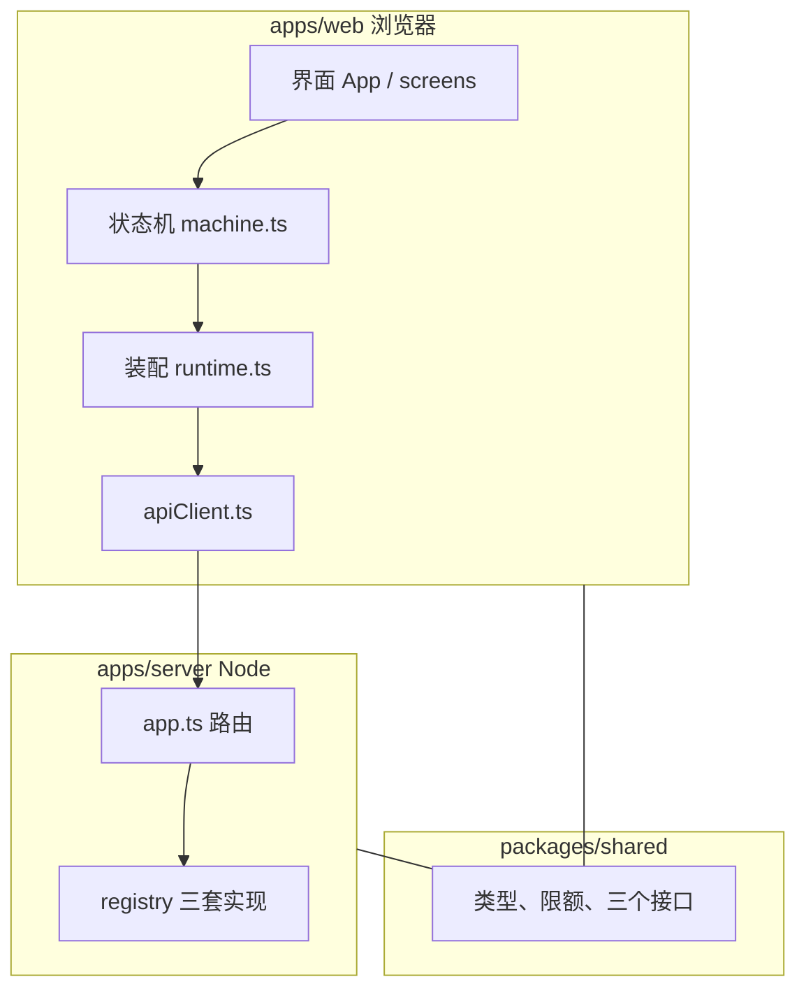

# 07 模块结构

本系列：[01 系统设计](01-系统设计.md) · [02 开发说明](02-开发说明.md) · [03 界面设计需求](03-界面设计需求.md) · [04 Tab5 迁移可行性](04-Tab5迁移可行性.md) · [05 代码导读](05-代码导读.md) · [06 研究提示词](06-研究提示词.md) · **07 模块结构** · [08 模块怎么接在一起](08-模块怎么接在一起.md)

英文在 [`docs/02-en`](../02-en/07-module-structure.md)。

这一份只回答「每个模块做什么」。一次对话怎么把它们串起来，看 [08 模块怎么接在一起](08-模块怎么接在一起.md)。逐个文件的清单仍在 [05 代码导读](05-代码导读.md)。每个文件里每一段在做什么，看 [09 代码详解](09-代码详解/00-从这里开始.md)。

下面的代码是按真实文件缩过的。变量名和判断跟代码一致，省略了日志、超时和边界情况。要看完整实现，打开每一节标题里的文件。

## 1. 一张地图

仓库是三个包。浏览器和 Node 共用 `@kt/shared` 里的类型。



- **界面**只显示，并 `send` 一个事件。
- **状态机**决定下一步。模型只能返回「追问」「提出意思」或「无法判断」。
- **装配**把录音机、播放器和 HTTP 交进状态机。
- **浏览器 HTTP** 把这三件事变成 `fetch('/api/...')`。
- **服务器**按请求头选出 mock、cloud 或 local，再调用同一组接口。

## 2. 共用类型：`packages/shared`

两边对「一次请求长什么样」用同一份定义。限额也在这里。

`packages/shared/src/types.ts`：

```ts
export const LIMITS = {
  segmentSeconds: 30,
  semanticClarifications: 3,
  correctionAttempts: 2,
  asrRetries: 2,
};
```

`packages/shared/src/contracts.ts` 把识别、对话、朗读拆成三个接口。三套预设都实现这一组，所以界面不用知道答案来自假数据、OpenAI，还是这台 Mac。

```ts
type InterpretationResult =
  | { kind: 'ASK_CLARIFICATION'; questionZh: string }
  | { kind: 'PROPOSE_MEANING'; meaningZh: string }
  | { kind: 'UNRESOLVED'; reasonCode: string };

interface SpeechRecognizer {
  transcribe(audio, language, meta): Promise<string>;
}
interface DialogueModel {
  interpretChinese(input, meta): Promise<InterpretationResult>;
  translate(input, meta): Promise<string>;
}
interface SpeechSynthesizer {
  synthesize(text, language, meta): Promise<AudioData>;
}

type ProviderBundle = { asr: SpeechRecognizer; dialogue: DialogueModel; tts: SpeechSynthesizer };
```

`meta` 里有 `taskId` 和 `requestId`。过期的结果靠这两个号丢掉。密钥不出现在这个包里。

## 3. 入口：`apps/web/src/main.tsx`

地址决定加载哪一个页面。儿童界面和监控页不互相加载。

```ts
if (pathname 是 /monitor) {
  加载 MonitorApp;
} else {
  加载 App;
}
```

## 4. 界面：`apps/web/src/ui/App.tsx` 和 `screens.tsx`

`App` 启动那一台状态机，再用 `screenOf` 选屏幕。按钮把用户动作交回去。

```tsx
const [snap, send] = useActor(dialogueMachine, { input: { preset } });
const screen = screenOf(snap);

if (feature === 'photo' || feature === 'library') {
  return <VocabularyShell />;   // 词卡，不进入状态机
}
return <当前屏幕 snap={snap} send={send} />;
```

`screens.tsx` 里的首页按钮只发事件：

```tsx
send({ type: 'START_TASK', direction: 'ZH_TO_SV' });
send({ type: 'FINISH_INPUT' });
send({ type: 'CONFIRM_YES' });
```

屏幕组件里没有「要不要追问」这种判断。

## 5. 屏幕名：`apps/web/src/dialogue/selectors.ts`

状态机内部有很多小状态。界面只认识十一个屏幕名。

```ts
function screenOf(s): Screen {
  if (s.matches('idle')) return 'home';
  if (s.matches({ task: 'recording' })) return 'recording';
  if (s.matches({ task: { clarifying: 'asking' } })) return 'clarify';
  if (s.matches({ task: { confirming: 'asking' } })) return 'confirm';
  if (s.matches({ task: 'result' })) return 'result';
  return 'busy';
}
```

忙碌时再分成四段：`asr`、`interpret`、`translate`、`tts`。对应「识别 / 理解 / 翻译 / 准备语音」。

## 6. 状态机：`apps/web/src/dialogue/machine.ts`

这是唯一决定流程的地方。听写完成后，方向决定下一站。瑞典语直接去翻译。中文去理解。

```ts
transcribing: {
  invoke: { src: 'transcribe', input: { language: 说话的语言 } },
  onDone: [
    { guard: 结果已过期, 丢掉 },
    { guard: 方向是 SV_TO_ZH, target: '#translating' },
    { target: '#interpreting' },
  ],
}
```

理解返回之后，状态机检查次数，再决定去提问还是去确认。第 4 个问题不会被放出来。

```ts
interpreting.onDone: [
  { guard: 结果已过期, 丢掉 },
  {
    guard: 结果是 ASK_CLARIFICATION 并且 clarificationCount < 3,
    target: '#clarifying',
    同时 clarificationCount 加 1,
  },
  { guard: 结果仍是 ASK_CLARIFICATION, target: '#fallback' },
  { guard: 结果是 PROPOSE_MEANING, target: '#confirming' },
]
```

确认点了「是」，才进入翻译。点了「否」，进入纠正，最多两次。

状态机通过 `invoke` 的名字调用外部能力：`transcribe`、`interpret`、`translate`、`synthesize`。这些名字在装配文件里接到真正的函数。状态机文件本身不写 `fetch`。

## 7. 装配：`apps/web/src/services/runtime.ts`

这里把零件装进状态机。换麦克风或换 HTTP，改的是这一层。

```ts
export const dialogueMachine = createDialogueMachine({
  providers,          // 按预设拿出一组 HTTP 接口
  recorder,           // mock 用脚本麦克风，其余用真麦克风
  audioStore,         // 当前任务的录音，只在内存里
  speakPrompt,        // 「现在可以说啦」这类短句
  log,                // 阶段事件，不含原文
});
```

mock 且麦克风模式是 `auto` 时，`RecorderFacade` 选 `ScriptedRecorder`。点停止就得到场景脚本里的句子，不必真的说话。cloud 和 local 始终用真麦克风。

## 8. 浏览器一侧的接口：`apps/web/src/services/apiClient.ts`

它实现第 2 节那三个接口，里面是 `fetch`。每个请求带上预设和两个编号。

```ts
headers = {
  'X-Provider-Preset': preset,   // mock | cloud | local
  'X-Task-Id': meta.taskId,
  'X-Request-Id': meta.requestId,
};

asr.transcribe = (audio, language) =>
  POST `/api/asr?language=${language}`，body 是音频字节;

dialogue.interpretChinese = (input) =>
  POST `/api/interpret`，body 是 JSON;

dialogue.translate = (input) =>
  POST `/api/translate`;

tts.synthesize = (text, language) =>
  POST `/api/tts`，返回音频字节;
```

浏览器里没有 API key。开发时 Vite 把 `/api` 转到本机 `127.0.0.1:8787`。

## 9. 声音：`apps/web/src/audio/`

- `recorder.ts`：真麦克风，以及 mock 用的脚本麦克风。
- `audioStore.ts`：这一轮的各段录音。识别完就清掉。刷新页面，这一轮就没了。
- `player.ts`：播放服务器返回的译文语音。
- `prompts.ts`：界面自己说的短句，走浏览器语音，不走模型。
- `session.ts`：在 iPhone 上，播放和录音交替，避免下一次录音是空的。

## 10. 词卡：`apps/web/src/vocabulary/`

词卡用 `App` 里的 `feature` 切换，不占用 `machine.ts` 的任务和计数器。

```ts
拍照 -> POST /api/vocabulary/identify
得到中文、瑞典语、冠词、分类
保存到这台设备的 IndexedDB
朗读仍是 POST /api/tts
```

同一张照片再保存，会打开已有卡片。人脸或没有物体的照片不会做成卡片。家庭词库是另一条同步，口令不是监控密码。

## 11. 服务器路由：`apps/server/src/app.ts`

`context()` 读请求头，选出这一次用哪一套实现。`local` 即使暂时不可用，也不会在这里改成 cloud。

```ts
function context(req) {
  const preset = req.header('X-Provider-Preset') ?? 'mock';
  const provider = observed[preset];   // 已经包过监控的那一套
  检查 taskId、requestId;
  return { provider, meta };
}

POST /api/asr       -> provider.bundle.asr.transcribe(...)
POST /api/interpret -> provider.bundle.dialogue.interpretChinese(...)
POST /api/translate -> provider.bundle.dialogue.translate(...)
POST /api/tts       -> provider.bundle.tts.synthesize(...)
```

翻译接口没有登录。`/api/monitor/*`、导出和清空要先登录。

## 12. 三套实现：`apps/server/src/providers/`

`registry.ts` 在启动时做出三份，形状都是 `ProviderBundle`。

```ts
registry = {
  mock:  { bundle: 固定的假识别、假理解、假翻译、一段短音频 },
  cloud: { bundle: OpenAI，没有密钥就标成不可用 },
  local: { bundle: whisper.cpp + Ollama + macOS say },
};
```

- `mock/`：不看真实音频，读请求上带着的剧本文本。
- `cloud/`：密钥只在服务器的 `.env`。朗读默认走实时语音。
- `local/`：引擎地址必须是 `127.0.0.1`。失败返回 `LOCAL_*`。
- `dialogueParsing.ts`：两套模型的 JSON 都过同一套检查。形状不对就报错。

## 13. 监控：`telemetry/` 和 `apps/web/src/monitor/`

`observe.ts` 包住每一次模型调用。成功、失败、取消各写一行。写进去的是阶段、耗时、token 和费用。录音、识别原文、译文、提示词不进这张表。

数据库默认是 `apps/server/data/telemetry.sqlite`。页面在 `/monitor`，轮询大约几秒一次，页面藏起来就停。

词卡的照片和两个词存在另一份库和这台设备上，跟这张监控表分开。
