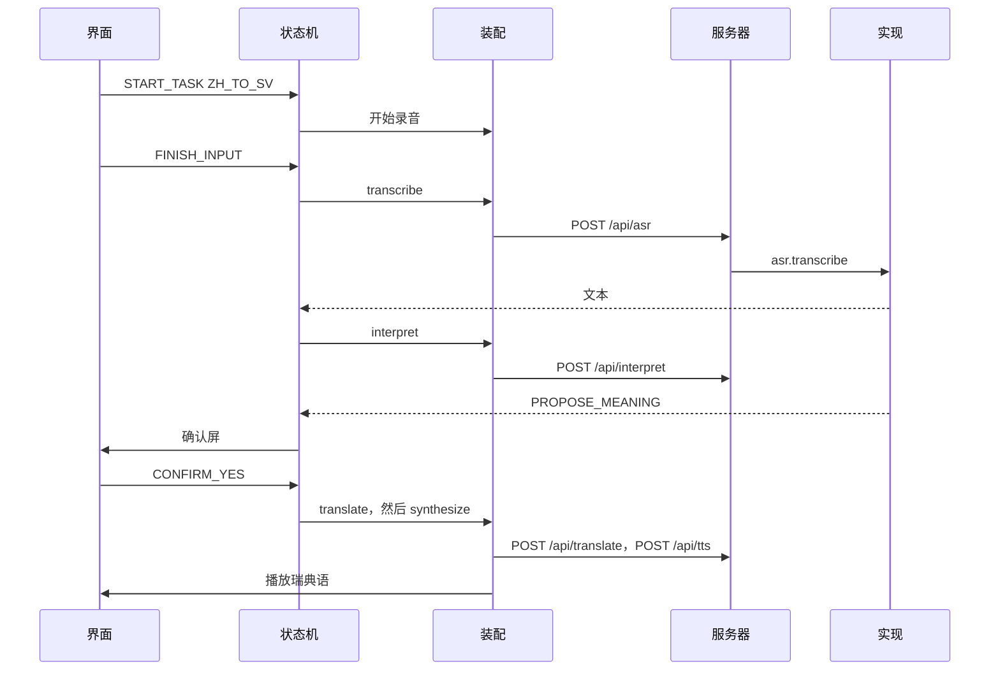

# 08 模块怎么接在一起

本系列：[01 系统设计](01-系统设计.md) · [02 开发说明](02-开发说明.md) · [03 界面设计需求](03-界面设计需求.md) · [04 Tab5 迁移可行性](04-Tab5迁移可行性.md) · [05 代码导读](05-代码导读.md) · [06 研究提示词](06-研究提示词.md) · [07 模块结构](07-模块结构.md) · **08 模块怎么接在一起** · [09 代码详解](09-代码详解/00-从这里开始.md)

英文在 [`docs/02-en`](../02-en/08-how-modules-fit.md)。

[07 模块结构](07-模块结构.md) 说明每一块做什么。这一份只看它们交接时传递的东西。每个源码文件内部的段落，看 [09 代码详解](09-代码详解/00-从这里开始.md)。中文翻译、瑞典语、追问、词卡、监控各自的逐步顺序，看 [按功能看](09-代码详解/功能/00-按功能看.md)。下面按 mock、中文到瑞典语走一遍交接的东西。换成 cloud 或 local，箭头不变，变的是服务器里被选中的那一份实现。

## 1. 交接时只传这几样

模块之间不共享一大团内部状态。交出去的只有下面几样。

- **事件。** 界面发给状态机，例如 `START_TASK`、`FINISH_INPUT`、`CONFIRM_YES`。
- **屏幕名。** 状态机的快照经过 `screenOf`，界面才知道画哪一屏。
- **调用名。** 状态机说 `transcribe` 或 `interpret`。装配层把它接到 HTTP。
- **请求头。** `X-Provider-Preset`、`X-Task-Id`、`X-Request-Id`。
- **很短的 JSON。** 理解结果是三种之一。翻译结果是一个字符串。识别结果是 `{ text }`。
- **音频字节。** 上传一段录音，或下载一段朗读。用完就从内存里清掉。

监控在这些调用外面再记一行时间、状态和费用。那一行里没有上面的句子。

## 2. 一次中文到瑞典语



逐步对应到文件：

1. `screens.tsx` 发送 `START_TASK`。`App.tsx` 的 `send` 进入 `machine.ts`。状态变成录音，`selectors.ts` 把这一状态变成屏幕名 `recording`。
2. `runtime.ts` 里的录音机开始录。mock 的脚本麦克风在停止时交出场景句子，并放进 `audioStore.ts`。
3. 界面发送 `FINISH_INPUT`。状态机进入 `transcribing`，调用装配好的 `transcribe`。
4. `apiClient.ts` 发出 `POST /api/asr?language=zh`。头里是这一轮的预设和两个编号。
5. `app.ts` 的 `context()` 用 `X-Provider-Preset` 从 `registry` 取出那一套。mock 不解析音频，直接返回请求里带来的剧本文本。`observe.ts` 同时写一行监控。
6. 结果回到状态机。方向是中文到瑞典语，所以进入 `interpreting`，再请求 `POST /api/interpret`。
7. 模型返回 `PROPOSE_MEANING`。状态机进入确认，界面画出「是 / 否」。返回 `ASK_CLARIFICATION` 并且还没满 3 次时，进入提问，再回到录音。满 3 次仍不清楚，进入兜底，不再翻译。
8. 界面发送 `CONFIRM_YES`。状态机才调用 `translate`，然后 `synthesize`。播放器播出返回的音频。声音真正开始时，`runtime.ts` 记下这段等待。
9. 状态变成已送达。`selectors.ts` 给出 `result`。界面上可以再来一轮。

每一步的返回都带着当初的 `requestId`。状态已经往前走了，这条返回就被 `isStale` 丢掉。

## 3. 瑞典语到中文少了两步

听写完成之后，状态机看到方向是 `SV_TO_ZH`，目标改成 `#translating`。

因此没有 `POST /api/interpret`，也没有确认屏。识别出的瑞典语原文、中文译文和中文语音一起出现在结果屏。

其余接头相同：仍是同一台状态机、同一组请求头、服务器上的同一套选择。

## 4. 词卡从旁边绕过去

首页把 `feature` 设成 `photo` 或 `library` 时，`App.tsx` 改画 `VocabularyShell`。状态机停在空闲，它的计数器不动。

```text
首页
  ├─ 说中文 / 说瑞典语 → 状态机 → /api/asr|interpret|translate|tts
  └─ 拍照识字 / 我的词卡 → VocabularyShell
        识别 → /api/vocabulary/identify
        朗读 → 仍是 /api/tts
        保存 → 这台设备的 IndexedDB
```

删一张卡片，改的是词卡库。正在进行的翻译任务不读这张表。

## 5. 监控挂在调用外面

儿童界面把阶段事件交给 `eventLogger.ts`，批量送到 `POST /api/events`。多一个内容字段，schema 会拒绝。

模型调用则在服务器里被 `observe.ts` 包住。无论请求从网页来还是以后从别的客户端来，只要进了这三个接口，就会有一行。

```text
状态机 --阶段事件--> /api/events --> 事件表
状态机 --模型调用--> /api/asr 等 --> observe --> ai_requests 表
                                              |
                                              +--> /monitor 来读
```

`/monitor` 由 `main.tsx` 单独加载。它和儿童界面不共用那一台状态机。翻译接口不用登录。监控、导出和清空要登录。

## 6. 换预设时，哪几层不动

从 mock 换成 cloud 或 local，这些文件保持原样：

- `screens.tsx` 仍发送同样的事件。
- `machine.ts` 仍按同样的箭头走。
- `apiClient.ts` 仍打同样的路径。变的是头里的 `X-Provider-Preset`。

变的是 `app.ts` 选中的那一份 `ProviderBundle`：假数据、OpenAI，或本机的 whisper、Ollama 和 `say`。密钥只在服务器进程里。浏览器这一侧看不到它。
