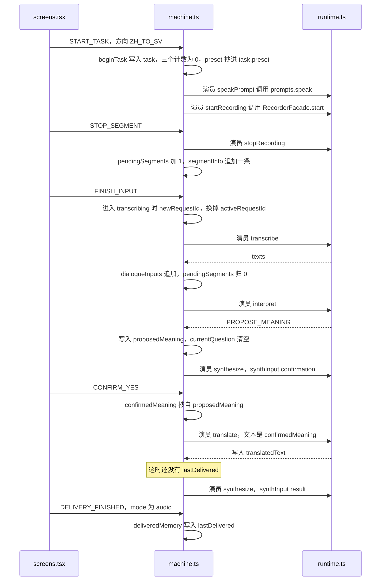
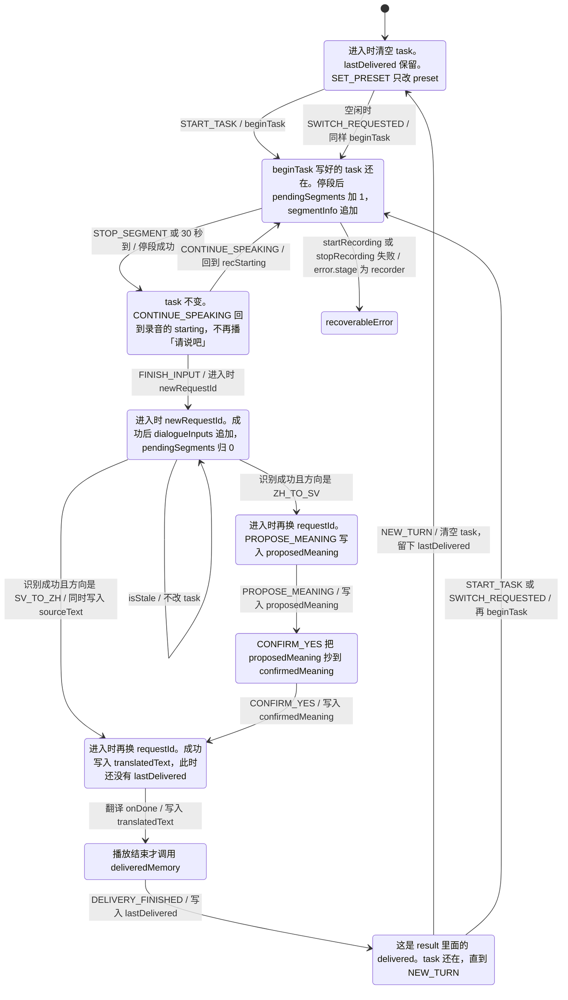
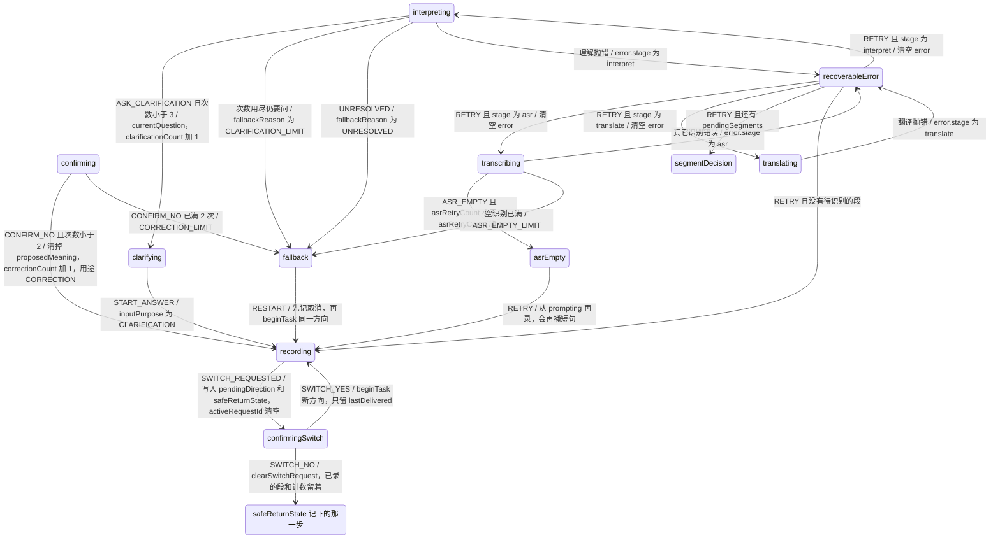

# `apps/web/src/dialogue/machine.ts`

源码：[machine.ts](../../../../../apps/web/src/dialogue/machine.ts)

这是项目里唯一决定「下一步做什么」的文件。界面只发事件。模型只返回三种理解结果。次数、确认、换方向，都在这里。

例子贯穿全文：孩子要表达「我想去厕所。」方向是中文到瑞典语。

## 两张图怎么读

这一轮要记住的字段都在 `MachineContext` 里，类型在 [types.ts](types.md)。改这些字段的是下面的 `assign`：`beginTask`、`newRequestId`、`deliveredMemory`，以及各阶段 `onDone` 里的 `patchTask`。录音字节在 `audioStore`，不进这份记录。

这里用两种图。

调用顺序图看时间。竖着往下是「我想去厕所。」点「是」的那一遍。实线是调用，格子里的名字能在源码里搜到。界面把事件送进来，状态机先改 context，再调用演员。演员是 `speakPrompt`、`startRecording`、`stopRecording`、`transcribe`、`interpret`、`translate`、`synthesize`。它们再去调 [runtime.ts](../services/runtime.md)。完整的 HTTP 函数链在 [说中文，翻成瑞典语](../../功能/01-说中文翻成瑞典语.md)。

状态图看阶段。框里的字是这个阶段写下或拿着的 context。箭头写成「事件 / 进入哪里」：斜杠前面是触发这次改变的事件或演员结果，箭头指向的框就是结果。`isStale` 对不上时停在原地，不改 `task`。







任务进行中的 `CANCEL` 回到 `idle`，不写 `lastDelivered`。`segmentDecision`、`transcribing`、`interpreting`、`clarifying`、`confirming`、`translating`、`result`、`asrEmpty`、`recoverableError`、`fallback` 收到 `SWITCH_REQUESTED` 时，和录音中一样进入 `confirmingSwitch`，`safeReturnState` 记下离开的那一步。`SWITCH_NO` 时，如果离开点是 `recording` 而且 `pendingSegments` 还是 0，没有段可以决定，就重新 `startRecording`。

## 文件开头：依赖和过期结果

`createDialogueMachine(deps)` 接收外面传进来的零件：录音机、音频库、播放、HTTP、记日志。状态机自己不 `fetch`。

`isStale` 比较返回结果上的 `taskId`、`requestId` 和当前任务。对不上就丢掉。

例子：孩子已经点了取消，识别结果才回来。`requestId` 已经换过，这条结果不能把界面拉回去。

```text
isStale(context, out)：out.requestId !== activeRequestId，或 out.taskId !== task.id，就丢掉，不改界面

beginTask(ctx, direction) {
  task.preset = ctx.preset，这一轮不再改
  clarificationCount、correctionCount、asrRetryCount 都从 0
  proposedMeaning = null，confirmedMeaning = null
}
```

## `idle`：空闲，也就是首页

等待 `START_TASK`。事件里带着方向。

进入任务时，预设被复制进 `task.preset`，这一轮不能再换。计数器从 0 开始。`SET_PRESET` 只在空闲时接受。任务进行中改预设会被忽略。空闲时如果直接要求换方向，不再追问，当作开始那一个方向。

```text
idle {
  START_TASK → #recording，并 beginTask(direction)
  SWITCH_REQUESTED → #recording，同样 beginTask，不再追问
  SET_PRESET → 只改 preset，留在首页
}
```

## `recording`：录音

先播放短句「请说吧」，然后打开麦克风。一段最长 30 秒，数字来自 `LIMITS.segmentSeconds`。

孩子可以：

- `STOP_SEGMENT`：自己点停止。
- `SEGMENT_TIMEOUT`：30 秒到了，只结束这一段。
- `SKIP_PROMPT`：短句还在说时跳过。

静音不会自动结束。停下来之后进入 `segmentDecision`。

mock 时，录音机交给状态机的是场景剧本，不是真实声波。状态机不关心声音从哪来，它只收下一段音频。

```text
recording，先从 prompting 开始 {
  speakPrompt 播放「请说吧」
  onDone、SKIP_PROMPT 或 onError → starting，然后 startRecording
  startRecording 失败 → #recoverableError
  listening 里 STOP_SEGMENT 或 segmentTimeout → finalizing
  stopRecording 成功 → #segmentDecision
}
```

## `segmentDecision`：继续，还是说完

两个事件：

- `CONTINUE_SPEAKING`：再录一段，仍是同一个任务。
- `FINISH_INPUT`：把已经录下的各段送去识别。

例子：「老师……」「他把我的……」「水壶拿走了。」是三段，一次 `FINISH_INPUT`，一次翻译。

```text
segmentDecision {
  CONTINUE_SPEAKING → #recStarting，再录一段
  FINISH_INPUT → #transcribing，去识别
}
```

## `transcribing`：按顺序识别

调用装配好的 `transcribe`。成功后看方向：

- `SV_TO_ZH`：去 `translating`。没有理解和确认。
- 其他，也就是中文到瑞典语：去 `interpreting`。

识别为空，并且 `asrRetryCount < 2`：去 `asrEmpty`，请再说一次。已经满 2 次：去 `fallback`，不再猜。

识别完，`audioStore` 里这一轮的段落被清掉。空识别走的是 `onError`，错误类别是 `ASR_EMPTY`，不是成功返回一个空字符串。

```text
transcribing，src 是 transcribe {
  onDone 按顺序 {
    isStale → 丢掉
    direction === 'SV_TO_ZH' → #translating
    否则 → #interpreting
  }
  onError 按顺序 {
    ASR_EMPTY 并且 asrRetryCount < LIMITS.asrRetries → #asrEmpty
    仍是 ASR_EMPTY → #fallback
    否则 → #recoverableError
  }
}
```

## `interpreting`：理解中文

调用 `interpret`。交给模型的包括已经听写的句子，以及还剩几次追问：`3 - clarificationCount`。

返回之后：

- `ASK_CLARIFICATION` 并且次数还不到 3：去 `clarifying`，次数加 1。
- 仍是 `ASK_CLARIFICATION`：说明已经没有名额了，去 `fallback`。
- `PROPOSE_MEANING`：把提出的中文意思记下，去 `confirming`。
- `UNRESOLVED`：去 `fallback`。

例子：「我想去厕所。」通常直接得到提出的意思，次数保持 0。

例子：「他拿走了我的那个。」可能得到一个短问题。界面只显示这一个问题。第 4 个问题不会出现，因为次数已经到 3 时走兜底。

```text
interpreting，src 是 interpret {
  remainingClarifications = LIMITS.semanticClarifications - clarificationCount
  onDone 按顺序 {
    isStale → 丢掉
    kind === 'ASK_CLARIFICATION' 并且 clarificationCount < 3 → #clarifying，次数加 1
    仍是 ASK_CLARIFICATION → #fallback，原因 CLARIFICATION_LIMIT
    kind === 'PROPOSE_MEANING' → #confirming
    否则 → #fallback，原因 UNRESOLVED
  }
}
```

## `clarifying`：问一个短问题

播放这个问题。孩子点 `START_ANSWER` 后回到录音。这一段的用途标成 `CLARIFICATION`，仍然是同一个任务，不是新的一轮。问句的语音没合成出来，仍进入提问屏，大人可以看字。

```text
clarifying {
  synthesize，synthInput('question')
  onError 也进 asking，大人可以看字
  START_ANSWER → #recording，beginInput('CLARIFICATION')
}
```

## `confirming`：必须点是，才翻译

`text.ts` 把意思说成「你是说：我想去厕所，对吗？」

- `CONFIRM_YES`：记下 `confirmedMeaning`，去 `translating`。
- `CONFIRM_NO`：次数不到 2 时回到录音，用途是 `CORRECTION`。
- 已经纠正过 2 次：去 `fallback`。

```text
confirming {
  synthesize，synthInput('confirmation')
  onError 也进 asking
  CONFIRM_YES → #translating，写下 confirmedMeaning
  CONFIRM_NO {
    correctionCount < LIMITS.correctionAttempts → #recording，inputPurpose = 'CORRECTION'
    否则 → #fallback，原因 CORRECTION_LIMIT
  }
}
```

## `translating`：翻译

调用 `translate`。中文到瑞典语时，翻译的文本是确认过的中文意思，不是最初没确认的识别稿。然后进入 `result`。

```text
translating，src 是 translate {
  direction === 'ZH_TO_SV' 时翻译 confirmedMeaning
  否则翻译 sourceText
  onDone → #result
  onError → #recoverableError
}
```

## `result`：结果

播放目标语言。播放结束或成人接受纯文字时，发出 `DELIVERY_FINISHED`。这时才把这句话记成 `lastDelivered`。只是接口返回了译文，还不会记住。

`NEW_TURN` 回到空闲。也可以直接再开始另一个方向。

```text
result {
  synthesize，synthInput('result')
  onDone → pending，等播完
  onError → ttsFailed，字还在
  DELIVERY_FINISHED 且 mode === 'audio' → delivered
  mode === 'text_only' → 也到 delivered
  NEW_TURN → #idle
  delivered 里的 START_TASK → #recording
}
```

## `recoverableError` 和 `fallback`

网络、超时、模型 JSON 不合法，进入 `recoverableError`。`RETRY` 回到失败的那一步：识别、理解、翻译或录音。

问满、纠正满、空识别满，进入 `fallback`。可以 `RESTART` 同一方向重来，或 `CANCEL` 回首页。失败的任务不会被记成已送达。

```text
recoverableError 里点 RETRY {
  error.stage === 'asr' → #transcribing
  stage === 'interpret' → #interpreting
  stage === 'translate' → #translating
  否则 → #recording
}

fallback 里 RESTART → #recording，并 beginTask
```

## `confirmingSwitch`：任务中途换方向

录音或识别过程中发来 `SWITCH_REQUESTED`。先问要不要换。

- `SWITCH_NO`：回到刚才的检查点，已录的段落和计数还在。
- `SWITCH_YES`：丢掉这一轮未完成的任务，按新方向重新开始。上一句已经送达的话还留着。

空闲和已经送达时换方向，不再问这一句。

```text
confirmingSwitch {
  SWITCH_YES → #recording，beginTask(pendingDirection)
  SWITCH_NO {
    safeReturnState === 'transcribing' → 回到识别
    safeReturnState === 'confirming' → 回到确认
    否则 → #recording
  }
}
```

## 读的时候可以只盯一个例子

用 mock 打开首页，选场景 T01「我想去厕所。」点说中文，点停止，点说完，点是。对照上面的状态名：`idle` → `recording` → `segmentDecision` → `transcribing` → `interpreting` → `confirming` → `translating` → `result`。
