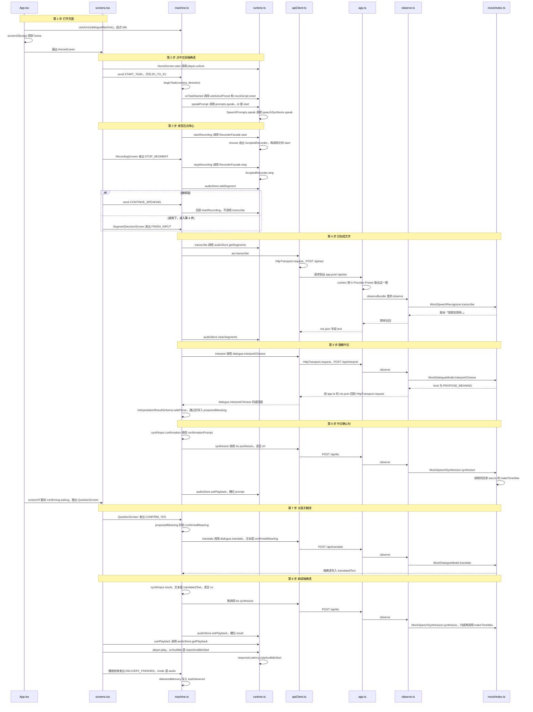

# 说中文，翻成瑞典语

例子：首页点「中文 → Svenska」，mock 下停下来就得到剧本「我想去厕所。」孩子点「说完了」，再点「是」。瑞典语被读出来。

点「是」之后才翻译。确认这句话本身会先用中文读一遍，那一次朗读还不是译文。

整条路只有一台状态机，在 [machine.ts](../web/dialogue/machine.md)。界面只发事件。真正的识别、理解、翻译、朗读由 [runtime.ts](../web/services/runtime.md) 接到 [apiClient.ts](../web/services/apiClient.md)，再进 [app.ts](../server/app.md)。

## 这 8 步里，谁调用谁

下面是调用顺序图。竖着往下是时间。实线箭头表示这个函数调用那个函数，虚线箭头是返回。每一列是一个文件，格子里的名字都能在源码里搜到。横条上的「第 N 步」对应后面各节。

例子是 mock 下的「我想去厕所。」点「继续说」时，状态机回到 `startRecording`，不会调用 `transcribe`。

## 第 1 步：打开页面

浏览器打开的不是 `/monitor`。

1. [main.tsx](../web/main.md) 加载 [App.tsx](../web/ui/App.md) 和 [styles.css](../web/styles.md)。
2. `App` 用 `useActor` 启动状态机，起点是 `idle`。
3. [selectors.ts](../web/dialogue/selectors.md) 的 `screenOf` 把 `idle` 变成屏幕名 `home`。
4. `App` 画出 [screens.tsx](../web/ui/screens.md) 里的 `HomeScreen`。

这时还没有任务，也没有请求。

## 第 2 步：点「中文 → Svenska」

1. `HomeScreen` 里的 `start('ZH_TO_SV')` 先让 [player.ts](../web/audio/player.md) 解锁播放，再发出 `START_TASK`。
2. 状态机离开 `idle`，进入 `recording`。`beginTask` 记下方向 `ZH_TO_SV`，并把当时的预设抄进这一轮。这一轮中途不能再换预设。
3. `screenOf` 变成 `recording`。`App` 改画 `RecordingScreen`。
4. 进入录音前，状态机先叫 `speakPrompt`。[prompts.ts](../web/audio/prompts.md) 播放「请说吧」。孩子可以点跳过，事件是 `SKIP_PROMPT`。

## 第 3 步：录音，然后点停止

1. 短句放完，状态机调用 `startRecording`。
2. [runtime.ts](../web/services/runtime.md) 里的 `RecorderFacade` 决定用哪只麦克风。mock 且麦克风模式是自动时，用 [recorder.ts](../web/audio/recorder.md) 的 `ScriptedRecorder`，声音来自 [mockScenarios.ts](../shared/mockScenarios.md) 的剧本。cloud 和 local 用真麦克风。
3. 一段最长 30 秒，数字在 [types.ts](../shared/types.md) 的 `LIMITS.segmentSeconds`。到点会自己停这一段。静音不会自己停。
4. 孩子点停止。`RecordingScreen` 发出 `STOP_SEGMENT`。
5. `stopRecording` 把这一段放进 [audioStore.ts](../web/audio/audioStore.md)。状态进入 `segmentDecision`。
6. `screenOf` 变成 `segmentDecision`，界面是「继续说」和「说完了」。

例子停在一句上，所以下一步点「说完了」。若要说三段，先点「继续说」，事件是 `CONTINUE_SPEAKING`，回到录音，仍是同一个任务。

## 第 4 步：点「说完了」，识别成文字

1. `SegmentDecisionScreen` 发出 `FINISH_INPUT`。
2. 状态机进入 `transcribing`，调用 `transcribe`。`screenOf` 这时给不出专门的屏幕名，落到 `busy`。[selectors.ts](../web/dialogue/selectors.md) 的 `busyStage` 是 `asr`，界面写着「识别语音」。
3. `apiClient` 发 `POST /api/asr?language=zh`。头里有 `X-Provider-Preset`、`X-Task-Id`、`X-Request-Id`。
4. [vite.config.ts](../web/vite.md) 把 `/api` 转到 `127.0.0.1:8787`。
5. [app.ts](../server/app.md) 的 `context()` 按请求头从 [registry.ts](../server/providers/registry.md) 取出那一套，并用 [observe.ts](../server/telemetry/observe.md) 包住这次调用。
6. mock 在 [mock/index.ts](../server/providers/mock/index.md) 里不分析声波，交回剧本「我想去厕所。」cloud 走 [cloud/index.ts](../server/providers/cloud/index.md)。local 先由 [transcode.ts](../server/media/transcode.md) 转成 WAV，再交给 [whisper.ts](../server/providers/local/whisper.md)。

返回的是中文文本。识别结束后，这一轮的录音从 `audioStore` 清掉。

## 第 5 步：因为是中文，先理解意思

方向是 `ZH_TO_SV`，状态机接着进入 `interpreting`，调用 `interpret`。界面仍是 `busy`，字变成「理解意思」。

1. 请求是 `POST /api/interpret`。身体里有听写文本，以及还剩几次追问：`3 - clarificationCount`。次数上限在 `LIMITS.semanticClarifications`。
2. 服务器用 [dialogueParsing.ts](../server/providers/dialogueParsing.md) 检查返回，只接受三种：追问、提出意思、无法判断。云端提示在 [prompts.ts](../server/providers/cloud/prompts.md)。本机理解在 [ollama.ts](../server/providers/local/ollama.md)。
3. 「我想去厕所。」通常得到 `PROPOSE_MEANING`。提出的中文意思写进任务的 `proposedMeaning`。

这一步仍不产生瑞典语。

## 第 6 步：用中文问「你是说……，对吗？」

1. 状态机进入 `confirming`，先到内部状态 `synthesizing`。
2. 它调用 `synthesize`，读的是确认句，不是译文。句子由 [text.ts](../web/dialogue/text.md) 拼成「你是说：我想去厕所，对吗？」
3. 朗读请求是 `POST /api/tts`。mock 用 [wav.ts](../server/providers/mock/wav.md) 造一段声音。cloud 默认走 [realtimeTts.ts](../server/providers/cloud/realtimeTts.md)。local 用 [tts.ts](../server/providers/local/tts.md) 的 macOS `say`。
4. 音频放进 `audioStore` 的 `prompt` 槽。内部状态变成 `asking`。
5. `screenOf` 看到 `confirming.asking`，屏幕名是 `confirm`。`QuestionScreen` 画出「是」和「不是」。

朗读确认句失败时，仍进入这一屏，大人可以看字。事件 `RETRY` 会再请求一次语音。

## 第 7 步：点「是」，这时才翻译

1. `QuestionScreen` 发出 `CONFIRM_YES`。
2. 状态机把 `proposedMeaning` 抄到 `confirmedMeaning`，进入 `translating`。
3. 调用 `translate`。中文到瑞典语时，送去翻译的文本是 `confirmedMeaning`。
4. 请求是 `POST /api/translate`。返回一个瑞典语字符串，写进 `translatedText`。
5. 界面在这一步是 `busy`，`busyStage` 是 `translate`，字是「翻译中」。

## 第 8 步：把瑞典语读出来

1. 状态机进入 `result`，内部先是 `synthesizing`，再调用一次 `synthesize`。这次读的是译文，语言是瑞典语。
2. 音频放进 `audioStore` 的 `result` 槽。内部状态变成 `pending`。
3. `screenOf` 在结果还没合成完时仍给 `busy`（准备语音）。合成完变成 `result`，`App` 画出 `ResultScreen`。
4. [player.ts](../web/audio/player.md) 播放。声音真正开始时，[runtime.ts](../web/services/runtime.md) 的 `reportAudibleStart` 记下从确认到出声的等待，逻辑在 [responseLatency.ts](../web/dialogue/responseLatency.md)。
5. 播放结束，`ResultScreen` 发出 `DELIVERY_FINISHED`，模式是 `audio`。状态变成 `delivered`。
6. 这时才把这一轮记进 `lastDelivered`。下一轮翻译可以把上一句当上下文，但只在送达之后。

界面上可以再来一轮：再点同一个方向会发新的 `START_TASK`，回首页是 `NEW_TURN`。

## 这一路用到的文件，按出现顺序

1. [main.tsx](../web/main.md)、[App.tsx](../web/ui/App.md)、[selectors.ts](../web/dialogue/selectors.md)、[screens.tsx](../web/ui/screens.md)
2. [machine.ts](../web/dialogue/machine.md)、[prompts.ts](../web/audio/prompts.md)、[recorder.ts](../web/audio/recorder.md)、[audioStore.ts](../web/audio/audioStore.md)
3. [runtime.ts](../web/services/runtime.md)、[apiClient.ts](../web/services/apiClient.md)、[vite.config.ts](../web/vite.md)
4. [app.ts](../server/app.md)、[registry.ts](../server/providers/registry.md)、[observe.ts](../server/telemetry/observe.md)
5. 三套实现之一：[mock](../server/providers/mock/index.md)、[cloud](../server/providers/cloud/index.md)、[local](../server/providers/local/index.md)
6. 确认句：[text.ts](../web/dialogue/text.md)。播放和等待：[player.ts](../web/audio/player.md)、[responseLatency.ts](../web/dialogue/responseLatency.md)

共用的词和限额在 [types.ts](../shared/types.md)。请求长什么样，由 [schemas.ts](../shared/schemas.md) 和 [contracts.ts](../shared/contracts.md) 规定。
