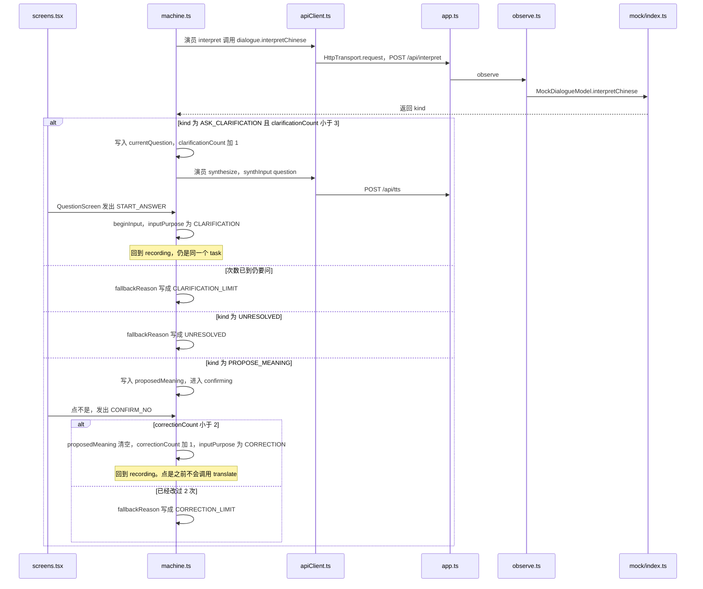

# 中文没说清

前半段和 [说中文，翻成瑞典语](01-说中文翻成瑞典语.md) 相同：录音、点「说完了」、识别、进入理解。分叉发生在 `POST /api/interpret` 的返回，以及孩子在确认屏上点「不是」。

例子：孩子说「他拿走了我的那个。」

前半段的函数链与 [说中文，翻成瑞典语](01-说中文翻成瑞典语.md) 相同，图从 `interpret` 的返回画起。

## 模型要求追问

1. 理解结果是 `ASK_CLARIFICATION`，并且 `clarificationCount` 还不到 3。
2. [machine.ts](../web/dialogue/machine.md) 进入 `clarifying`，次数加 1。问题写在 `currentQuestion`。
3. 和确认一样，先 `synthesize` 把这个问题读出来，再进入 `asking`。
4. [selectors.ts](../web/dialogue/selectors.md) 把 `clarifying.asking` 变成屏幕名 `clarify`。[screens.tsx](../web/ui/screens.md) 的 `QuestionScreen` 只显示这一个问题。
5. 孩子点回答，事件是 `START_ANSWER`。状态回到 `recording`。这一段的用途标成 `CLARIFICATION`，仍是同一个任务。
6. 再说、再点「说完了」、再识别、再理解。新的听写接在原来的 `dialogueInputs` 后面。

次数到 3 时如果模型还要追问，状态进入 `fallback`，原因是 `CLARIFICATION_LIMIT`。这一轮不再翻译。兜底屏在 [没听清、出错、或问到头](05-没听清出错或问到头.md)。

理解结果是 `UNRESOLVED` 时，直接兜底，原因是 `UNRESOLVED`。

服务器还会再守一次：追问次数已经是 0 时，[dialogueParsing.ts](../server/providers/dialogueParsing.md) 把「还要问」收成无法判断，原因是追问次数用完。

## 孩子点「不是」

确认屏已经出现，提出的意思不对。

1. `QuestionScreen` 发出 `CONFIRM_NO`。
2. `correctionCount` 还不到 2 时，提出的意思被清掉，回到录音。这一段的用途是 `CORRECTION`。上限是 [types.ts](../shared/types.md) 里的 `LIMITS.correctionAttempts`。
3. 孩子再说一句。之后仍要重新理解，并再次确认。点「是」之前不会翻译。
4. 已经改过 2 次还点「不是」，进入 `fallback`，原因是 `CORRECTION_LIMIT`。

## 这一路多出来的文件

主路那些文件都还在。这里多看的是状态机里的 `clarifying`、`CONFIRM_NO`，以及 [screens.tsx](../web/ui/screens.md) 上回答和「不是」两个按钮。
