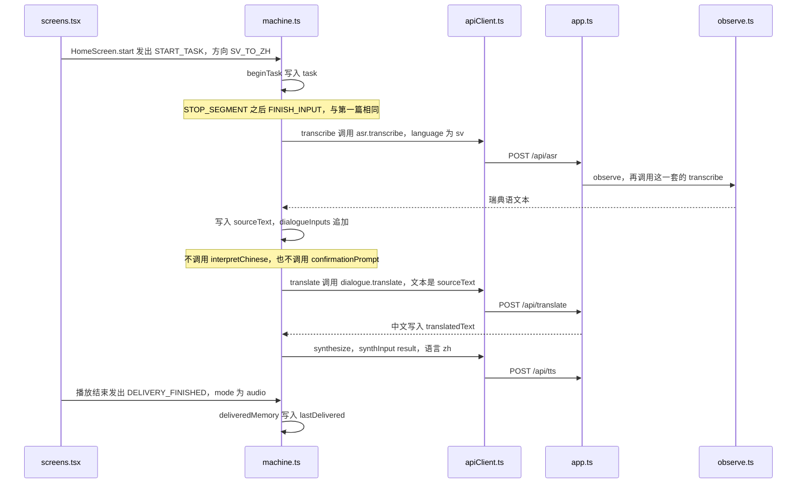

# 说瑞典语，翻成中文

例子：首页点「Svenska → 中文」，说一句瑞典语，点「说完了」。界面接着出现中文译文，并读出中文。中间没有「你是说……，对吗？」

录音和停止的函数与第一篇第 2、第 3 步相同。识别成功后，状态机按方向直接调用 `translate`。

## 和中文那条路相同的部分

1. [screens.tsx](../web/ui/screens.md) 的 `start('SV_TO_ZH')` 发出 `START_TASK`。
2. [machine.ts](../web/dialogue/machine.md) 录音、停止、`segmentDecision`、`FINISH_INPUT`，然后 `transcribing`。
3. [apiClient.ts](../web/services/apiClient.md) 发 `POST /api/asr`，这次 `language=sv`。
4. [app.ts](../server/app.md) 仍按 `X-Provider-Preset` 选 mock、cloud 或 local。local 的 [whisper.ts](../server/providers/local/whisper.md) 只听写，不翻译。

## 识别之后直接翻译

听写成功后，状态机看方向是 `SV_TO_ZH`，下一步是 `#translating`。

因此没有 `POST /api/interpret`，也没有 `confirming`。送去翻译的文本是识别出的瑞典语原文 `sourceText`。

1. `POST /api/translate` 返回中文，写进 `translatedText`。
2. `result` 里再 `POST /api/tts`，语言是中文。
3. 播放结束发出 `DELIVERY_FINISHED`。`screenOf` 给出 `result`，[ResultScreen](../web/ui/screens.md) 上同时看得到瑞典语原文和中文译文。

结果屏、播放器和送达记忆，与中文那条路的最后一步相同，见 [说中文，翻成瑞典语](01-说中文翻成瑞典语.md) 的第 8 步。
