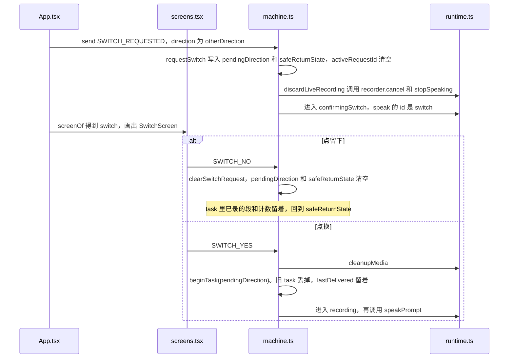

# 做到一半，换一个方向

例子：正在把中文翻成瑞典语，录音已经停过一次。孩子点顶栏的另一个语言。页面先问要不要换，点了才放弃这一轮。

怎么读：先看这份 JSON，再看调用顺序图，然后读第 1 步和第 2 步。

## 这一刻的状态机

阶段离开了 `task`，停在 `confirmingSwitch`。原来那一轮还在 `task` 里。`pendingDirection` 是准备换成的方向，`safeReturnState` 是点「留下」要回去的地方。

```json
{
  "value": "confirmingSwitch",
  "context": {
    "sessionId": "session-1",
    "preset": "mock",
    "task": {
      "id": "task-1",
      "direction": "ZH_TO_SV",
      "preset": "mock",
      "inputPurpose": "INITIAL",
      "segmentInfo": [{ "id": "seg-1", "durationMs": 1800, "purpose": "INITIAL" }],
      "pendingSegments": 1,
      "dialogueInputs": [],
      "proposedMeaning": null,
      "currentQuestion": null,
      "confirmedMeaning": null,
      "sourceText": null,
      "translatedText": null,
      "clarificationCount": 0,
      "correctionCount": 0,
      "asrRetryCount": 0,
      "startedAt": 0
    },
    "lastDelivered": null,
    "pendingDirection": "SV_TO_ZH",
    "safeReturnState": "segmentDecision",
    "activeRequestId": null,
    "error": null,
    "fallbackReason": null,
    "audioStatus": "none",
    "segmentStartedAt": null
  }
}
```



已经 `delivered` 时，`SWITCH_REQUESTED` 不再进入 `confirmingSwitch`，直接 `beginTask`。

## 第 1 步：点顶栏的方向

1. [App.tsx](../web/ui/App.md) 在任务进行中显示方向按钮。
2. 点击发出 `SWITCH_REQUESTED`。新方向来自 [types.ts](../shared/types.md) 的 `otherDirection`：现在是中文到瑞典语，请求里就是瑞典语到中文。
3. [machine.ts](../web/dialogue/machine.md) 几乎每个任务状态都接这个事件。它记下 `pendingDirection`，并记下现在从哪一步离开，放在 `safeReturnState`。
4. 状态变成 `confirmingSwitch`。进行中的请求会停。晚到的结果还会被 `isStale` 丢掉，因为 `requestId` 已经对不上。

## 第 2 步：问一句要不要换

1. [selectors.ts](../web/dialogue/selectors.md) 把 `confirmingSwitch` 变成屏幕名 `switch`。
2. [screens.tsx](../web/ui/screens.md) 画出 `SwitchScreen`。[prompts.ts](../web/audio/prompts.md) 播放换方向的短句。
3. 点留下，事件是 `SWITCH_NO`。状态机按 `safeReturnState` 回到原来的录音、识别、确认或结果。已经录下的段还在。
4. 点换，事件是 `SWITCH_YES`。旧任务被清掉，只留下已经送达过的 `lastDelivered`。然后用新方向执行和首页 `START_TASK` 一样的 `beginTask`，进入录音。

意思确认用的是 `CONFIRM_YES` / `CONFIRM_NO`。换方向用的是 `SWITCH_YES` / `SWITCH_NO`。两对按钮在不同的屏幕上。

结果已经送到、状态是 `delivered` 时，再点另一个方向不必再问。状态机直接 `beginTask`。
