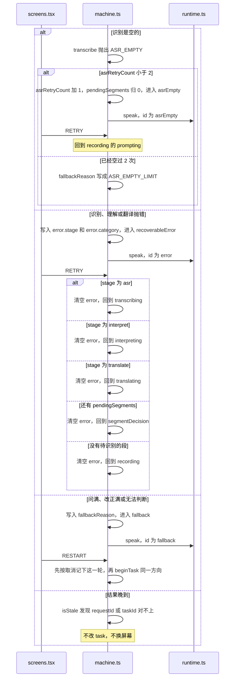

# 没听清、出错、或问到头

这三屏都从 [machine.ts](../web/dialogue/machine.md) 来。[selectors.ts](../web/dialogue/selectors.md) 把它们分成 `asrEmpty`、`error`、`fallback`。[screens.tsx](../web/ui/screens.md) 分别画 `AsrEmptyScreen`、`ErrorScreen`、`FallbackScreen`。

朗读失败不进 `recoverableError`。`result` 进入 `ttsFailed` 时 `translatedText` 还在。`RETRY` 再调用 `synthesize`。大人点「只看文字」发出 `DELIVERY_FINISHED`，mode 为 `text_only`，同样由 `deliveredMemory` 写入 `lastDelivered`。

## 识别结果是空的

听写返回空字符串。

1. `asrRetryCount` 还小于 2：进入 `asrEmpty`，原因还没到上限。上限是 `LIMITS.asrRetries`。
2. [prompts.ts](../web/audio/prompts.md) 播放「再说一次」。
3. 孩子点再录，事件是 `RETRY`，回到 `recording`。
4. 已经空过 2 次：进入 `fallback`，原因是 `ASR_EMPTY_LIMIT`。不再猜一句译文。

## 某一步失败，还可以重试

录音启动失败、识别超时、理解或翻译抛错，进入 `recoverableError`。错误类别来自 [errors.ts](../shared/errors.md)，例如 `NETWORK`、`TIMEOUT`、`NOT_CONFIGURED`。

1. 进入时记一条 `ERROR`，并播放错误短句。
2. 点重试，事件是 `RETRY`。状态机按失败发生的阶段回去：识别失败回到 `transcribing`，理解失败回到 `interpreting`，翻译失败回到 `translating`。
3. 点取消，事件是 `CANCEL`，回到首页 `idle`。

翻译已经成功、只有朗读失败时，不进这个错误屏。结果停在 `ttsFailed`：字还在，可以 `RETRY` 再求一次语音，或者由大人点「只看文字」，事件是 `DELIVERY_FINISHED`，模式 `text_only`。

## 问清楚做不到

追问满 3 次、改正满 2 次，或模型返回无法判断，进入 `fallback`。短句说明这一轮停住。

1. 点重新开始，事件是 `RESTART`。旧的这一轮记成取消，用同一方向开一个新任务，进入录音。
2. 点取消，回到首页。

这三屏都不会编一条译文出来。

## 晚到的结果

每一跳之前，状态机会换一个 `requestId`。返回里的编号和当前任务对不上时，`isStale` 把这条结果丢掉。

例子：孩子在识别还没回来时点了取消。取消之后那条识别结果到达，界面留在首页，不会被拉回去。
