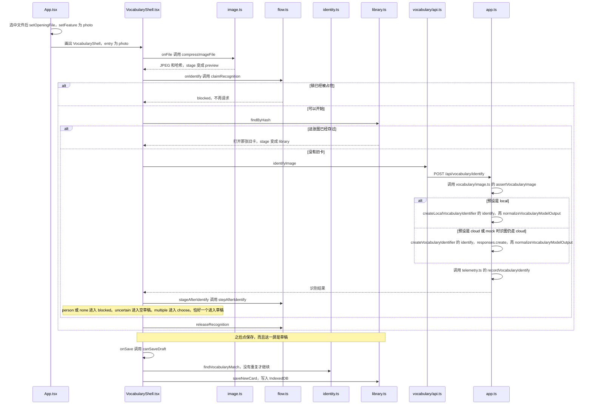

# 拍一张照片，做成词卡

例子：首页点拍照，拍一个杯子，点识别，看到「杯子 / en kopp」，点保存。

这条路不进入 [machine.ts](../web/dialogue/machine.md)。状态机停在首页。`App` 用自己的 `feature` 决定画词卡。

怎么读：先看状态机这份 JSON，它停在首页。再看词卡自己的 `stage`。然后是调用顺序图和四个步骤。

## 这一刻的状态机

拍照、识别、保存都不改 `snap.context.task`。

```json
{
  "value": "idle",
  "context": {
    "sessionId": "session-1",
    "preset": "mock",
    "task": null,
    "lastDelivered": null,
    "pendingDirection": null,
    "safeReturnState": null,
    "activeRequestId": null,
    "error": null,
    "fallbackReason": null,
    "audioStatus": "none",
    "segmentStartedAt": null
  }
}
```

杯子记在 `VocabularyShell` 的 `stage` 里。看到「杯子 / en kopp」、还没点保存时，是一份草稿。照片字节不在这里列出。分类用家居作示意。

```json
{
  "feature": "photo",
  "stage": {
    "name": "draft",
    "cardId": "card-1",
    "draft": {
      "zh": "杯子",
      "sv": "kopp",
      "article": "en",
      "translationUncertain": false,
      "category": "home"
    },
    "banner": null
  }
}
```



## 第 1 步：从首页打开相机

1. [App.tsx](../web/ui/App.md) 把首页的拍照按钮接到隐藏的文件输入。选中一张图后，`feature` 变成 `photo`，照片放进 `openingFile`。
2. `App` 改画 [VocabularyShell.tsx](../web/vocabulary/VocabularyShell.md)。翻译那一屏先让开。
3. [capture.ts](../web/vocabulary/capture.md) 规定这是相机输入。[image.ts](../web/vocabulary/image.md) 把原图收成一张较小的 JPEG，并算出哈希。上传的是这张 JPEG。

## 第 2 步：点识别

1. `onIdentify` 先问 [flow.ts](../web/vocabulary/flow.md) 的 `claimRecognition`。上一张还没回来时，第二次点击被挡住。
2. [library.ts](../web/vocabulary/library.md) 的 `findByHash` 看这张图是不是已经存过。存过就直接打开那张旧卡，不再请求模型。
3. 没有旧卡时，[api.ts](../web/vocabulary/api.md) 的 `identifyImage` 发 `POST /api/vocabulary/identify`。头里有 `X-Provider-Preset` 和 `X-Card-Id`。身体是 JPEG 字节。
4. [app.ts](../server/app.md) 把这个路径交给识图。cloud 在 [identify.ts](../server/vocabulary/identify.md)。local 在 [vision.ts](../server/providers/local/vision.md)，模型要能看图。图片再由 [image.ts](../server/vocabulary/image.md) 检查一次。
5. 返回交给 [normalize.ts](../server/vocabulary/normalize.md) 整理。耗时记在 [telemetry.ts](../server/vocabulary/telemetry.md)，不记照片，也不记认出来的词。

## 第 3 步：按结果决定下一屏

[flow.ts](../web/vocabulary/flow.md) 的 `stepAfterIdentify`：

- `person` 或 `none`：`blocked`。界面说明不能做成卡片，库不变。人和「没有物体」停在这里。
- `uncertain`，或一个候选都没有：进入草稿，词是空的，横幅是不确定。不编一个词出来。
- `multiple`：进入挑选，孩子或大人点其中一个。点之前还会用 [identity.ts](../web/vocabulary/identity.md) 看库里有没有同一个词。
- 恰好一个候选：进入草稿，带上中文、瑞典语、冠词和分类。分类名字来自 [classify.ts](../web/vocabulary/classify.md)。

## 第 4 步：点保存

1. [speech.ts](../web/vocabulary/speech.md) 的 `canSaveDraft` 要求中文和瑞典语都有，并且没有超过长度。
2. 再查一次同一个词是否已在库里。有的话进入替换，而不是悄悄多存一张。
3. `saveNewCard` 把照片、缩略图、哈希和两个词写进这台手机的 IndexedDB。实现在 [library.ts](../web/vocabulary/library.md)。
4. 保存成功后界面回到词库，并定位到这张新卡。

词卡库和翻译任务各用各的存储。删一张卡不会改正在进行的对话。

家长把卡片同步到 Mac 时，走的是另一条：[sync.ts](../web/vocabulary/sync.md)、[remote.ts](../web/vocabulary/remote.md)，服务器是 [routes.ts](../server/vocabulary/routes.md) 和 [store.ts](../server/vocabulary/store.md)。家庭口令只用于这一条，和监控密码不是同一个。
