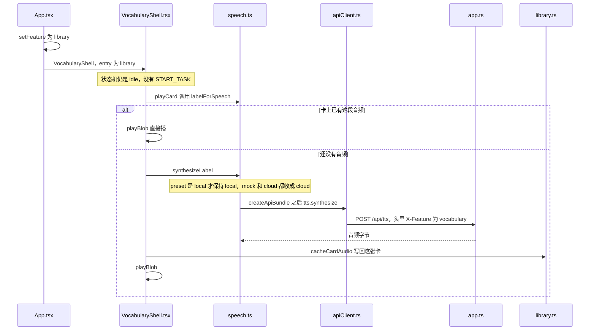

# 打开词卡，读出这个词

例子：首页点「我的词卡」，打开杯子那一张，点瑞典语喇叭。

怎么读：先看状态机这份 JSON，再看词卡这一屏，然后是调用顺序图和两个步骤。

## 这一刻的状态机

打开词卡、点喇叭都不发 `START_TASK`。状态机仍停在首页。

```json
{
  "value": "idle",
  "context": {
    "sessionId": "session-1",
    "preset": "mock",
    "task": null,
    "lastDelivered": null,
    "pendingDirection": null,
    "safeReturnState": null,
    "activeRequestId": null,
    "error": null,
    "fallbackReason": null,
    "audioStatus": "none",
    "segmentStartedAt": null
  }
}
```

这一屏在 `VocabularyShell`。瑞典语要读的是冠词加词，`en kopp`。卡上还没有瑞典语音频时，`svAudio` 是空的，点喇叭之后才写回去。

```json
{
  "feature": "library",
  "stage": {
    "name": "card",
    "card": {
      "id": "card-1",
      "zh": "杯子",
      "sv": "kopp",
      "article": "en",
      "svAudio": null
    }
  }
}
```



草稿屏的 `playDraft` 也调用 `synthesizeLabel`，音频先留在这一屏的 `clips`，等 `saveNewCard` 时一起写入。

## 第 1 步：打开词库

1. [App.tsx](../web/ui/App.md) 把「我的词卡」设成 `feature = 'library'`。
2. 画出 [VocabularyShell.tsx](../web/vocabulary/VocabularyShell.md)，入口是 `library`。
3. 列表、筛选和翻页在 [gallery.ts](../web/vocabulary/gallery.md) 和 [VocabBrowser.tsx](../web/vocabulary/VocabBrowser.md)。每页 24 张。这是排序和筛选，不是再把卡片分成另一套组。
4. 点一张卡，壳层进入 `card`，照片和两个词来自 [library.ts](../web/vocabulary/library.md)。

状态机仍停在 `idle`。这里没有 `START_TASK`。

## 第 2 步：点喇叭

1. `playCard` 先看这张卡上有没有已经存好的音频。有就直接播。
2. 没有时，[speech.ts](../web/vocabulary/speech.md) 的 `labelForSpeech` 决定读什么。中文读中文词。瑞典语把冠词和词拼在一起，例如 `en kopp`。
3. `synthesizeLabel` 调用和翻译相同的朗读接口：`POST /api/tts`。头里 `X-Feature` 是 `vocabulary`，并带上卡片编号。
4. 预设是 local 时，服务器用 macOS `say`。预设是 mock 或 cloud 时，这个朗读走 cloud 的声音。函数里把 mock 收成 cloud，因为词卡要的是能听的词，不是翻译剧本。
5. 返回的音频用 `cacheCardAudio` 写回这张卡。下次再点，不再请求。
6. `playBlob` 在按钮处理里播放。`synthesizeLabel` 自己不开始出声。

草稿屏上的喇叭是 `playDraft`，顺序相同，只是音频先留在这一屏的 `clips` 里，等保存时一起写进卡片。
