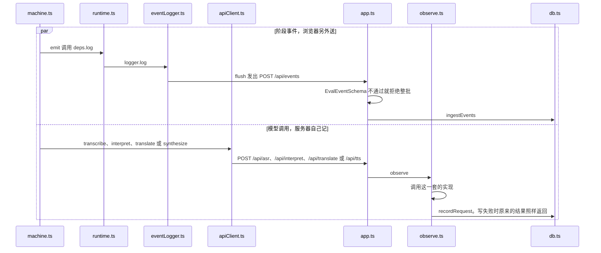
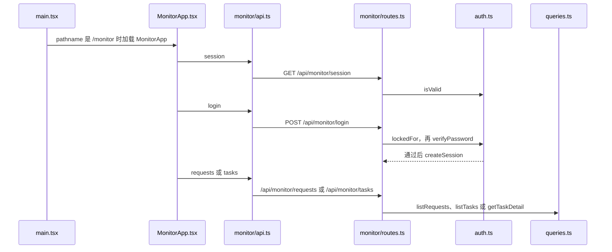

# 这一轮怎么出现在监控里

例子：刚走完「我想去厕所。」打开 `/monitor`，请求页能看到识别、理解、翻译、朗读各一行。行里有耗时和费用依据，没有这句中文，也没有瑞典语译文。

监控不决定下一步。儿童界面的状态机该怎么走，仍按前面几篇。

怎么读：先看手机上留下的 JSON，再看监控里的一行。然后是两条记录链，最后是打开监控页。

## 这一刻的状态机

「我想去厕所。」已经送达并回到首页。句子在手机的 `lastDelivered` 里。

```json
{
  "value": "idle",
  "context": {
    "sessionId": "session-1",
    "preset": "mock",
    "task": null,
    "lastDelivered": {
      "taskId": "task-1",
      "direction": "ZH_TO_SV",
      "source": "我想去厕所。",
      "translation": "Jag vill gå på toaletten."
    },
    "pendingDirection": null,
    "safeReturnState": null,
    "activeRequestId": null,
    "error": null,
    "fallbackReason": null,
    "audioStatus": "none",
    "segmentStartedAt": null
  }
}
```

监控里的一行请求没有 `source`，也没有 `translation`。识别这一行只留下阶段、耗时和费用依据。数字是示意，下面只列出和这件事有关的字段。`stage` 用的是记录里的大写名字。

```json
{
  "taskId": "task-1",
  "sessionId": "session-1",
  "preset": "mock",
  "stage": "ASR",
  "direction": "ZH_TO_SV",
  "feature": "translate",
  "language": null,
  "durationMs": 12,
  "status": "succeeded",
  "costUsd": null
}
```

一次「我想去厕所。」在监控里留下两条链。两条都不存句子。



打开监控页是另一条入口，不经过儿童界面的状态机。



## 模型调用：服务器自己记

孩子点「说完了」之后，每一次 `POST /api/asr`、`/api/interpret`、`/api/translate`、`/api/tts` 都经过 [app.ts](../server/app.md)。

1. [observe.ts](../server/telemetry/observe.md) 包住这次调用。成功、失败、取消各写一行。
2. 行进 [db.ts](../server/telemetry/db.md) 的 SQLite，文件在 `apps/server/data/telemetry.sqlite`。
3. 有 token 又有单价时，[pricing.ts](../server/telemetry/pricing.md) 算出美元。缺用量就保持未知，不写成 0。
4. 写监控如果失败，原来的翻译结果或错误照样返回给手机。

词卡识别走 `/api/vocabulary/identify`，记在同一类请求行里，阶段不同，所以费用页能把它和翻译分开。见 [telemetry.ts](../server/vocabulary/telemetry.md)。

## 阶段事件：浏览器另外送

状态机在关键点调用 `log`，例如任务开始、点了「是」、播放开始。

1. [runtime.ts](../web/services/runtime.md) 把 `log` 接到 [eventLogger.ts](../web/services/eventLogger.md)。
2. 事件先在浏览器里攒一批，再 `POST /api/events`。
3. [evaluation.ts](../shared/evaluation.md) 的 schema 多一个内容字段就拒绝整批。
4. [eventStore.ts](../server/evaluation/eventStore.md) 收下之后可以折进同一份数据库，供任务页把阶段排成时间线。

所以一次中文翻译在监控里有两类记录：模型请求行，和阶段事件。两类都不存句子。

## 打开监控页

1. 地址是 `/monitor`。[main.tsx](../web/main.md) 不加载儿童界面，只加载 [MonitorApp.tsx](../web/monitor/MonitorApp.md) 和 [monitor.css](../web/monitor/monitor.css.md)。
2. [api.ts](../web/monitor/api.md) 先问会话。没有登录就显示密码框。
3. 密码检查在 [auth.ts](../server/monitor/auth.md)。没有写死的默认密码。连续失败 5 次会锁 60 秒。
4. 登录后，各个标签调用 [routes.ts](../server/monitor/routes.md)。汇总查询在 [queries.ts](../server/telemetry/queries.md)。
5. 概览、请求、任务、测试、评估、费用分别是 [OverviewTab](../web/monitor/OverviewTab.md)、[RequestsTab](../web/monitor/RequestsTab.md)、[TasksTab](../web/monitor/TasksTab.md)、[TestSessionsTab](../web/monitor/TestSessionsTab.md)、[EvaluationTab](../web/monitor/EvaluationTab.md)、[CostTab](../web/monitor/CostTab.md)。

翻译接口本身不用这个密码。没登录仍可以走「说中文」。不能看的是这些统计。

上一篇：[打开词卡，读出这个词](07-打开词卡并朗读.md) · 下一篇：[换成 cloud 或 local](09-换成cloud或local.md)
