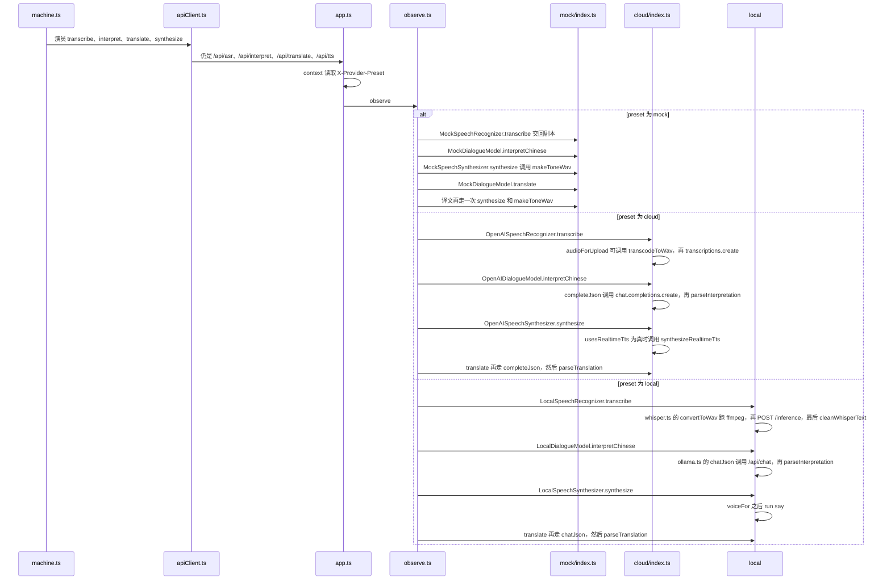

# 换成 cloud 或 local

例子：同一句「我想去厕所。」，先用 mock 走完，再把预设换成 local 走一遍。孩子点的仍是「中文 → Svenska」「说完了」「是」。屏幕顺序不变。

状态机调用的演员名字不变。`context()` 按 `X-Provider-Preset` 换成下面三套里的一套，再由 `observe` 包住。

local 某一台没开时，这次调用失败，`preset` 不会被改成 cloud。

## 预设在哪选定

1. 打开页面时，[presetPreference.ts](../web/services/presetPreference.md) 读网址里的 `preset`，其次读上次记住的值。cloud 还没被大人确认过时，回到 mock。
2. [App.tsx](../web/ui/App.md) 把这个值交给状态机。`START_TASK` 时抄进 `task.preset`。这一轮中途再改齿轮，当前任务不理。
3. 之后每次请求，[apiClient.ts](../web/services/apiClient.md) 把预设放进头 `X-Provider-Preset`。路径仍是 `/api/asr`、`/api/interpret`、`/api/translate`、`/api/tts`。

## 服务器换的是哪一套

[app.ts](../server/app.md) 的 `context()` 用这个头查 [registry.ts](../server/providers/registry.md)。

- mock：[mock/index.ts](../server/providers/mock/index.md)。识别交回剧本。适合看状态机，不必说话。
- cloud：[cloud/index.ts](../server/providers/cloud/index.md)。密钥只在服务器的 `.env`。[index.ts](../server/index.md) 启动时读配置，浏览器包里没有密钥。
- local：[local/index.ts](../server/providers/local/index.md)。识别是 whisper，理解是 Ollama，朗读是 `say`。某一台没开，这次调用失败，预设不会改成 cloud。

三套都实现 [contracts.ts](../shared/contracts.md) 里的同一组方法，所以 [machine.ts](../web/dialogue/machine.md) 不用知道背后是哪一套。

## 走同一句时，哪几步的内容会变

顺序仍是 [说中文，翻成瑞典语](01-说中文翻成瑞典语.md) 的 8 步。变的是第 4、5、6、8 步里面服务器调用的函数。

1. 识别：mock 交回「我想去厕所。」cloud 把音频送给语音识别。local 先转码再送给 whisper。
2. 理解：mock 按剧本给出「提出意思」。cloud 和 local 把文本送给各自的对话模型，再用同一套 JSON 检查。
3. 确认句的朗读、译文、译文的朗读：mock 造一段短 wav。cloud 用配置里的语音模型。local 用本机声音。

界面文件、事件名、确认必须发生在翻译之前，这几件保持原样。
