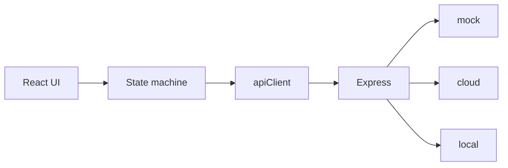

# 05 Code guide

Series: [01 System design](01-system-design.md) · [02 Developer guide](02-developer-guide.md) · [03 UI brief](03-ui-brief.md) · [04 Tab5 feasibility](04-tab5-feasibility.md) · **05 Code guide** · [06 Research prompts](06-research-prompts.md) · [07 Module structure](07-module-structure.md) · [08 How the modules fit](08-how-modules-fit.md) · [09 Code walkthrough](09-code-walkthrough/00-start-here.md)

The Chinese file is in [`docs/01-zh`](../01-zh/05-代码导读.md).

Read the project from the code. Product rules are in [01 System design](01-system-design.md). Install and commands are in [02 Developer guide](02-developer-guide.md). What each module does, with shortened code, is in [07 Module structure](07-module-structure.md). How one turn threads the modules together is in [08 How the modules fit](08-how-modules-fit.md). A page per source file, plus one page per user action, is in [09 Code walkthrough](09-code-walkthrough/00-start-here.md). The action order is in [By feature](09-code-walkthrough/features/00-by-feature.md).

Read sections 1 to 3 first and follow one tap all the way through. Section 4 is a map. Open it when you need a file. Do not read it straight through.

## 1. Three parts

The screen only displays and sends events. The one dialogue machine decides the next step. The browser turns recognition, understanding, translation, and speech into HTTP. Node picks `mock`, `cloud`, or `local` from a request header. All three engines implement the same interfaces, so the screen does not know whether the answer is fake, OpenAI, or this Mac.

The key lives only in the backend `.env`. The browser never sees it.

**`packages/shared`** (package `@kt/shared`)

Used by both the browser and Node. Types, Zod checks, limits, and error categories. Both sides share one definition of what a request looks like.

**`apps/web`** (package `@kt/web`)

Runs in the browser. In development that is Vite at `https://localhost:5173`. The child UI, the state machine, recording and playback, vocabulary cards, and the monitor page live here.

**`apps/server`** (package `@kt/server`)

Runs in Node, by default on `127.0.0.1:8787`. HTTP, the three providers, the SQLite monitor, and the household vocabulary library live here.

`npm run dev` starts both. Vite forwards the browser's `/api` to 8787, so a phone only opens the page address. The proxy is in `apps/web/vite.config.ts`.

## 2. How to read it

Answer the question at the end of each pass before going on.

### Pass 1: follow one "speak Chinese"

Goal: point from the home button to Swedish being spoken.

1. `apps/web/src/main.tsx`  
   A normal address loads `App`. `/monitor` loads only the monitor.

2. `apps/web/src/ui/App.tsx`  
   `useActor` starts the machine. Buttons are almost all `send({ type: '...' })`.

3. `apps/web/src/dialogue/selectors.ts`  
   Turns a machine state into a screen name. `App` uses `screenOf(snap)` to choose the screen.

4. `apps/web/src/ui/screens.tsx`  
   Buttons and copy for each screen. It does not decide the flow.

5. `transcribing` in `apps/web/src/dialogue/machine.ts`  
   After transcription, Chinese goes to understanding. Swedish goes straight to translation.

6. `apps/web/src/services/runtime.ts`  
   Hands the recorder, the player, and HTTP into the machine. The machine does not `fetch` by itself.

7. `apps/web/src/services/apiClient.ts`  
   Sends `POST /api/asr` and the other calls, with the preset, the task id, and the request id.

8. `context()` in `apps/server/src/app.ts`  
   Reads those headers, picks the preset, and calls recognition, dialogue, or speech.

Who decides whether to ask a follow-up after the child presses "finished"? The machine, not the model. The model only returns "ask" or "propose a meaning". The cap on questions is in the machine.

### Pass 2: why the three presets can be swapped

1. `packages/shared/src/contracts.ts`  
   The three interfaces: recognition, dialogue, and speech. This is the seam of the project.

2. `apps/server/src/providers/registry.ts`  
   Builds the mock, cloud, and local implementations at startup.

3. `providers/mock`, `providers/cloud`, `providers/local`  
   One implementation each, the same shape.

4. `apps/server/src/providers/dialogueParsing.ts`  
   JSON from every model goes through the same check. A bad shape is an error. Nothing is guessed.

Do you edit the machine to switch from mock to cloud? No. What changes is the request header, and which implementation the server selects.

### Pass 3: vocabulary cards are a side path

Photo vocabulary and "My cards" do not live in `machine.ts`. `App.tsx` switches the view with `feature` (`photo` or `library`). `vocabulary/VocabularyShell.tsx` draws it. Identification uses `/api/vocabulary/identify`. Reading a card still uses `/api/tts`.

Does deleting a card affect a translation in progress? No. The two sides do not read or write each other's task.

### Pass 4: what the monitor stores

1. `telemetry/observe.ts` wraps every model call. Success, failure, and cancellation each write one row.
2. `telemetry/db.ts` writes SQLite. Only timing, status, tokens, and cost. No recording and no translation text.
3. `eventLogger.ts` sends UI stage events to `/api/events`. An extra field is rejected.
4. `apps/web/src/monitor/` is the adult page at `/monitor`. Those routes require a login. The translation routes do not.

Why can't you search the monitor database for what the child said? The write path accepts metadata only.

## 3. One Chinese-to-Swedish turn

The steps below use mock. Cloud and local keep the same machine steps. Only the implementation selected on the server changes.

1. The home button in `screens.tsx` sends `START_TASK` with direction `ZH_TO_SV`.
2. `machine.ts` enters `recording` and calls the recorder injected by `runtime.ts`. Mock does not open a real microphone. On stop it returns the sentence from the scenario script.
3. After stop comes `segmentDecision`. Continue records another segment. Finished enters `transcribing`.
4. The machine calls `apiClient`, which requests `POST /api/asr?language=zh`.
5. `app.ts` checks the task id and the request id, selects the implementation with `X-Provider-Preset`, and `observe.ts` writes one row.
6. Mock ignores the audio, reads the script sentence carried on the request, and returns text.
7. Chinese enters `interpreting` and requests `POST /api/interpret`. The result is "ask" or "propose a meaning".
8. If a question is needed and the count is still under the cap, the machine enters `clarifying` and returns to recording. The cap is `LIMITS` in `@kt/shared`. The check is in `machine.ts`.
9. A clear meaning enters `confirming`. `dialogue/text.ts` builds "你是说：……，对吗？". Translation starts only after yes.
10. `POST /api/translate` returns Swedish. `POST /api/tts` returns audio. `audio/player.ts` plays it. When the sound actually starts, `runtime.ts` records a latency.
11. The machine enters `delivered`. `selectors.ts` turns these internal states into the result screen.

Swedish to Chinese goes to `translating` as soon as transcription finishes. It does not pass through understanding or confirmation. The condition is direction `SV_TO_ZH`.

Every request carries a `requestId`. A result that arrives after the state has moved on is dropped by `isStale`.

Recordings live in `audio/audioStore.ts`, in memory only. They are cleared after recognition. Refreshing the page drops the current task. That is intentional.

## 4. File map

Open this section when you need a particular file.

### Repository root

- `package.json` — `dev`, `build`, `test`, `check`, and the desktop launcher start here.
- `.env` — read only by Node. Port, OpenAI, local engines, monitor password.
- `.env.example` — the variable notes. Safe to commit.
- `launcher/start.command` — what the desktop button actually runs. Starts the local engines and the dev servers, then opens the translator and the monitor.
- `launcher/install.sh` — builds the one desktop app and applies the icon.
- `launcher/monitor.command` — opens only the monitor. There is no separate desktop button.
- `launcher/stop.command` — stops the page, the backend, and whisper by port.
- `launcher/mascot.svg` — the source drawing for the desktop icon.

### `packages/shared/src`

- `index.ts` — re-exports the modules below. Application code imports from `@kt/shared`.
- `types.ts` — direction, language, task, and request types.
- `contracts.ts` — the three interfaces. A new provider must implement them.
- `schemas.ts` — Zod. The server rejects JSON with the wrong shape.
- `errors.ts` — error categories. HTTP status follows the category.
- `evaluation.ts` — which fields an evaluation event may have. An extra content field is rejected.
- `monitor.ts` — types shared by the monitor API and the page.
- `vocabulary.ts` — identification results, cards, and categories.
- `mockScenarios.ts` — the mock scripts. T01 and T02 on the screen read this file.

### `apps/web/src`

Entry and wiring:

- `main.tsx` — starts React. The child UI and the monitor do not load each other.
- `services/runtime.ts` — creates the machine and injects recording, playback, HTTP, and logging.
- `services/apiClient.ts` — the browser-side interfaces. Inside, they are `fetch('/api/...')`.
- `services/settings.ts` — options stored in this browser: scenario, microphone, whether cloud was acknowledged.
- `services/presetPreference.ts` — remembers the preset in the address bar.
- `services/eventLogger.ts` — batches stage events to `/api/events`.
- `services/testSession.ts` — the research test code, and the round-trip probe.

Dialogue:

- `dialogue/machine.ts` — the one dialogue machine. Flow, counts, the direction fork, and stale responses are here.
- `dialogue/types.ts` — context, events, and the recorder interface.
- `dialogue/selectors.ts` — state to screen name. While busy, it distinguishes recognition, understanding, translation, and speech.
- `dialogue/text.ts` — the Chinese confirmation sentence.
- `dialogue/responseLatency.ts` — time from "ready to hear the answer" until the sound actually starts.

Sound:

- `audio/recorder.ts` — the real microphone, and the scripted recorder used by mock.
- `audio/audioStore.ts` — segments for the current task, in memory only.
- `audio/player.ts` — plays the audio returned by speech synthesis.
- `audio/prompts.ts` — short lines the UI speaks itself, such as "现在可以说啦". Browser speech, not the model.
- `audio/session.ts` — on iPhone, switches between playback and recording so the next recording is not empty.

Child UI:

- `ui/App.tsx` — the top bar, which screen to show, and the way home opens vocabulary.
- `ui/screens.tsx` — home, recording, continue or finished, question, confirm, result, error, and the stop screen.
- `ui/BigButton.tsx` — the look of a large button. No flow.
- `ui/art.tsx` — the mascot and the line icons.
- `ui/hooks.ts` — the 30-second countdown, and whether the result is playing.
- `ui/DevPanel.tsx` — the adult panel behind the gear.
- `styles.css` — styles for the child UI.

Vocabulary:

- `vocabulary/VocabularyShell.tsx` — photo, preview, confirm, and the study page.
- `vocabulary/VocabBrowser.tsx` — the card grid and one card.
- `vocabulary/flow.ts` — an identification result becomes "blocked", "pick one", or "draft".
- `vocabulary/photo.ts` — the local steps of one photo.
- `vocabulary/capture.ts` — opens the camera or the photo library.
- `vocabulary/image.ts` — checks the image and makes a thumbnail.
- `vocabulary/api.ts` — sends the identification request.
- `vocabulary/speech.ts` — reads a card, reusing `/api/tts`.
- `vocabulary/library.ts` — the on-device library, in IndexedDB.
- `vocabulary/identity.ts` — decides whether two cards are the same word after normalization.
- `vocabulary/hash.ts` — SHA-256 of the photo bytes.
- `vocabulary/classify.ts` — category icons, and sorting old cards by common words.
- `vocabulary/copy.ts` — Chinese and Swedish lines in the vocabulary flow.
- `vocabulary/gallery.ts` — filter, sort, and paging for the card wall.
- `vocabulary/remote.ts` — pair, list, upload, and delete for the household library.
- `vocabulary/sync.ts` — copies one local card into the household library and does not delete the local card.
- `vocabulary/actions.ts` — reports an action to the monitor. No words and no photo.

The monitor loads only at `/monitor`:

- `monitor/MonitorApp.tsx` — login and tabs.
- `monitor/api.ts` — client for the monitor routes.
- `monitor/context.tsx` — filters for time, preset, direction, and stage.
- `monitor/hooks.ts` — polling. It stops when the page is hidden.
- `monitor/format.ts` — how milliseconds, money, and percentages are shown.
- `monitor/parts.tsx` — tables and the drawer.
- `monitor/charts.tsx` — overview charts.
- `monitor/OverviewTab.tsx` — volume, success rate, latency.
- `monitor/RequestsTab.tsx` — one model call.
- `monitor/TasksTab.tsx` — one dialogue turn.
- `monitor/TestSessionsTab.tsx` — test sessions and join codes.
- `monitor/EvaluationTab.tsx` — human scores.
- `monitor/CostTab.tsx` — rates, budget, export, and clear.
- `monitor/monitor.css` — styles for the monitor page only.

### `apps/server/src`

Process and routes:

- `index.ts` — reads `.env`, builds the three providers, listens.
- `config.ts` — turns environment variables into one config object.
- `app.ts` — every HTTP route, and which preset this request uses.

Providers:

- `providers/registry.ts` — the registry. Cloud is unavailable when there is no key.
- `providers/contracts.ts` — the shared interfaces, plus availability and model names.
- `providers/dialogueParsing.ts` — checks model JSON and turns it into ask, propose, or unresolved.
- `providers/mock/index.ts` — fixed fake recognition, understanding, and translation.
- `providers/mock/wav.ts` — a short WAV for mock speech.
- `providers/cloud/index.ts` — OpenAI recognition, dialogue, and speech.
- `providers/cloud/prompts.ts` — the system prompts sent to the model.
- `providers/cloud/realtimeTts.ts` — the realtime speech channel.
- `providers/local/index.ts` — packs local recognition, the model, and speech into one bundle.
- `providers/local/config.ts` — local engine addresses. A non-loopback address is rejected.
- `providers/local/whisper.ts` — calls local whisper.cpp.
- `providers/local/ollama.ts` — calls local Ollama.
- `providers/local/tts.ts` — calls macOS `say`.
- `providers/local/vision.ts` — local photo identification. Failure does not switch to the cloud.
- `providers/local/common.ts` — the temp directory for one request. It is deleted when the request ends.
- `providers/local/exec.ts` — starts an external program without a shell.
- `providers/local/probe.ts` — checks whether whisper and Ollama are ready.
- `providers/local/doctor.ts` — the report from `npm run local:doctor`.
- `providers/local/exposure.ts` — warns when an engine is listening on a LAN address.

Audio and monitor:

- `media/transcode.ts` — ffmpeg turns browser audio into 16 kHz mono WAV. An iPhone records AAC.
- `media/duration.ts` — duration of a WAV, for the monitor only.
- `telemetry/observe.ts` — one row per model call. A bookkeeping failure does not change the original result.
- `telemetry/db.ts` — SQLite. The default file is `apps/server/data/telemetry.sqlite`.
- `telemetry/queries.ts` — the summaries and filters on the page.
- `telemetry/pricing.ts` — turns tokens into US dollars from `config/prices.json`. If it cannot, the cost stays unknown. It is not written as 0.
- `telemetry/modelConfig.ts` — records the model name used for that turn.
- `telemetry/export.ts` — CSV export.
- `monitor/routes.ts` — `/api/monitor/*`. Everything except login needs an admin session.
- `monitor/auth.ts` — password, session, and login limiting. There is no default password.
- `evaluation/eventStore.ts` — the in-memory event list, `events.ndjson`, and CSV.

Vocabulary library:

- `vocabulary/routes.ts` — pair, list, upload, and delete.
- `vocabulary/store.ts` — SQLite plus a media folder. Image bytes are not stored in the database.
- `vocabulary/identify.ts` — cloud identification. The photo is used for this request only.
- `vocabulary/image.ts` — rejects a body that is not an image.
- `vocabulary/normalize.ts` — turns the model's words into a shape the UI can use.
- `vocabulary/telemetry.ts` — timing and tokens for this identification.

When `local` is unavailable it does not quietly switch to cloud. The failure becomes a visible `LOCAL_*` error.

The household passphrase is not the monitor password.

### Command-line scripts

These files are in `apps/server/scripts`. They are not on the normal request path.

- `local-doctor.ts` — checks the tools and models on this Mac.
- `local-start.ts` — starts whisper on the loopback address and warms the model.
- `local-smoke.ts` — runs the local path with synthetic speech.
- `local-eval.ts` — runs the local evaluation on the scenarios.
- `local-e2e-http.ts` — runs the local path through real HTTP.
- `check-cloud.ts` — sends synthetic text to OpenAI. This costs a little money.
- `scenarios.ts` — sentences for evaluation.
- `narrativeScenarios.ts` — longer narrative sentences.
- `eval-narratives.ts` — runs the narrative evaluation.

### Tests

- `tests/machine` — confirmation, at most 3 questions, switching direction, error recovery.
- `tests/integration` — the full mock flow over real HTTP, monitor login, and the cloud adapter.
- `tests/local` — local adapters against fake whisper, Ollama, ffmpeg, and `say`.
- `tests/telemetry` — exactly one row per call, and no transcript in the export.
- `tests/vocabulary` — identification, the library, sync, and image limits.
- `tests/web` — recording, playback, and remembering the preset.
- `tests/media` — ffmpeg transcoding.
- `tests/interpretation` — the understanding policy for longer narratives.

If you change the machine and do not change the tests, the rule is usually wrong.

## 5. Where to edit

- Ask one more question, skip a confirmation, or change the direction rule: `dialogue/machine.ts`, then run `tests/machine`.
- Button copy, the countdown, and color: `ui/screens.tsx` and `styles.css`. Do not put flow decisions in a screen component.
- The Chinese confirmation sentence: `dialogue/text.ts`.
- A mock sentence: `packages/shared/src/mockScenarios.ts`.
- How a question is asked, or how spoken the Swedish is: `providers/cloud/prompts.ts`. If local needs its own wording, also look at `providers/local/ollama.ts`.
- Change an OpenAI model name: `OPENAI_*_MODEL` in `.env`. Do not edit the machine.
- How a new error is shown: `packages/shared/src/errors.ts`, then the error screen in `screens.tsx`.
- One more number on the monitor: `telemetry/db.ts`, `observe.ts`, and the matching monitor tab. Do not store the original words.
- A card category, or "is this the same card": `vocabulary/classify.ts` and `vocabulary/identity.ts`.

The machine decides whether a step happens. The model only decides what the sentence means. If the question cap lives only in the prompt, the UI cannot guarantee a maximum of three questions.

## 6. Five small exercises

Change one place each time. Look at the result with mock at `https://localhost:5173`, then put the change back.

1. Change the Chinese sentence of T01 in `mockScenarios.ts` and finish that scenario. The confirmation line should show the new sentence.
2. Search `machine.ts` for `semanticClarifications` and see why a fourth question never reaches the screen. The tests are in `tests/machine`.
3. Find `X-Provider-Preset` in `apiClient.ts`, then see `context()` in `app.ts` turn it into `registry[preset]`.
4. In `observe.ts`, see whether a failure is still recorded. Open Requests on `/monitor` and look for a row after one failure.
5. From `setFeature('photo')` in `App.tsx`, go to `VocabularyShell.tsx`, then to `stepAfterIdentify` in `flow.ts`. Name the three exits: blocked, pick one, draft.

After these, it is clear which layer owns the flow, the copy, and the model. Confirm-before-translate and stop-when-unclear are product decisions. Check them again in [01 System design](01-system-design.md).
