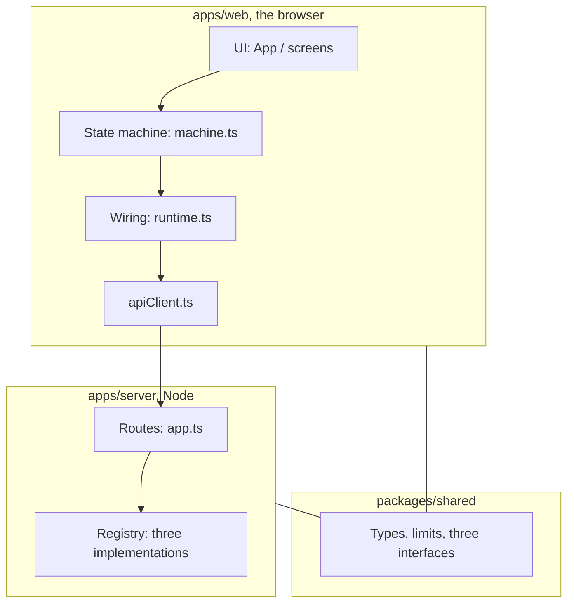

# 07 Module structure

Series: [01 System design](01-system-design.md) · [02 Developer guide](02-developer-guide.md) · [03 UI brief](03-ui-brief.md) · [04 Tab5 feasibility](04-tab5-feasibility.md) · [05 Code guide](05-code-guide.md) · [06 Research prompts](06-research-prompts.md) · **07 Module structure** · [08 How the modules fit](08-how-modules-fit.md)

The Chinese file is in [`docs/01-zh`](../01-zh/07-模块结构.md).

This page answers what each module does. How one turn threads them together is in [08 How the modules fit](08-how-modules-fit.md). The file-by-file list stays in [05 Code guide](05-code-guide.md).

The code below is shortened from the real files. Names and decisions match the code. Logging, timeouts, and edge cases are left out. Open the file named in each heading for the full version.

## 1. One map

The repository is three packages. The browser and Node share the types in `@kt/shared`.



- The **UI** displays and `send`s an event.
- The **state machine** chooses the next step. A model may only return "ask", "propose a meaning", or "unresolved".
- **Wiring** hands the recorder, the player, and HTTP into the machine.
- The **browser HTTP client** turns those three jobs into `fetch('/api/...')`.
- The **server** reads the preset header and calls mock, cloud, or local through the same interfaces.

## 2. Shared types: `packages/shared`

Both sides use one definition of a request. The limits live here too.

`packages/shared/src/types.ts`:

```ts
export const LIMITS = {
  segmentSeconds: 30,
  semanticClarifications: 3,
  correctionAttempts: 2,
  asrRetries: 2,
};
```

`packages/shared/src/contracts.ts` splits recognition, dialogue, and speech into three interfaces. All three presets implement this set, so the UI does not know whether the answer is fake, OpenAI, or this Mac.

```ts
type InterpretationResult =
  | { kind: 'ASK_CLARIFICATION'; questionZh: string }
  | { kind: 'PROPOSE_MEANING'; meaningZh: string }
  | { kind: 'UNRESOLVED'; reasonCode: string };

interface SpeechRecognizer {
  transcribe(audio, language, meta): Promise<string>;
}
interface DialogueModel {
  interpretChinese(input, meta): Promise<InterpretationResult>;
  translate(input, meta): Promise<string>;
}
interface SpeechSynthesizer {
  synthesize(text, language, meta): Promise<AudioData>;
}

type ProviderBundle = { asr: SpeechRecognizer; dialogue: DialogueModel; tts: SpeechSynthesizer };
```

`meta` carries `taskId` and `requestId`. A stale result is dropped with those two ids. The API key is not in this package.

## 3. Entry: `apps/web/src/main.tsx`

The address chooses the page. The child UI and the monitor do not load each other.

```ts
if (pathname is /monitor) {
  load MonitorApp;
} else {
  load App;
}
```

## 4. UI: `apps/web/src/ui/App.tsx` and `screens.tsx`

`App` starts the one state machine, then uses `screenOf` to pick a screen. Buttons hand the user's action back.

```tsx
const [snap, send] = useActor(dialogueMachine, { input: { preset } });
const screen = screenOf(snap);

if (feature === 'photo' || feature === 'library') {
  return <VocabularyShell />;   // cards, outside the state machine
}
return <current screen snap={snap} send={send} />;
```

A Home button in `screens.tsx` only sends an event:

```tsx
send({ type: 'START_TASK', direction: 'ZH_TO_SV' });
send({ type: 'FINISH_INPUT' });
send({ type: 'CONFIRM_YES' });
```

A screen component does not decide whether to ask a follow-up.

## 5. Screen names: `apps/web/src/dialogue/selectors.ts`

The machine has many small states. The UI knows eleven screen names.

```ts
function screenOf(s): Screen {
  if (s.matches('idle')) return 'home';
  if (s.matches({ task: 'recording' })) return 'recording';
  if (s.matches({ task: { clarifying: 'asking' } })) return 'clarify';
  if (s.matches({ task: { confirming: 'asking' } })) return 'confirm';
  if (s.matches({ task: 'result' })) return 'result';
  return 'busy';
}
```

While busy, the stage is one of `asr`, `interpret`, `translate`, `tts`.

## 6. State machine: `apps/web/src/dialogue/machine.ts`

This is the only place that decides the flow. After transcription, direction chooses the next stop. Swedish goes straight to translation. Chinese goes to interpretation.

```ts
transcribing: {
  invoke: { src: 'transcribe', input: { language: the speaker's language } },
  onDone: [
    { guard: result is stale, drop it },
    { guard: direction is SV_TO_ZH, target: '#translating' },
    { target: '#interpreting' },
  ],
}
```

After interpretation, the machine checks the count, then chooses a question or a confirmation. A fourth question is not shown.

```ts
interpreting.onDone: [
  { guard: result is stale, drop it },
  {
    guard: result is ASK_CLARIFICATION and clarificationCount < 3,
    target: '#clarifying',
    and add 1 to clarificationCount,
  },
  { guard: result is still ASK_CLARIFICATION, target: '#fallback' },
  { guard: result is PROPOSE_MEANING, target: '#confirming' },
]
```

Translation starts after confirmation Yes. No starts a correction, at most twice.

The machine calls outside work by the `invoke` name: `transcribe`, `interpret`, `translate`, `synthesize`. Wiring connects those names to real functions. The machine file itself does not call `fetch`.

## 7. Wiring: `apps/web/src/services/runtime.ts`

This file plugs the parts into the machine. A different microphone or a different HTTP client is a change here.

```ts
export const dialogueMachine = createDialogueMachine({
  providers,          // one HTTP bundle per preset
  recorder,           // scripted mic for mock, real mic otherwise
  audioStore,         // recordings for the current task, memory only
  speakPrompt,        // short lines such as "现在可以说啦"
  log,                // stage events, no transcript
});
```

When the preset is mock and the mic mode is `auto`, `RecorderFacade` picks `ScriptedRecorder`. Stop returns the sentence from the scenario script. Cloud and local always use the real microphone.

## 8. Browser-side interfaces: `apps/web/src/services/apiClient.ts`

This implements the three interfaces from section 2. Inside, they are `fetch`. Every request carries the preset and the two ids.

```ts
headers = {
  'X-Provider-Preset': preset,   // mock | cloud | local
  'X-Task-Id': meta.taskId,
  'X-Request-Id': meta.requestId,
};

asr.transcribe = (audio, language) =>
  POST `/api/asr?language=${language}`, body is the audio bytes;

dialogue.interpretChinese = (input) =>
  POST `/api/interpret`, body is JSON;

dialogue.translate = (input) =>
  POST `/api/translate`;

tts.synthesize = (text, language) =>
  POST `/api/tts`, returns audio bytes;
```

The browser has no API key. In development, Vite forwards `/api` to `127.0.0.1:8787`.

## 9. Sound: `apps/web/src/audio/`

- `recorder.ts`: the real microphone, and the scripted microphone used by mock.
- `audioStore.ts`: the segments of this turn. Cleared after recognition. A refresh drops the turn.
- `player.ts`: plays the speech returned by the server.
- `prompts.ts`: short lines the UI speaks itself, through the browser, not through the model.
- `session.ts`: on iPhone, alternates playback and recording so the next recording is not empty.

## 10. Vocabulary cards: `apps/web/src/vocabulary/`

Cards switch with `feature` in `App`. They do not use the machine's task or counters.

```ts
photo -> POST /api/vocabulary/identify
Chinese, Swedish, article, category come back
save into IndexedDB on this device
reading a card is still POST /api/tts
```

Saving the same photo again opens the existing card. A face, or a photo with no object, does not become a card. The household library is a separate sync. Its passphrase is not the monitor password.

## 11. Server routes: `apps/server/src/app.ts`

`context()` reads the headers and picks the implementation for this call. When `local` is unavailable, this function does not switch the call to cloud.

```ts
function context(req) {
  const preset = req.header('X-Provider-Preset') ?? 'mock';
  const provider = observed[preset];   // the bundle already wrapped for the monitor
  check taskId and requestId;
  return { provider, meta };
}

POST /api/asr       -> provider.bundle.asr.transcribe(...)
POST /api/interpret -> provider.bundle.dialogue.interpretChinese(...)
POST /api/translate -> provider.bundle.dialogue.translate(...)
POST /api/tts       -> provider.bundle.tts.synthesize(...)
```

The translation routes have no login. `/api/monitor/*`, export, and clear require a login first.

## 12. Three implementations: `apps/server/src/providers/`

`registry.ts` builds three bundles at startup. Each one has the `ProviderBundle` shape.

```ts
registry = {
  mock:  { bundle: fixed fake recognition, interpretation, translation, and a short clip },
  cloud: { bundle: OpenAI, marked unavailable when there is no key },
  local: { bundle: whisper.cpp + Ollama + macOS say },
};
```

- `mock/`: ignores the real audio and reads the script text carried on the request.
- `cloud/`: the key stays in the server `.env`. Speech defaults to the realtime path.
- `local/`: engine addresses must be `127.0.0.1`. A failure returns `LOCAL_*`.
- `dialogueParsing.ts`: JSON from both models goes through the same check. A bad shape is an error.

## 13. Monitor: `telemetry/` and `apps/web/src/monitor/`

`observe.ts` wraps every model call. Success, failure, and cancellation each write one row. The row holds the stage, duration, tokens, and cost. Recordings, recognized text, translations, and prompts stay out of that table.

The database defaults to `apps/server/data/telemetry.sqlite`. The page is `/monitor`. It polls every few seconds and stops while the page is hidden.

A card's photo and its two words live in another store, on the device. That store is separate from the monitor table.
