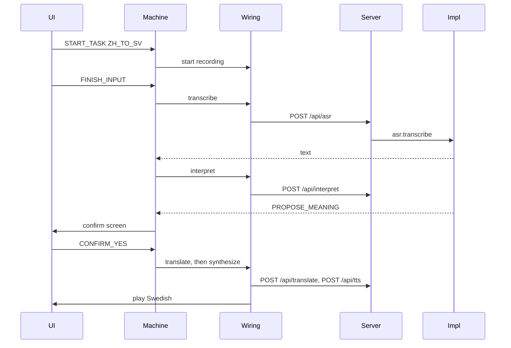

# 08 How the modules fit

Series: [01 System design](01-system-design.md) · [02 Developer guide](02-developer-guide.md) · [03 UI brief](03-ui-brief.md) · [04 Tab5 feasibility](04-tab5-feasibility.md) · [05 Code guide](05-code-guide.md) · [06 Research prompts](06-research-prompts.md) · [07 Module structure](07-module-structure.md) · **08 How the modules fit** · [09 Code walkthrough](09-code-walkthrough/00-start-here.md)

The Chinese file is in [`docs/01-zh`](../01-zh/08-模块怎么接在一起.md).

[07 Module structure](07-module-structure.md) says what each piece does. This page follows what they pass to each other. Paragraphs inside each source file, and the step-by-step feature pages, are in [09 Code walkthrough](09-code-walkthrough/00-start-here.md). Feature order is in [By feature](09-code-walkthrough/features/00-by-feature.md). The walkthrough below uses mock, Chinese to Swedish. Cloud or local keeps the same arrows. The selected implementation on the server is what changes.

## 1. What crosses a boundary

The modules do not share one large internal state. What they hand over is small.

- **Events.** The UI sends them to the machine, for example `START_TASK`, `FINISH_INPUT`, `CONFIRM_YES`.
- **A screen name.** `screenOf` turns a machine snapshot into the screen the UI draws.
- **An invoke name.** The machine says `transcribe` or `interpret`. Wiring connects that name to HTTP.
- **Headers.** `X-Provider-Preset`, `X-Task-Id`, `X-Request-Id`.
- **A short JSON body.** An interpretation is one of three kinds. A translation is one string. Recognition is `{ text }`.
- **Audio bytes.** One segment uploaded, or one speech clip downloaded. Cleared from memory when finished.

The monitor writes one extra row around these calls: time, status, and cost. That row does not contain the sentence.

## 2. One Chinese-to-Swedish turn



The same steps, as files:

1. `screens.tsx` sends `START_TASK`. `send` in `App.tsx` enters `machine.ts`. The state is recording, and `selectors.ts` turns that state into the screen name `recording`.
2. The recorder in `runtime.ts` starts. The mock scripted microphone returns the scenario sentence on stop and puts it in `audioStore.ts`.
3. The UI sends `FINISH_INPUT`. The machine enters `transcribing` and calls the wired `transcribe`.
4. `apiClient.ts` sends `POST /api/asr?language=zh`. The headers are this turn's preset and the two ids.
5. `context()` in `app.ts` uses `X-Provider-Preset` to take that bundle from the registry. Mock does not parse the audio. It returns the script text carried on the request. `observe.ts` writes one monitor row at the same time.
6. The result returns to the machine. The direction is Chinese to Swedish, so the machine enters `interpreting` and requests `POST /api/interpret`.
7. The model returns `PROPOSE_MEANING`. The machine enters confirmation, and the UI draws Yes / No. When the result is `ASK_CLARIFICATION` and the count is still under 3, the machine asks the question and returns to recording. After 3 unclear questions it enters the fallback and does not translate.
8. The UI sends `CONFIRM_YES`. Only then does the machine call `translate`, then `synthesize`. The player plays the returned audio. When the sound actually starts, `runtime.ts` records that wait.
9. The state becomes delivered. `selectors.ts` returns `result`. The UI can start another turn.

Every reply carries the original `requestId`. If the state has already moved on, `isStale` drops that reply.

## 3. Swedish to Chinese skips two steps

After transcription, the machine sees direction `SV_TO_ZH` and targets `#translating`.

There is no `POST /api/interpret` and no confirmation screen. The recognized Swedish, the Chinese translation, and the Chinese speech appear together on the result screen.

The joints stay the same: one machine, the same headers, and the same selection on the server.

## 4. Vocabulary cards go around the machine

When Home sets `feature` to `photo` or `library`, `App.tsx` draws `VocabularyShell` instead. The machine stays idle. Its counters do not move.

```text
Home
  ├─ Speak Chinese / Speak Swedish → machine → /api/asr|interpret|translate|tts
  └─ Photo vocabulary / My cards → VocabularyShell
        identify → /api/vocabulary/identify
        read aloud → still /api/tts
        save → IndexedDB on this device
```

Deleting a card writes the card store. A translation in progress does not read that store.

## 5. The monitor sits outside the call

The child UI gives stage events to `eventLogger.ts`, which batches them to `POST /api/events`. An extra content field is rejected by the schema.

Model calls are wrapped on the server by `observe.ts`. A call that reaches these three routes gets one row, whether it came from the page or from another client later.

```text
machine --stage events--> /api/events --> events table
machine --model calls--> /api/asr and the rest --> observe --> ai_requests
                                                         |
                                                         +--> /monitor reads them
```

`main.tsx` loads `/monitor` on its own. That page does not share the dialogue machine. The translation routes have no login. The monitor, export, and clear require a login.

## 6. What stays put when the preset changes

Switching from mock to cloud or local leaves these files as they are:

- `screens.tsx` still sends the same events.
- `machine.ts` still follows the same arrows.
- `apiClient.ts` still calls the same paths. The header `X-Provider-Preset` is what changes.

What changes is the `ProviderBundle` chosen in `app.ts`: fake data, OpenAI, or whisper, Ollama, and `say` on this Mac. The key stays inside the server process. The browser side does not see it.
