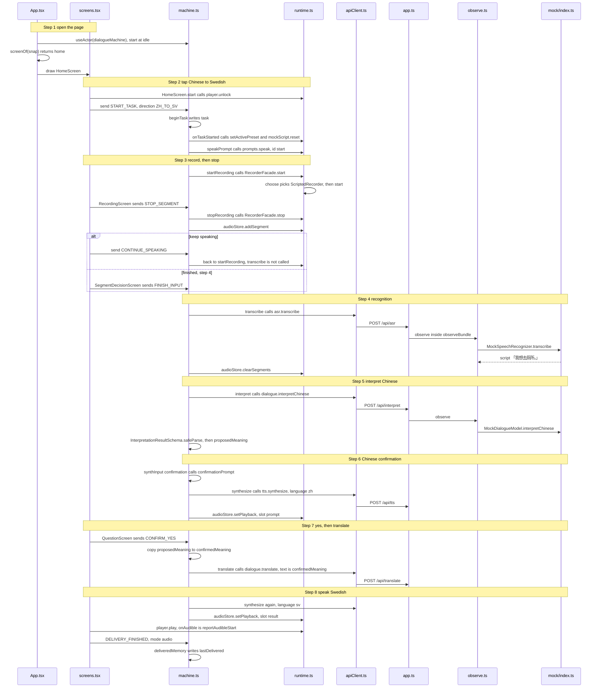

# Speak Chinese, hear Swedish

Example: on the home screen tap Chinese → Svenska. Under mock, stopping yields the script 「我想去厕所。」 The child taps Finished, then yes. Swedish is spoken.

Translation happens only after yes. The confirmation sentence is spoken in Chinese first. That reading is not the translation.

There is one state machine, in [machine.ts](../web/dialogue/machine.md). The screen only sends events. Recognition, interpretation, translation, and speech are wired in `runtime.ts` and `apiClient.ts`, then handled in `app.ts`. Paragraph notes for those files are in the [Chinese index](../../../01-zh/09-代码详解/00-从这里开始.md).

How to read this page: the two JSON snapshots, then the call sequence, then steps 1 to 8. The “step N” notes on the diagram are those sections.

## The machine at this moment

`value` is the stage. `context` is the stored fields. The ids are illustrative.

Before yes. A meaning has been proposed. There is no translation yet.

```json
{
  "value": { "task": { "confirming": "asking" } },
  "context": {
    "sessionId": "session-1",
    "preset": "mock",
    "task": {
      "id": "task-1",
      "direction": "ZH_TO_SV",
      "preset": "mock",
      "inputPurpose": "INITIAL",
      "segmentInfo": [{ "id": "seg-1", "durationMs": 1800, "purpose": "INITIAL" }],
      "pendingSegments": 0,
      "dialogueInputs": [{ "purpose": "INITIAL", "textParts": ["我想去厕所。"] }],
      "proposedMeaning": "我想去厕所。",
      "currentQuestion": null,
      "confirmedMeaning": null,
      "sourceText": null,
      "translatedText": null,
      "clarificationCount": 0,
      "correctionCount": 0,
      "asrRetryCount": 0,
      "startedAt": 0
    },
    "lastDelivered": null,
    "pendingDirection": null,
    "safeReturnState": null,
    "activeRequestId": "req-confirm",
    "error": null,
    "fallbackReason": null,
    "audioStatus": "ready",
    "segmentStartedAt": null
  }
}
```

After playback, back on the home screen. `task` is cleared. The previous sentence stays in `lastDelivered`.

```json
{
  "value": "idle",
  "context": {
    "sessionId": "session-1",
    "preset": "mock",
    "task": null,
    "lastDelivered": {
      "taskId": "task-1",
      "direction": "ZH_TO_SV",
      "source": "我想去厕所。",
      "translation": "Jag vill gå på toaletten."
    },
    "pendingDirection": null,
    "safeReturnState": null,
    "activeRequestId": null,
    "error": null,
    "fallbackReason": null,
    "audioStatus": "none",
    "segmentStartedAt": null
  }
}
```

## Who calls whom across the 8 steps

Time runs downward. A solid arrow is a call. A dashed arrow is a return. Names can be searched in the source. Tapping “keep speaking” returns to `startRecording` and does not call `transcribe`.



## Steps

1. The page is not `/monitor`. `main.tsx` loads `App` and `styles.css`. `useActor` starts the machine at `idle`. `screenOf` turns that into `home`.
2. `start('ZH_TO_SV')` unlocks the player, then sends `START_TASK`. `beginTask` copies the preset into this turn. `speakPrompt` plays the start prompt. `SKIP_PROMPT` can skip it.
3. `startRecording` runs. Mock with automatic mic uses `ScriptedRecorder`. A segment lasts at most `LIMITS.segmentSeconds` (30). `STOP_SEGMENT` stores the segment and enters `segmentDecision`.
4. `FINISH_INPUT` enters `transcribing`. `POST /api/asr?language=zh` carries `X-Provider-Preset`, `X-Task-Id`, and `X-Request-Id`. Mock returns the script. The segments are then cleared.
5. Direction `ZH_TO_SV` enters `interpreting`. `POST /api/interpret` includes the remaining clarifications, `3 - clarificationCount`. 「我想去厕所。」 usually returns `PROPOSE_MEANING` into `proposedMeaning`. No Swedish yet.
6. `confirming` synthesizes 「你是说：我想去厕所，对吗？」 via `POST /api/tts`, then shows yes and no. A failed clip still shows the words.
7. `CONFIRM_YES` copies `proposedMeaning` to `confirmedMeaning` and calls `translate` with that text only. The screen says translating.
8. `result` synthesizes the Swedish line, `player.play` starts, and `DELIVERY_FINISHED` with mode `audio` writes `lastDelivered`. `NEW_TURN` returns home. Another tap of the same direction sends a new `START_TASK`.

Previous: [By feature](00-by-feature.md) · Next: [Chinese was not clear](02-chinese-was-not-clear.md)
