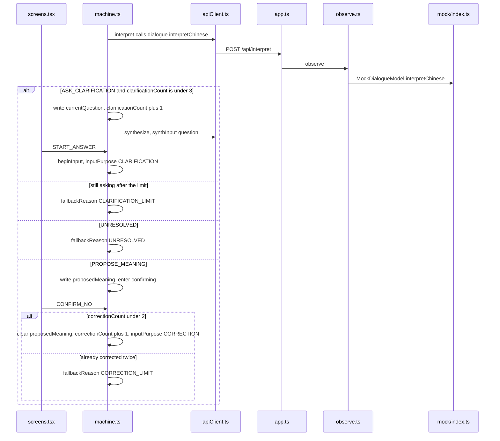

# Chinese was not clear

The first half matches [Speak Chinese, hear Swedish](01-speak-chinese-hear-swedish.md): record, tap Finished, recognize, then interpret. The fork is the return from `POST /api/interpret`, and the child tapping no on the confirmation screen.

Example: the child says 「他拿走了我的那个。」

How to read this page: the two JSON snapshots, then the call sequence, then the two sections below.

## The machine at this moment

The interpretation asks one question. The count is 1. No meaning has been proposed yet.

```json
{
  "value": { "task": { "clarifying": "asking" } },
  "context": {
    "sessionId": "session-1",
    "preset": "mock",
    "task": {
      "id": "task-2",
      "direction": "ZH_TO_SV",
      "preset": "mock",
      "inputPurpose": "INITIAL",
      "segmentInfo": [{ "id": "seg-1", "durationMs": 2200, "purpose": "INITIAL" }],
      "pendingSegments": 0,
      "dialogueInputs": [{ "purpose": "INITIAL", "textParts": ["他拿走了我的那个。"] }],
      "proposedMeaning": null,
      "currentQuestion": "你说的“那个”，是指什么呢？",
      "confirmedMeaning": null,
      "sourceText": null,
      "translatedText": null,
      "clarificationCount": 1,
      "correctionCount": 0,
      "asrRetryCount": 0,
      "startedAt": 0
    },
    "lastDelivered": null,
    "pendingDirection": null,
    "safeReturnState": null,
    "activeRequestId": "req-question",
    "error": null,
    "fallbackReason": null,
    "audioStatus": "ready",
    "segmentStartedAt": null
  }
}
```

If the confirmation screen receives no, and fewer than 2 corrections have been used, the proposed meaning is cleared and recording starts again with `inputPurpose` `CORRECTION`.

```json
{
  "value": { "task": { "recording": "prompting" } },
  "context": {
    "sessionId": "session-1",
    "preset": "mock",
    "task": {
      "id": "task-1",
      "direction": "ZH_TO_SV",
      "preset": "mock",
      "inputPurpose": "CORRECTION",
      "segmentInfo": [{ "id": "seg-1", "durationMs": 1800, "purpose": "INITIAL" }],
      "pendingSegments": 0,
      "dialogueInputs": [{ "purpose": "INITIAL", "textParts": ["我想去厕所。"] }],
      "proposedMeaning": null,
      "currentQuestion": null,
      "confirmedMeaning": null,
      "sourceText": null,
      "translatedText": null,
      "clarificationCount": 0,
      "correctionCount": 1,
      "asrRetryCount": 0,
      "startedAt": 0
    },
    "lastDelivered": null,
    "pendingDirection": null,
    "safeReturnState": null,
    "activeRequestId": null,
    "error": null,
    "fallbackReason": null,
    "audioStatus": "none",
    "segmentStartedAt": null
  }
}
```

## Who calls whom



`translate` is not called before yes. A fourth question does not appear. The server also folds “ask again” into unresolved when no clarifications remain, in `dialogueParsing.ts`.

Previous: [Speak Chinese, hear Swedish](01-speak-chinese-hear-swedish.md) · Next: [Speak Swedish, hear Chinese](03-speak-swedish-hear-chinese.md)
