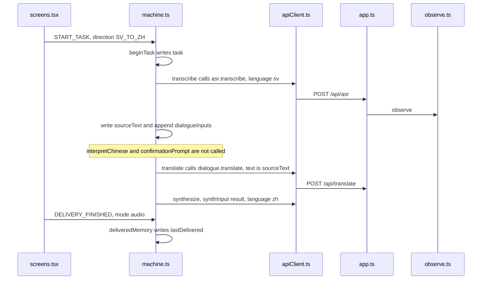

# Speak Swedish, hear Chinese

Example: on the home screen tap Svenska → 中文, say one Swedish sentence, tap Finished. Chinese text appears and is spoken. There is no 「你是说……，对吗？」

How to read this page: the JSON, then the call sequence, then the two sections.

## The machine at this moment

Recognition has succeeded and the translation is stored. Chinese speech is about to play. There is no `proposedMeaning` and no `confirmedMeaning`. The mock script is 「Lägg boken på bordet.」 The translation is 「把书放在桌子上。」

```json
{
  "value": { "task": { "result": "pending" } },
  "context": {
    "sessionId": "session-1",
    "preset": "mock",
    "task": {
      "id": "task-sv",
      "direction": "SV_TO_ZH",
      "preset": "mock",
      "inputPurpose": "INITIAL",
      "segmentInfo": [{ "id": "seg-1", "durationMs": 2000, "purpose": "INITIAL" }],
      "pendingSegments": 0,
      "dialogueInputs": [{ "purpose": "INITIAL", "textParts": ["Lägg boken på bordet."] }],
      "proposedMeaning": null,
      "currentQuestion": null,
      "confirmedMeaning": null,
      "sourceText": "Lägg boken på bordet.",
      "translatedText": "把书放在桌子上。",
      "clarificationCount": 0,
      "correctionCount": 0,
      "asrRetryCount": 0,
      "startedAt": 0
    },
    "lastDelivered": null,
    "pendingDirection": null,
    "safeReturnState": null,
    "activeRequestId": "req-tts",
    "error": null,
    "fallbackReason": null,
    "audioStatus": "ready",
    "segmentStartedAt": null
  }
}
```

## Who calls whom

Recording and stopping match steps 2 and 3 of the Chinese path. After recognition the machine calls `translate` directly because the direction is `SV_TO_ZH`.



The result screen, the player, and `lastDelivered` match step 8 of the Chinese path.

Previous: [Chinese was not clear](02-chinese-was-not-clear.md) · Next: [Switch direction in the middle](04-switch-direction-mid-turn.md)
