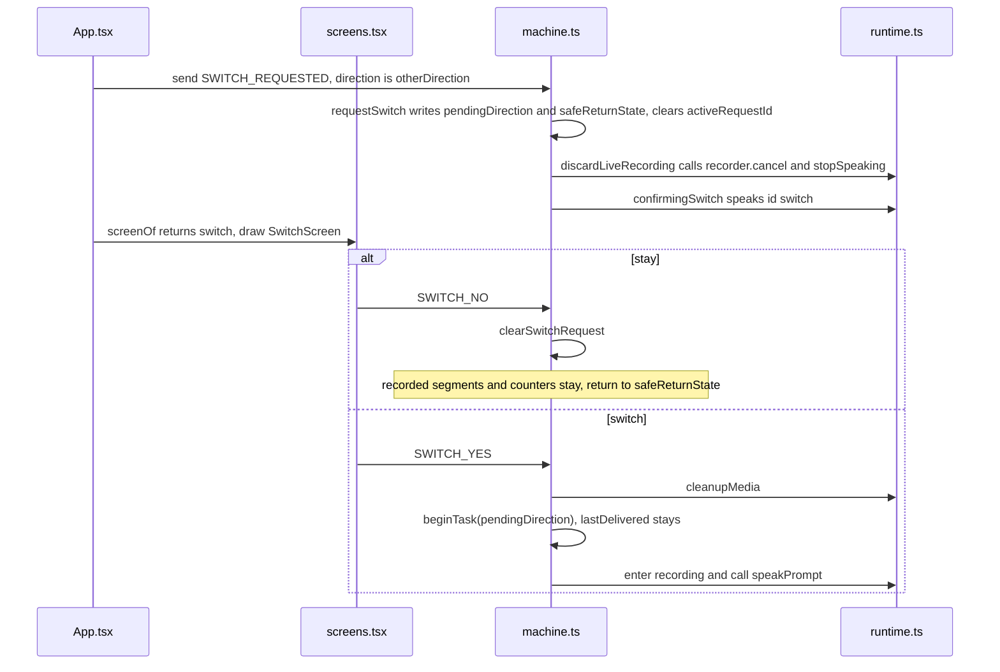

# Switch direction in the middle

Example: a Chinese-to-Swedish turn has already stopped once. The child taps the other language in the top bar. The page asks before giving up the turn.

How to read this page: the JSON, then the call sequence, then the two steps.

## The machine at this moment

The stage has left `task` and is `confirmingSwitch`. The old turn is still in `task`. `pendingDirection` is the direction being requested. `safeReturnState` is where “stay” returns.

```json
{
  "value": "confirmingSwitch",
  "context": {
    "sessionId": "session-1",
    "preset": "mock",
    "task": {
      "id": "task-1",
      "direction": "ZH_TO_SV",
      "preset": "mock",
      "inputPurpose": "INITIAL",
      "segmentInfo": [{ "id": "seg-1", "durationMs": 1800, "purpose": "INITIAL" }],
      "pendingSegments": 1,
      "dialogueInputs": [],
      "proposedMeaning": null,
      "currentQuestion": null,
      "confirmedMeaning": null,
      "sourceText": null,
      "translatedText": null,
      "clarificationCount": 0,
      "correctionCount": 0,
      "asrRetryCount": 0,
      "startedAt": 0
    },
    "lastDelivered": null,
    "pendingDirection": "SV_TO_ZH",
    "safeReturnState": "segmentDecision",
    "activeRequestId": null,
    "error": null,
    "fallbackReason": null,
    "audioStatus": "none",
    "segmentStartedAt": null
  }
}
```

## Who calls whom



Meaning confirmation uses `CONFIRM_YES` and `CONFIRM_NO`. A direction change uses `SWITCH_YES` and `SWITCH_NO`. When the stage is already `delivered`, `SWITCH_REQUESTED` calls `beginTask` directly and does not ask.

If `SWITCH_NO` would return to `recording` while `pendingSegments` is still 0, recording starts again instead. There is no segment to decide on.

Previous: [Speak Swedish, hear Chinese](03-speak-swedish-hear-chinese.md) · Next: [Not heard, an error, or the limit](05-not-heard-error-or-limit.md)
