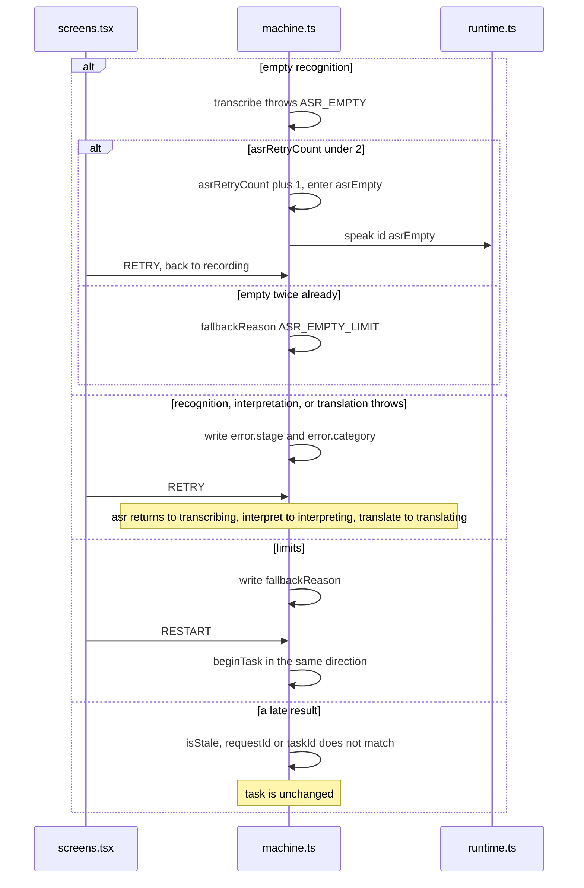

# Not heard, an error, or the limit

These three screens all come from the machine. `screenOf` names them `asrEmpty`, `error`, and `fallback`.

How to read this page: the three JSON snapshots, then the call sequence, then the sections. None of the three has a translation yet.

## The machine at this moment

Recognition was empty, and the retry count is still under the limit. The transcript was not written into `dialogueInputs`.

```json
{
  "value": { "task": "asrEmpty" },
  "context": {
    "sessionId": "session-1",
    "preset": "mock",
    "task": {
      "id": "task-1",
      "direction": "ZH_TO_SV",
      "preset": "mock",
      "inputPurpose": "INITIAL",
      "segmentInfo": [{ "id": "seg-1", "durationMs": 900, "purpose": "INITIAL" }],
      "pendingSegments": 0,
      "dialogueInputs": [],
      "proposedMeaning": null,
      "currentQuestion": null,
      "confirmedMeaning": null,
      "sourceText": null,
      "translatedText": null,
      "clarificationCount": 0,
      "correctionCount": 0,
      "asrRetryCount": 1,
      "startedAt": 0
    },
    "lastDelivered": null,
    "pendingDirection": null,
    "safeReturnState": null,
    "activeRequestId": "req-asr",
    "error": null,
    "fallbackReason": null,
    "audioStatus": "none",
    "segmentStartedAt": null
  }
}
```

Recognition timed out and can be retried. The failure is in `error`, not in `fallbackReason`.

```json
{
  "value": { "task": "recoverableError" },
  "context": {
    "sessionId": "session-1",
    "preset": "mock",
    "task": {
      "id": "task-1",
      "direction": "ZH_TO_SV",
      "preset": "mock",
      "inputPurpose": "INITIAL",
      "segmentInfo": [{ "id": "seg-1", "durationMs": 1800, "purpose": "INITIAL" }],
      "pendingSegments": 1,
      "dialogueInputs": [],
      "proposedMeaning": null,
      "currentQuestion": null,
      "confirmedMeaning": null,
      "sourceText": null,
      "translatedText": null,
      "clarificationCount": 0,
      "correctionCount": 0,
      "asrRetryCount": 0,
      "startedAt": 0
    },
    "lastDelivered": null,
    "pendingDirection": null,
    "safeReturnState": null,
    "activeRequestId": "req-asr",
    "error": { "stage": "asr", "category": "TIMEOUT" },
    "fallbackReason": null,
    "audioStatus": "none",
    "segmentStartedAt": null
  }
}
```

Three clarifications have already been asked and the model still wants another. `fallbackReason` is `CLARIFICATION_LIMIT`.

```json
{
  "value": { "task": "fallback" },
  "context": {
    "sessionId": "session-1",
    "preset": "mock",
    "task": {
      "id": "task-2",
      "direction": "ZH_TO_SV",
      "preset": "mock",
      "inputPurpose": "CLARIFICATION",
      "segmentInfo": [],
      "pendingSegments": 0,
      "dialogueInputs": [{ "purpose": "INITIAL", "textParts": ["他拿走了我的那个。"] }],
      "proposedMeaning": null,
      "currentQuestion": "最后再问一次，是指什么呢？",
      "confirmedMeaning": null,
      "sourceText": null,
      "translatedText": null,
      "clarificationCount": 3,
      "correctionCount": 0,
      "asrRetryCount": 0,
      "startedAt": 0
    },
    "lastDelivered": null,
    "pendingDirection": null,
    "safeReturnState": null,
    "activeRequestId": "req-interpret",
    "error": null,
    "fallbackReason": "CLARIFICATION_LIMIT",
    "audioStatus": "none",
    "segmentStartedAt": null
  }
}
```

## Who calls whom



A failed reading of the result does not enter `recoverableError`. The stage becomes `ttsFailed`, `translatedText` stays, and `DELIVERY_FINISHED` with mode `text_only` still writes `lastDelivered`.

Previous: [Switch direction in the middle](04-switch-direction-mid-turn.md) · Next: [Photograph an object into a card](06-photo-into-a-card.md)
