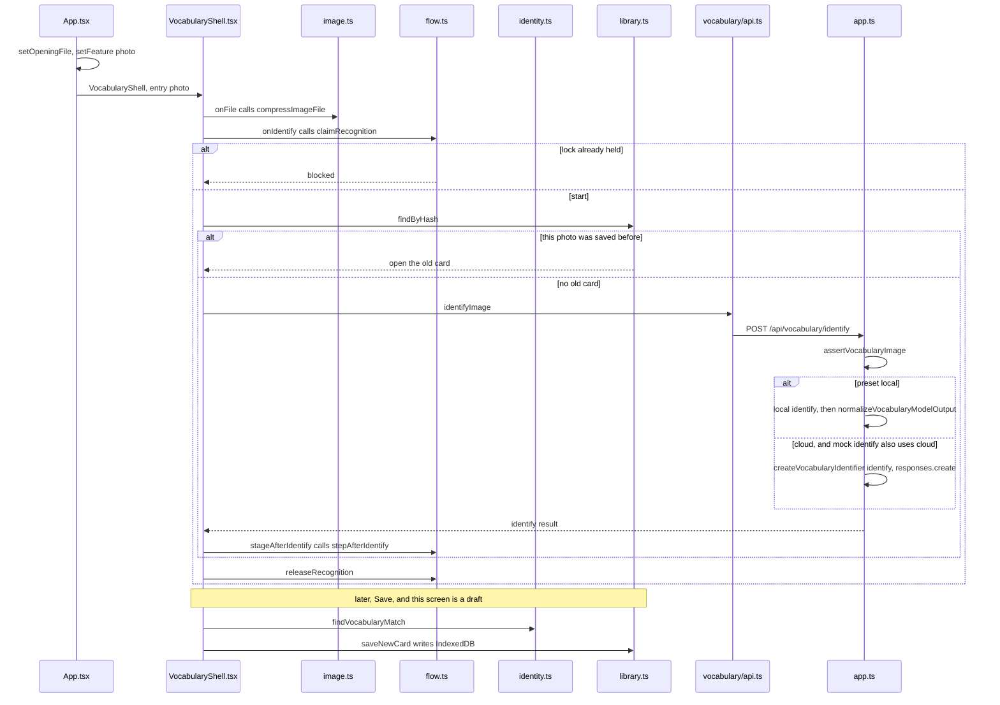

# Photograph an object into a card

Example: on the home screen tap the camera, photograph a cup, tap recognize, see 「杯子 / en kopp」, tap save.

This path does not enter the dialogue machine. The machine stays on the home screen. `App` uses its own `feature` to draw the cards.

How to read this page: the machine JSON, which stays idle, then the card `stage`, then the call sequence, then the four steps.

## The machine at this moment

Taking the photo, recognizing it, and saving it do not change `snap.context.task`.

```json
{
  "value": "idle",
  "context": {
    "sessionId": "session-1",
    "preset": "mock",
    "task": null,
    "lastDelivered": null,
    "pendingDirection": null,
    "safeReturnState": null,
    "activeRequestId": null,
    "error": null,
    "fallbackReason": null,
    "audioStatus": "none",
    "segmentStartedAt": null
  }
}
```

The cup lives in `VocabularyShell`'s `stage`. This is the draft before save. The photo bytes are not listed. The category `home` is illustrative.

```json
{
  "feature": "photo",
  "stage": {
    "name": "draft",
    "cardId": "card-1",
    "draft": {
      "zh": "杯子",
      "sv": "kopp",
      "article": "en",
      "translationUncertain": false,
      "category": "home"
    },
    "banner": null
  }
}
```

## Who calls whom



`stepAfterIdentify` blocks `person` and `none`. `uncertain` opens an empty draft. `multiple` opens a choice. One candidate opens a draft with both words. Saving requires Chinese and Swedish, then checks for the same word before `saveNewCard`.

Previous: [Not heard, an error, or the limit](05-not-heard-error-or-limit.md) · Next: [Open a card and hear the word](07-open-a-card-and-speak-it.md)
