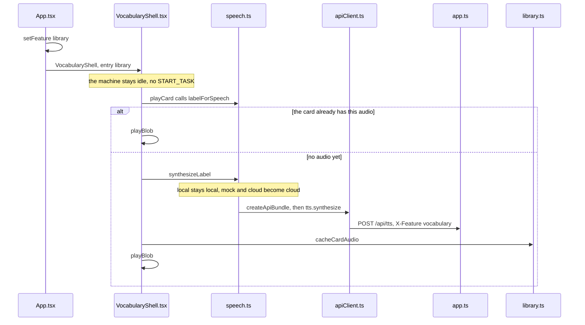

# Open a card and hear the word

Example: on the home screen tap My cards, open the cup, tap the Swedish speaker.

How to read this page: the machine JSON, then this card screen, then the call sequence, then the two steps.

## The machine at this moment

Opening a card and tapping the speaker do not send `START_TASK`. The machine stays on the home screen.

```json
{
  "value": "idle",
  "context": {
    "sessionId": "session-1",
    "preset": "mock",
    "task": null,
    "lastDelivered": null,
    "pendingDirection": null,
    "safeReturnState": null,
    "activeRequestId": null,
    "error": null,
    "fallbackReason": null,
    "audioStatus": "none",
    "segmentStartedAt": null
  }
}
```

This screen is `VocabularyShell`. Swedish is spoken as the article plus the word, `en kopp`. While the card has no Swedish audio yet, `svAudio` is null. After the tap it is written back.

```json
{
  "feature": "library",
  "stage": {
    "name": "card",
    "card": {
      "id": "card-1",
      "zh": "杯子",
      "sv": "kopp",
      "article": "en",
      "svAudio": null
    }
  }
}
```

## Who calls whom



`playDraft` on the draft screen also calls `synthesizeLabel`. That audio stays in the screen's `clips` until `saveNewCard`.

Previous: [Photograph an object into a card](06-photo-into-a-card.md) · Next: [How this turn shows up in the monitor](08-how-this-turn-shows-in-the-monitor.md)
