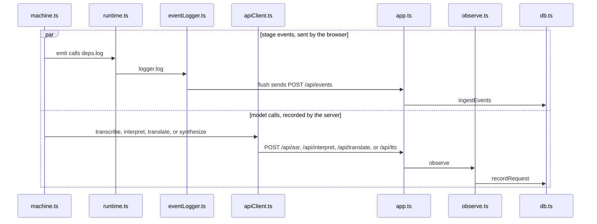

# How this turn shows up in the monitor

Example: after 「我想去厕所。」 open `/monitor`. The requests page shows one row each for recognition, interpretation, translation, and speech. Each row has timing and a cost basis. It does not have the Chinese sentence or the Swedish translation.

The monitor does not choose the next step. The child's machine still follows the earlier pages.

How to read this page: the JSON left on the phone, then one monitor row, then the two record paths, then opening the monitor.

## The machine at this moment

The sentence has been delivered and the page is home again. The words are in `lastDelivered` on the phone.

```json
{
  "value": "idle",
  "context": {
    "sessionId": "session-1",
    "preset": "mock",
    "task": null,
    "lastDelivered": {
      "taskId": "task-1",
      "direction": "ZH_TO_SV",
      "source": "我想去厕所。",
      "translation": "Jag vill gå på toaletten."
    },
    "pendingDirection": null,
    "safeReturnState": null,
    "activeRequestId": null,
    "error": null,
    "fallbackReason": null,
    "audioStatus": "none",
    "segmentStartedAt": null
  }
}
```

A monitor request row has no `source` and no `translation`. The recognition row keeps the stage, the duration, and the cost basis. The numbers are illustrative. `stage` uses the uppercase name stored in the row.

```json
{
  "taskId": "task-1",
  "sessionId": "session-1",
  "preset": "mock",
  "stage": "ASR",
  "direction": "ZH_TO_SV",
  "feature": "translate",
  "language": null,
  "durationMs": 12,
  "status": "succeeded",
  "costUsd": null
}
```

## Two records



Opening the monitor is a separate entry. `main.tsx` loads `MonitorApp` when the path is `/monitor`. `monitorApi.session` calls `GET /api/monitor/session`. Login calls `auth.lockedFor`, then `verifyPassword`, then `createSession`. Request and task tabs call `listRequests`, `listTasks`, or `getTaskDetail`.

Translation itself does not ask for this password.

Previous: [Open a card and hear the word](07-open-a-card-and-speak-it.md) · Next: [Switch to cloud or local](09-switch-to-cloud-or-local.md)
