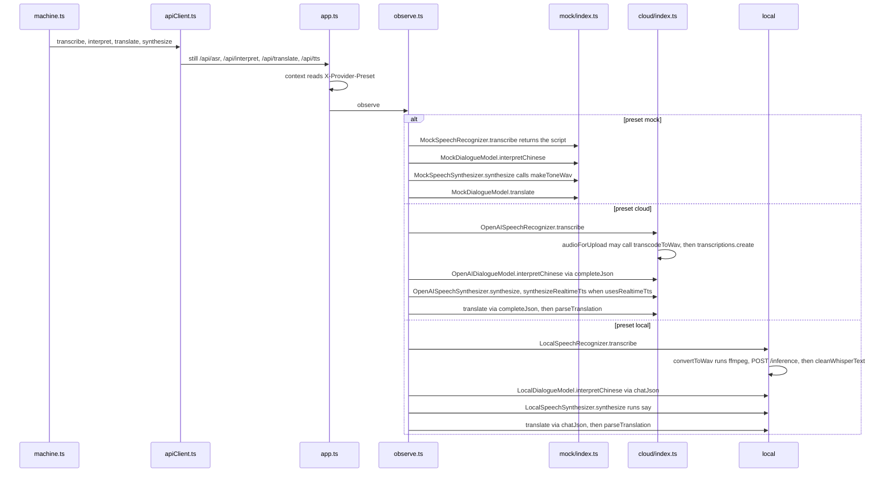

# Switch to cloud or local

Example: the same sentence 「我想去厕所。」, first finished under mock, then again with the preset set to local. The child still taps Chinese → Svenska, Finished, and yes. The screen order does not change.

How to read this page: the JSON, which has the same shape as the Chinese path before yes, with `preset` changed. Then the call sequence, where the server functions change. Then the three sections.

## The machine at this moment

When the turn starts, `preset` is copied into `task.preset`. This is local, on the confirmation screen, before yes. The shape matches the mock turn. The proposed meaning here reuses 「我想去厕所。」 as an illustration. A local model returns whatever that call actually produced.

```json
{
  "value": { "task": { "confirming": "asking" } },
  "context": {
    "sessionId": "session-1",
    "preset": "local",
    "task": {
      "id": "task-local",
      "direction": "ZH_TO_SV",
      "preset": "local",
      "inputPurpose": "INITIAL",
      "segmentInfo": [{ "id": "seg-1", "durationMs": 1800, "purpose": "INITIAL" }],
      "pendingSegments": 0,
      "dialogueInputs": [{ "purpose": "INITIAL", "textParts": ["我想去厕所。"] }],
      "proposedMeaning": "我想去厕所。",
      "currentQuestion": null,
      "confirmedMeaning": null,
      "sourceText": null,
      "translatedText": null,
      "clarificationCount": 0,
      "correctionCount": 0,
      "asrRetryCount": 0,
      "startedAt": 0
    },
    "lastDelivered": null,
    "pendingDirection": null,
    "safeReturnState": null,
    "activeRequestId": "req-confirm",
    "error": null,
    "fallbackReason": null,
    "audioStatus": "ready",
    "segmentStartedAt": null
  }
}
```

The machine still calls `transcribe`, `interpret`, `translate`, and `synthesize`. `context()` in `app.ts` reads `X-Provider-Preset` and `observe` wraps that bundle.



If a local engine is not running, that call fails. The preset is not changed to cloud. The screen files, the event names, and “confirm before translate” stay as they are.

Previous: [How this turn shows up in the monitor](08-how-this-turn-shows-in-the-monitor.md) · Next: [Back to the index](00-by-feature.md)
