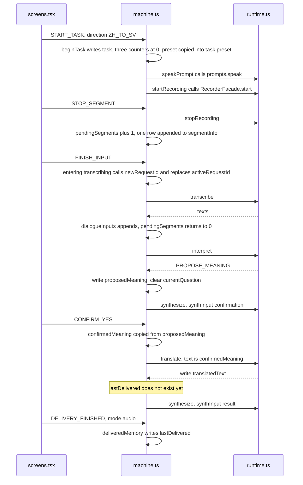
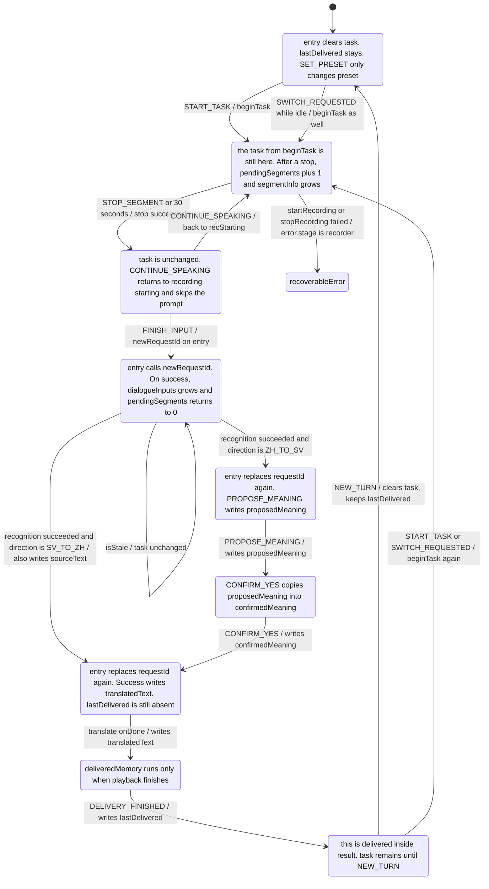
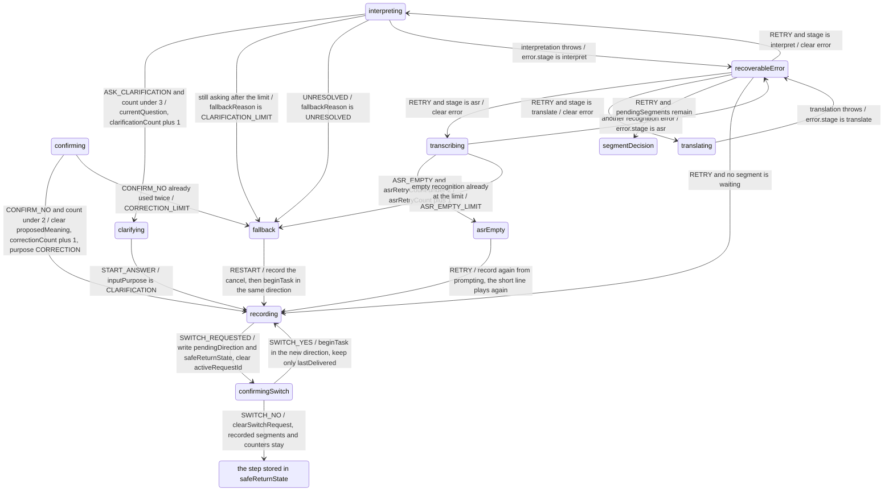

# `apps/web/src/dialogue/machine.ts`

Source: [machine.ts](../../../../../apps/web/src/dialogue/machine.ts)

This is the only file that decides what happens next. The screen only sends events. A model returns one of three interpretation results. Counts, confirmation, and a direction change all live here.

The example throughout is the child wanting to say 「我想去厕所。」 The direction is Chinese to Swedish.

## How to read this page

Read in this order. Section 1 is the JSON that `App.tsx` keeps. Section 2 is who calls whom for 「我想去厕所。」 Section 3 is which event changes which fields. From section 4 onward, each stage is matched to the source, in the same order as the main path. Branches sit after the stage they leave.

## 1. What this record looks like

The fields for one turn live in `MachineContext`. The type is in [types.ts](../../../../01-zh/09-代码详解/web/dialogue/types.md). The functions that write them are `assign`: `beginTask`, `newRequestId`, `deliveredMemory`, and `patchTask` inside each stage's `onDone`. Audio bytes stay in `audioStore` and never enter this record.

`useActor` in `App.tsx` holds one `snap` for as long as the page is open. It is the JSON below. `value` is the current stage. `context` is the stored fields. The three snapshots are three moments of the same machine. The ids are illustrative.

Just opened. There is no turn yet. `task` is `null`.

```json
{
  "value": "idle",
  "context": {
    "sessionId": "session-1",
    "preset": "mock",
    "task": null,
    "lastDelivered": null,
    "pendingDirection": null,
    "safeReturnState": null,
    "activeRequestId": null,
    "error": null,
    "fallbackReason": null,
    "audioStatus": "none",
    "segmentStartedAt": null
  }
}
```

「我想去厕所。」 has been recognized and a meaning has been proposed. The confirmation screen has not received yes. There is no translation yet. The three layers inside `value` are the stage: inside a task, confirming, waiting for the tap.

```json
{
  "value": { "task": { "confirming": "asking" } },
  "context": {
    "sessionId": "session-1",
    "preset": "mock",
    "task": {
      "id": "task-1",
      "direction": "ZH_TO_SV",
      "preset": "mock",
      "inputPurpose": "INITIAL",
      "segmentInfo": [{ "id": "seg-1", "durationMs": 1800, "purpose": "INITIAL" }],
      "pendingSegments": 0,
      "dialogueInputs": [{ "purpose": "INITIAL", "textParts": ["我想去厕所。"] }],
      "proposedMeaning": "我想去厕所。",
      "currentQuestion": null,
      "confirmedMeaning": null,
      "sourceText": null,
      "translatedText": null,
      "clarificationCount": 0,
      "correctionCount": 0,
      "asrRetryCount": 0,
      "startedAt": 0
    },
    "lastDelivered": null,
    "pendingDirection": null,
    "safeReturnState": null,
    "activeRequestId": "req-confirm",
    "error": null,
    "fallbackReason": null,
    "audioStatus": "ready",
    "segmentStartedAt": null
  }
}
```

After playback, back on the home screen, `task` is `null` again and the stage is `idle`. The previous sentence stays in `lastDelivered`. For Chinese to Swedish, `source` is the `confirmedMeaning` that was accepted, and `translation` is the Swedish line.

```json
{
  "value": "idle",
  "context": {
    "sessionId": "session-1",
    "preset": "mock",
    "task": null,
    "lastDelivered": {
      "taskId": "task-1",
      "direction": "ZH_TO_SV",
      "source": "我想去厕所。",
      "translation": "Jag vill gå på toaletten."
    },
    "pendingDirection": null,
    "safeReturnState": null,
    "activeRequestId": null,
    "error": null,
    "fallbackReason": null,
    "audioStatus": "none",
    "segmentStartedAt": null
  }
}
```

## 2. Who calls whom on this turn

The sequence diagram is time. Down the page is the turn where the child taps yes for 「我想去厕所。」 A solid arrow is a call. The names in the boxes can be searched in the source. The screen sends an event. The machine updates context, then calls `speakPrompt`, `startRecording`, `stopRecording`, `transcribe`, `interpret`, `translate`, and `synthesize`. Those names are written in `actors` and pointed at by `src`, and then they call [runtime.ts](../../../../01-zh/09-代码详解/web/services/runtime.md). The full HTTP chain is in [Speak Chinese, hear Swedish](../../features/01-speak-chinese-hear-swedish.md).



## 3. Which event changes which fields

The state diagram is the stage. Text inside a box is the context that stage writes or still holds. An arrow reads as `event / where it goes`. The part before the slash is the event that causes the change, or the return of one of the calls above. The box the arrow points at is the result. When `isStale` does not match, the machine stays put and does not change `task`. The first diagram is the main path. The second is the branches.





`CANCEL` during a task returns to `idle` and does not write `lastDelivered`. `segmentDecision`, `transcribing`, `interpreting`, `clarifying`, `confirming`, `translating`, `result`, `asrEmpty`, `recoverableError`, and `fallback` all enter `confirmingSwitch` on `SWITCH_REQUESTED`, the same way recording does. `safeReturnState` stores the step being left. On `SWITCH_NO`, if that step is `recording` and `pendingSegments` is still 0, there is no segment to decide on, so `startRecording` runs again.

## 4. Each stage against the source

### Top of the file: dependencies and a stale result

`createDialogueMachine(deps)` receives the parts passed in from outside: the recorder, the audio store, playback, HTTP, and logging. The machine itself does not `fetch`.

`isStale` compares `taskId` and `requestId` on the returned result with the current task. A mismatch is dropped.

Example: the child already cancelled, and the recognition result comes back later. `requestId` has already changed. That result cannot pull the screen back.

```text
isStale(context, out): drop it, and do not change the screen, when out.requestId !== activeRequestId or out.taskId !== task.id

beginTask(ctx, direction) {
  task.preset = ctx.preset, and this turn does not change it again
  clarificationCount, correctionCount, and asrRetryCount all start at 0
  proposedMeaning = null, confirmedMeaning = null
}
```

### `idle`: waiting, which is the home screen

Waiting for `START_TASK`. The event carries the direction.

On entry, the preset is copied into `task.preset`. This turn cannot change it. Counters start at 0. `SET_PRESET` is accepted only while idle. A preset change during a task is ignored. A direction change while idle is not asked about. It starts that direction.

```text
idle {
  START_TASK → #recording, and beginTask(direction)
  SWITCH_REQUESTED → #recording, beginTask as well, no extra question
  SET_PRESET → change only preset, stay on the home screen
}
```

### `recording`: recording

The short line 「请说吧」 plays first, then the microphone opens. One segment lasts at most 30 seconds. The number is `LIMITS.segmentSeconds`.

The child can:

- `STOP_SEGMENT`: tap stop.
- `SEGMENT_TIMEOUT`: 30 seconds elapsed, and only this segment ends.
- `SKIP_PROMPT`: skip the short line while it is still playing.

Silence does not end the segment. After a stop the stage is `segmentDecision`.

Under mock, the recorder hands the machine a script for the scenario, not a real waveform. The machine does not care where the sound came from. It only receives one segment.

```text
recording, starting at prompting {
  speakPrompt plays 「请说吧」
  onDone, SKIP_PROMPT, or onError → starting, then startRecording
  startRecording failed → #recoverableError
  STOP_SEGMENT or segmentTimeout while listening → finalizing
  stopRecording succeeded → #segmentDecision
}
```

### `segmentDecision`: keep speaking, or finished

Two events:

- `CONTINUE_SPEAKING`: record another segment, still the same task.
- `FINISH_INPUT`: send the segments already recorded to recognition.

Example: 「老师……」「他把我的……」「水壶拿走了。」 is three segments, one `FINISH_INPUT`, one translation.

```text
segmentDecision {
  CONTINUE_SPEAKING → #recStarting, record another segment
  FINISH_INPUT → #transcribing, go recognize
}
```

### `transcribing`: recognize in order

Calls the wired `transcribe`. After success, the direction decides:

- `SV_TO_ZH`: go to `translating`. There is no interpretation and no confirmation.
- Otherwise, Chinese to Swedish: go to `interpreting`.

Empty recognition, and `asrRetryCount < 2`: go to `asrEmpty` and ask again. Already at 2: go to `fallback` and stop guessing.

After recognition, this turn's segments are cleared from `audioStore`. An empty recognition is `onError` with category `ASR_EMPTY`. It is not a successful empty string.

```text
transcribing, src is transcribe {
  onDone, in order {
    isStale → drop
    direction === 'SV_TO_ZH' → #translating
    otherwise → #interpreting
  }
  onError, in order {
    ASR_EMPTY and asrRetryCount < LIMITS.asrRetries → #asrEmpty
    still ASR_EMPTY → #fallback
    otherwise → #recoverableError
  }
}
```

### `interpreting`: interpret Chinese

Calls `interpret`. The model receives the lines already recognized, and how many clarifications remain: `3 - clarificationCount`.

After the return:

- `ASK_CLARIFICATION` and the count is still under 3: go to `clarifying`, and add 1.
- Still `ASK_CLARIFICATION`: there is no quota left, so go to `fallback`.
- `PROPOSE_MEANING`: store the proposed Chinese meaning and go to `confirming`.
- `UNRESOLVED`: go to `fallback`.

Example: 「我想去厕所。」 usually returns a proposed meaning immediately. The count stays 0.

Example: 「他拿走了我的那个。」 may return one short question. The screen shows only that question. A fourth question does not appear, because the count of 3 already takes the fallback.

```text
interpreting, src is interpret {
  remainingClarifications = LIMITS.semanticClarifications - clarificationCount
  onDone, in order {
    isStale → drop
    kind === 'ASK_CLARIFICATION' and clarificationCount < 3 → #clarifying, count plus 1
    still ASK_CLARIFICATION → #fallback, reason CLARIFICATION_LIMIT
    kind === 'PROPOSE_MEANING' → #confirming
    otherwise → #fallback, reason UNRESOLVED
  }
}
```

### `clarifying`: ask one short question

The question is spoken. After the child taps `START_ANSWER`, recording starts again. This segment's purpose is `CLARIFICATION`. It is still the same task, not a new turn. If the question audio fails to synthesize, the question screen still opens, and an adult can read the words.

```text
clarifying {
  synthesize, synthInput('question')
  onError also enters asking, so an adult can read the words
  START_ANSWER → #recording, beginInput('CLARIFICATION')
}
```

### `confirming`: yes is required before translation

`text.ts` turns the meaning into 「你是说：我想去厕所，对吗？」

- `CONFIRM_YES`: store `confirmedMeaning` and go to `translating`.
- `CONFIRM_NO`: when the count is under 2, return to recording with purpose `CORRECTION`.
- Already corrected twice: go to `fallback`.

```text
confirming {
  synthesize, synthInput('confirmation')
  onError also enters asking
  CONFIRM_YES → #translating, write confirmedMeaning
  CONFIRM_NO {
    correctionCount < LIMITS.correctionAttempts → #recording, inputPurpose = 'CORRECTION'
    otherwise → #fallback, reason CORRECTION_LIMIT
  }
}
```

### `translating`: translate

Calls `translate`. For Chinese to Swedish, the text is the confirmed Chinese meaning, not the unconfirmed transcript. Then the stage is `result`.

```text
translating, src is translate {
  when direction === 'ZH_TO_SV', translate confirmedMeaning
  otherwise translate sourceText
  onDone → #result
  onError → #recoverableError
}
```

### `result`: the result

The target language is spoken. When playback ends, or an adult accepts text only, the screen sends `DELIVERY_FINISHED`. That is when the sentence is stored as `lastDelivered`. A translation coming back from the API is not enough to remember it.

`NEW_TURN` returns to idle. Another direction can also be started directly.

```text
result {
  synthesize, synthInput('result')
  onDone → pending, wait until playback ends
  onError → ttsFailed, the words stay
  DELIVERY_FINISHED and mode === 'audio' → delivered
  mode === 'text_only' → delivered as well
  NEW_TURN → #idle
  START_TASK inside delivered → #recording
}
```

### `recoverableError` and `fallback`

A network failure, a timeout, or illegal model JSON enters `recoverableError`. `RETRY` returns to the step that failed: recognition, interpretation, translation, or recording. When the failure is not one of those three stages and `pendingSegments` is still greater than 0, `RETRY` returns to `segmentDecision`.

The clarification limit, the correction limit, and the empty-recognition limit enter `fallback`. `RESTART` starts the same direction again. `CANCEL` returns home. A failed task is not stored as delivered.

```text
RETRY inside recoverableError {
  error.stage === 'asr' → #transcribing
  stage === 'interpret' → #interpreting
  stage === 'translate' → #translating
  pendingSegments still greater than 0 → #segmentDecision
  otherwise → #recording
}

RESTART inside fallback → #recording, and beginTask
```

### `confirmingSwitch`: change direction in the middle of a task

`SWITCH_REQUESTED` arrives during recording or recognition. The page asks before switching.

- `SWITCH_NO`: return to the checkpoint. Recorded segments and counters stay.
- `SWITCH_YES`: drop this unfinished turn and start again in the new direction. A sentence that was already delivered stays.

A direction change while idle, or after delivery, does not ask about this sentence.

```text
confirmingSwitch {
  SWITCH_YES → #recording, beginTask(pendingDirection)
  SWITCH_NO {
    return to the step stored in safeReturnState
    when that step is recording and pendingSegments is still 0 → startRecording again
  }
}
```

### One example is enough

Open the home screen under mock, choose scenario T01 「我想去厕所。」 Tap speak Chinese, tap stop, tap finished, tap yes. The stage names above are `idle` → `recording` → `segmentDecision` → `transcribing` → `interpreting` → `confirming` → `translating` → `result`.
