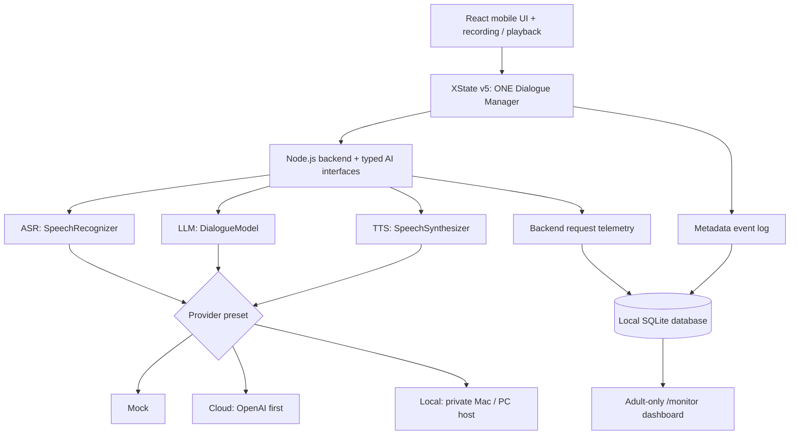
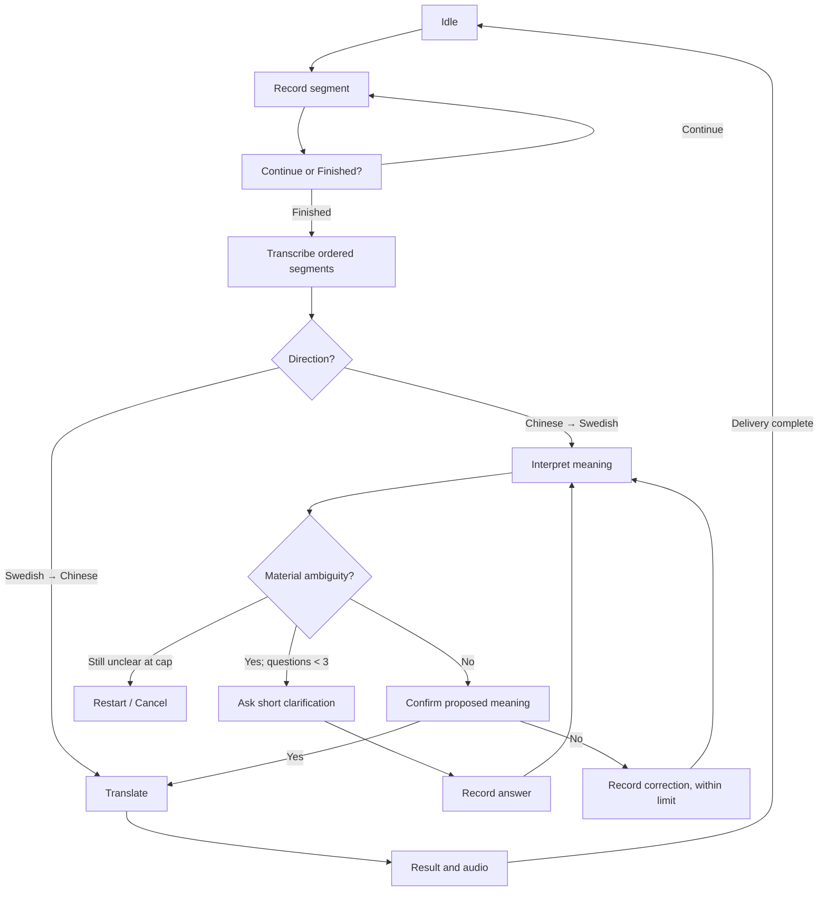
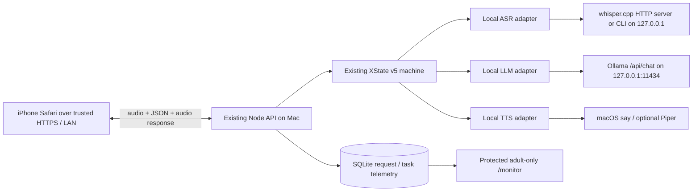

# Child-Friendly Chinese–Swedish Speech Translator
## Minimal V1 System Design — Provider-Independent Cursor Handoff

**Version:** 1.2 — 18 October 2026  
**Supersedes:** `Child_Translator_Minimal_V1_System_Design_Updated_EN.md` (v1.1)  
**Scope:** **Adult-only working prototype**, with both Cloud and fully local Mac inference, plus a private monitoring dashboard. No actual child recordings/personal data.  
**Target:** iPhone Safari, React/TypeScript, XState v5, Node.js backend  
**Architecture:** **ONE UI + ONE dialogue Statechart + interchangeable Mock, Cloud, and Local AI providers.**

> **Cursor (incremental extension of an already working app):** Preserve the current React UI, Cloud provider, XState v5 machine, and dialogue rules. Implement the new Mac-local ASR + LLM + TTS path AND the shared monitoring dashboard. Work autonomously, testing each integration layer; do not stop for approval between internal steps unless hardware, credentials, or a decision genuinely blocks you. Do not build a second app or Statechart.

---

## 1. Goal and fixed design decisions

Build a child-oriented **one-to-one, push-to-talk Chinese ↔ Swedish speech translator**, initially exercised with **adult speakers**. The interface is designed for pre-literate children, but V1 does **not** establish real child usability or child-speech ASR accuracy.

**Language directions:**

- **Chinese → Swedish (main workflow):** record → transcribe → interpret → clarify if needed → **always confirm Chinese intended meaning** → translate → show/play Swedish.
- **Swedish → Chinese (support workflow):** record → transcribe → translate directly → show **recognized Swedish original and Chinese translation** → play Chinese.

**Decisions carried over from Initial Design v0.2:**

1. **Every Chinese → Swedish translation needs explicit Yes** to the latest proposed meaning, even if the sentence seems clear.
2. At most **three semantic clarification questions per task**. Audio segments, ASR retries, and final confirmation do not consume this budget.
3. An unfinished task cannot be interrupted by a direction change without separate **Cancel and switch? Yes / No** confirmation.
4. Keep **one previous successfully delivered message** as session-only context, across directions. Never keep full history by default.

**Additional observed UX needs:** 30-second timer **per recording segment**; continue recording fragmented sentences across multiple segments; very large icons and brief spoken instructions (text not required for operation); adult-readable Swedish source transcript.

**Out of scope:** child testing, hardware device, school deployment, voice anonymization, always-on recording, training models, public hosting, storing conversation/audio content in analytics, and production legal-compliance certification. A local-only authenticated dashboard IS in scope. A later child-study protocol needs separate review.

---

## 2. High-level architecture



**Never duplicate** UI states, XState guards, clarification policy, memory semantics, or evaluation rules per AI provider. The machine makes dialogue decisions; models return structured proposals and translations.

| Preset | ASR | Understanding / translation | TTS | Purpose |
|---|---|---|---|---|
| `mock` | Deterministic fake | Deterministic fake | Prepared clips/fake playback | First: validate UI and dialogue flow |
| `cloud` | Cloud speech API | Cloud LLM | Cloud speech API | Adult-only real AI pilot |
| `local` | Mac-local multilingual Whisper | Mac-local Ollama multilingual LLM | Mac-local Mandarin/Swedish TTS | Required full local adult speech flow in v1.2 |

Design ASR, LLM and TTS as **three independent interfaces** so hybrid configurations remain possible later. **Do not build a full provider-combination selector in V1.** A developer-only setting selects a preset while **idle** and freezes it for a complete task.

**Privacy boundary:** Only adult speech and non-identifying/synthetic inputs are used for all real AI tests. A local server avoids sending content to model vendors but does not automatically resolve applicable research or privacy responsibilities.

---

## 3. Five child-oriented screens

| Screen | Core UI | Behavior |
|---|---|---|
| **Home** | Two prominent direction buttons + microphone | Choose Chinese → Swedish or Swedish → Chinese |
| **Recording** | Big microphone/Stop, animated **30-second countdown** | Manual stop or timeout ends **one segment**, not a task |
| **Continue / Finished** | 🎤➕ Continue, ✅ Finished | Add a segment, or submit the entire spoken message |
| **Clarify / Confirm** | 🔊 Replay; 🎤 Answer **or** ✅ Yes / ❌ No | One short question/decision at a time |
| **Result** | Big 🔊 Play/Replay, New turn / Re-record, text for adults | Display source text and translation; play target language |

UI rules:

- Make primary tap targets very large (aim for ~80 px); simple icons, clear shape and color cues, very little text.
- Child operation must **not depend on reading**. Spoken prompts include “现在可以说啦”, “还想继续说吗？”, “你是说……，对吗？”.
- Provide Replay for spoken questions. Do not overlap recorded microphone audio and app-spoken audio.
- Confirmation Yes/No and direction-switch Yes/No may look similar, but must carry **different machine events**.
- Do not assume Safari audio autoplay always succeeds; provide an explicit Play button.
- **ZH → SV result:** confirmed Chinese meaning + Swedish text + Swedish audio.
- **SV → ZH result:** recognized Swedish ASR original + Chinese translation + Chinese audio. The Swedish-speaking adult can inspect ASR recognition; this does **not** establish Chinese translation correctness.

---

## 4. Recording and dialogue flow

### 4.1 Segmented recording

1. One translation **task** can contain multiple audio **segments**. Each segment has a **30-second** countdown.
2. Pauses and silence do **not** automatically stop a segment. Stop or timeout ends only the current segment.
3. After each segment, choose **Continue** (another 30 seconds within the same task) or **Finished** (submit all segments).
4. On Finished, transcribe segments **in order**, keeping their boundaries. Do not invent words between fragments.
5. A clarification answer or correction reuses this recording UI but is tagged as a separate **input purpose** within the same task.
6. Keep audio temporarily in memory and discard on completion, cancellation, or session end; do not archive audio or transcripts in evaluation logs.

**Example:** “老师……” / “他把我的……” / “水壶拿走了。” → three segments, **one** message, **one** translation task.

**Safari checks:** microphone permission and secure HTTPS context; `MediaRecorder` support/MIME feature detection (do not assume WebM); supported backend audio formats; physical iPhone testing.

### 4.2 Conceptual Statechart



Implement **one** XState v5 machine with `setup`, typed `context` and events, `assign`, guards, and invoked async actors. Add globally reachable `confirmingSwitch`, `recoverableError`, and `fallback` states; the diagram only shows the main path. Reuse recording components for INITIAL, CLARIFICATION, and CORRECTION rather than building separate apps.

### 4.3 Essential policy

**Chinese → Swedish:**

- The LLM proposes either a short clarification or a tentative meaning. XState chooses which transition is allowed.
- Ask only when missing information **materially affects meaning**. Keep questions brief, neutral and understandable without reading.
- Increment the counter when a semantic question is **actually presented**. Never show question 4; after three unresolved questions, restart/cancel rather than guess.
- **Always** play a proposed Chinese meaning and wait for Yes before final translation.
- Confirmation No invalidates that proposed meaning; collect a correction. Limit to **two correction attempts** initially (provisional), then restart/cancel.
- Preserve original input and question/answer turns separately; a clarification answer is not a new task.

**Swedish → Chinese:** Transcribe adult Swedish, translate directly into clear Chinese, show recognized Swedish + Chinese result, and play Chinese. Do not enter the child meaning-confirmation flow.

**Direction switching:** While a task is active, request independent cancellation confirmation. **No** restores a safe checkpoint, retaining earlier segments/counters; an interrupted recording may need restarting. **Yes** cancels the unfinished task and starts a fresh task in the requested direction, while retaining only last successfully delivered message.

**Async safety:** Tag every request with `taskId` and `requestId`; ignore outdated completions after a switch/cancel, even if a network cancellation fails. Incomplete tasks never update session memory.

**Result delivery:** Do not remember a message just because an API returned a translation. Remember it only after the result was shown and target speech playback finished, or the adult tester explicitly accepted a text-only result after a TTS failure. Record whether the delivery was audio or text-only. Clear memory at `END_SESSION`. Previous message is optional context, never a factual assumption; use the **same prompt-memory setting** for Cloud/Local comparisons.

**Failures:** Empty ASR → re-record (provisional **two ASR retries**). Invalid model JSON / network failure / timeout → retry or cancel. TTS failure → retain readable text and allow manual replay or an adult text-only fallback. Never mark failed tasks as successful.

### 4.4 Compact Information State

```typescript
type Direction = 'ZH_TO_SV' | 'SV_TO_ZH';
type InputPurpose = 'INITIAL' | 'CLARIFICATION' | 'CORRECTION';
type ProviderPreset = 'mock' | 'cloud' | 'local';

type DialogueInput = {
  purpose: InputPurpose;
  textParts: string[];        // ordered segments; volatile
  inReplyTo?: string;         // clarification question, if any
};
type LastDelivered = {
  taskId: string;
  direction: Direction;
  source: string;             // confirmed Chinese meaning or Swedish ASR
  translation: string;
};
type Task = {
  id: string;
  direction: Direction;
  preset: ProviderPreset;     // frozen for task lifetime
  inputPurpose: InputPurpose;
  segmentInfo: { id: string; durationMs: number; purpose: InputPurpose }[];
  dialogueInputs: DialogueInput[];
  proposedMeaning: string | null;
  currentQuestion: string | null;
  confirmedMeaning: string | null;
  translatedText: string | null;
  clarificationCount: number;
  correctionCount: number;
  asrRetryCount: number;
};
type MachineContext = {
  sessionId: string;
  task: Task | null;
  lastDelivered: LastDelivered | null;
  pendingDirection: Direction | null;
  safeReturnState: string | null;
  activeRequestId: string | null;
};
const LIMITS = {
  segmentSeconds: 30,
  semanticClarifications: 3,
  correctionAttempts: 2,
  asrRetries: 2,
};
```

Keep audio blobs in a separate **volatile audio store**, not persistent XState snapshots. The actual machine should define typed UI events (`START_TASK`, `STOP_SEGMENT`, `SEGMENT_TIMEOUT`, `CONTINUE_SPEAKING`, `FINISH_INPUT`, `CONFIRM_YES`, `CONFIRM_NO`, `SWITCH_REQUESTED`, `SWITCH_YES`, `SWITCH_NO`, `DELIVERY_FINISHED`, `RETRY`, `CANCEL`, `END_SESSION`) and typed async completion/error events.

---

## 5. Provider contracts — interchangeable ASR, LLM, TTS

These are **design-level** TypeScript contracts; adapt transport encoding between browser and Node without changing semantics.

```typescript
type Language = 'zh' | 'sv';
type AudioData = { bytes: Uint8Array; mimeType: string; durationMs?: number };
type RequestMeta = { taskId: string; requestId: string; signal?: AbortSignal };

type InterpretationResult =
  | { kind: 'ASK_CLARIFICATION'; questionZh: string; reasonCode: string }
  | { kind: 'PROPOSE_MEANING'; meaningZh: string }
  | { kind: 'UNRESOLVED'; reasonCode: string };

interface SpeechRecognizer {
  transcribe(audio: AudioData, language: Language, meta: RequestMeta): Promise<string>;
}
interface DialogueModel {
  interpretChinese(input: {
    dialogueInputs: DialogueInput[];
    remainingClarifications: number;
    previousDelivered?: LastDelivered | null;
  }, meta: RequestMeta): Promise<InterpretationResult>;
  translate(input: {
    text: string;
    direction: Direction;
    previousDelivered?: LastDelivered | null;
  }, meta: RequestMeta): Promise<string>;
}
interface SpeechSynthesizer {
  synthesize(text: string, language: Language, meta: RequestMeta): Promise<AudioData>;
}
type ProviderBundle = {
  asr: SpeechRecognizer;
  dialogue: DialogueModel;
  tts: SpeechSynthesizer;
};
```

**Mandatory:** Validate JSON and schema from any LLM before dispatching XState events. Models cannot change counters, skip required confirmation, or bypass guards. Backend checks payload size, text length, timeouts and errors. No provider API key or private inference endpoint is exposed to the browser.

### 5.1 Mock (implement first)

Deterministic fake ASR, interpretation, translation and audio output. Support clear Chinese, ambiguity, clarification answer, confirmation No, Swedish input, recoverable error, and stale responses. **Exercise the real machine**, not shortcuts.

### 5.2 Cloud (second)

Use a Node-side Cloud bundle (initial example: OpenAI API) for ASR, structured interpretation/translation and TTS. Pin model identifiers and prompt versions for reproducible adult tests. Preserve ordered segment transcripts, keep credentials server-side, and support retries and timeouts. **Adult voices and non-identifying input only.** Verify current vendor endpoints, formats, limits and usage conditions at integration time; do not assume a data-retention setting from code alone.

### 5.3 Local Mac AI bundle — implement fully in this update

**Goal:** From the SAME iPhone UI and SAME Node routes, select `local` while idle, then perform the COMPLETE loop using only services running on the user's own Mac: **ASR, interpretation, clarification, translation, and TTS.** Local AI inference must not contact model-vendor clouds at runtime. It is acceptable to download model files once during setup. Do **not** silently call OpenAI if a local component is missing or fails.

#### Deployment diagram and boundaries



The Node backend is the **only** browser-facing API. Ollama, Whisper and TTS processes listen on `127.0.0.1` (or use child processes); never expose their native HTTP ports to the iPhone, LAN, internet or browser. **Ollama local mode is not Ollama cloud mode**: check model names, URL and installed model availability. One Mac-hosted Node server can serve the iPhone app, API and monitoring UI.

#### First: inspect actual Mac before choosing model sizes

Add `npm run local:doctor` (or equivalent script) to report, without secrets or audio content:

- CPU architecture (`arm64` Apple Silicon vs Intel), macOS version, Apple chip (if available), total RAM, free disk and GPU/Metal capability.
- Whether Ollama, `ffmpeg`, `cmake`, `whisper.cpp` server, `say`, and optional Piper are installed.
- Actual installed Ollama models (`ollama list`), accessible Mandarin and Swedish macOS TTS voices (`say -v '?'`), and listen/health status of each engine.
- Model sizes and any RAM/disk risks **before downloading anything large**. Do not assume an M-series chip, 32 GB RAM or a CUDA GPU. Do not purchase hardware or install unrelated services.
- Print actionable setup steps if missing, and a non-sensitive local readiness summary usable by the monitor health panel.

**Starter model policy (candidates, not guaranteed quality or latency):**

| Component | Practical first attempt | Downgrade/upgrade behavior |
|---|---|---|
| ASR | `whisper.cpp` multilingual **small or medium** (not `.en`) on Mac; use Metal where available | Start `small` if RAM constrained; test `medium` / `large-v3-turbo` only after measuring Chinese/Swedish adult speech accuracy and latency |
| LLM | **Ollama with local `qwen3:8b`** (quantized); `qwen3:4b`-class model if memory constrained | Try a **14B-class** model only if resources permit and Swedish fidelity or clarification quality is insufficient; verify exact downloadable tag |
| TTS | **macOS `say`** with an installed `zh_*` and `sv_*` voice; produce a playable audio file | If either voice is absent/unsuitable, try offline **Piper** Chinese `zh_CN` and Swedish `sv_SE` voice packs; verify licensing, install and real playback on this Mac |
| Translation | Reuse the same local LLM for understanding **and** both directions initially | Optional dedicated translation engine ONLY if bilingual manual tests show inadequate fidelity; never install multiple models without a specific failure case |

**Whisper notes:** The documented `whisper.cpp` HTTP server accepts a WAV file through `POST /inference`. If iPhone Safari records AAC/M4A or another supported blob, Node converts it **locally** via ffmpeg to PCM 16 kHz mono WAV before inference. Preserve one transcript per segment, in order. Use `language=zh` or `sv` as supported by selected Whisper build; do not automatically translate inside ASR. Confirm CLI flags and server payload against the installed version, not a guessed endpoint. Strip model output only as needed to parse JSON; don't silently repair the child's words. Temporary input/conversion files must be scoped per request and securely removed in `finally`, including errors and cancellation. File-based audio should not persist in app logs.

**Ollama notes:** Use `POST http://127.0.0.1:11434/api/chat` from Node. Set `stream:false`, pin `model`, use JSON-schema `format` for interpretation, and **validate** the result with the same Zod/TypeScript schema as the Cloud model. Choose deterministic short output and avoid generating verbose internal reasoning where supported. Ollama returns generation counters and nanosecond durations (for example `prompt_eval_count`, `eval_count`, `total_duration`, `load_duration`); normalize to milliseconds for dashboard storage. Do not confuse model compute duration with Node end-to-end request duration. Keep model warm for tests when possible and separately record cold-start load time.

**TTS notes:** The initial macOS `say` adapter is the easiest first Mac test, **provided both languages have usable installed voices**. Discover voice IDs at runtime; never hardcode a possibly missing voice. Safely invoke the binary with an argument-array subprocess API (not interpolated shell commands), create a unique temporary AIFF, then locally convert to an iPhone-supported WAV/M4A response. Validate user-controlled text length. Run a true offline test if claiming no network inference. If built-in voices fail, try Piper's current Open Home Foundation implementation with the two language voices. No Cloud fallback in Local preset; show an actionable TTS error / text-only adult fallback instead.

**Implementation checklist:**

1. `local:doctor`: hardware/installation/voice/model checks and instructions; show results in protected monitor health panel.
2. `LocalDialogueModel`: build schema-constrained interpretation and bilateral translation; add pure-text tests in both languages.
3. `LocalSpeechRecognizer`: local audio format conversion and whisper.cpp transcription on real adult iPhone recordings.
4. `LocalSpeechSynthesizer`: local Mandarin and Swedish audio and playback on real iPhone.
5. Bundle them under the EXISTING `ProviderBundle` contracts; keep `local` selected and frozen for a task. All dialogue policy remains in XState.
6. Bench the full sequence on at least 5 adult tasks in each language direction, including an incomplete Chinese utterance and mandatory confirmation.
7. If one engine is missing or unsupported on this Mac, do not mark Local as fully functional; provide working setup instructions and an explicit status such as `LOCAL_TTS_UNAVAILABLE`.

**Real end-to-end success criterion:** With no Cloud API key configured (and ideally external internet blocked after download/setup), adult speaks into iPhone → Mac transcribes → local LLM interprets and asks/answers according to unchanged XState → locally generated target-language audio plays on iPhone. Both Chinese→Swedish AND Swedish→Chinese must work. Do not claim success from a text-only or synthetic mocked demonstration.

### 5.4 Existing backend routes, new diagnostics and operational controls

Preserve existing routes: `GET /api/health`, `POST /api/asr` (segment), `POST /api/interpret`, `POST /api/translate`, `POST /api/tts`, and existing event logging routes. Keep route semantics stable; add instrumentation around their handler/service boundaries. If the existing implementation uses a single orchestration endpoint, instrument internal stage calls instead of rewriting it.

- `GET /api/local/health` **(protected)**: readiness, selected local model/voice tags, reachable ASR/LLM/TTS engines and last error. Never show credentials or private paths.
- `GET /api/monitor/summary?from=&to=&preset=` **(protected)**: aggregate task, requests, latency and cost metrics.
- `GET /api/monitor/requests?...` **(protected)**: paginated individual backend inference requests with filters.
- `GET /api/monitor/tasks?...` **(protected)**: task and segmentation summaries, failure reasons.
- `GET /api/monitor/timeseries?...` **(protected)**: hourly/daily count, usage, estimated cost and latency data.
- `GET /api/monitor/pricing` **(protected)**: active model rates, units, revision/effective date and source; may be edited ONLY server-side.
- `POST /api/monitor/annotations` **(protected)**: optional *adult-only* task quality scores/observations (no transcripts).
- `GET /api/monitor/export?type=requests|tasks|annotations&format=csv` **(protected)**: optional CSV fallback. The UI, not exporting, is the normal workflow.

Never route browser requests directly to Ollama/Whisper/Piper. Do not add API tokens, raw text or binary data to URLs or browser analytics. Protect monitor routes with a minimal backend authentication mechanism even on LAN; avoid hardcoded/shared default passwords and do not place secrets in the Vite/client build. Restrict to localhost-only access if authenticated LAN exposure is not yet ready.

---

## 6. New requirement: real-time adult Monitoring & Evaluation Dashboard

This section supersedes the minimal CSV-only expectation from v1.1. The dashboard is a **first-class part of the prototype**, sharing the same server and SQLite telemetry for **Cloud, Local and Mock**. It must display actual results from live sessions, not fabricated/demo values. **Do not add these controls to the child's main screen.**

### 6.1 Required UI: `/monitor` (desktop-first, responsive)

**A. Overview — shown on first load, auto-refresh every ~3–5 seconds while open**

- Filters: **time range** (today / last 7 days / custom), `providerPreset` (All/Cloud/Local/Mock), language direction, API stage, model, status, optionally scenario ID.
- Cards: task attempts, successfully delivered tasks, **AI request count** (including repeated calls), recorded audio minutes, Cloud billed/estimated USD cost, error count/error rate, average/median task duration, average and p95 backend stage latency. For small sample sizes label p95 as a descriptive statistic; **no false precision**.
- Time series: requests by hour/day; estimated Cloud spend by day; stage durations over time; optional Cloud vs Local latency comparison.
- Stage breakdown: counts and latency for **ASR**, **INTERPRET**, **TRANSLATE**, **TTS**; local inference cold-start timing if available.
- Health: local ASR/LLM/TTS statuses + current model tags; Cloud adapter configured/not configured (never reveal key). No background probing of cloud that generates billable calls.

**B. Request Explorer — one row per REAL backend model-service invocation**

Mandatory columns: timestamp, `requestId`, `taskId`, provider, **stage**, engine/model, direction, input recording seconds (where applicable), wall-clock request latency ms, status/error, input/output tokens when returned, **price USD**, price calculation type (`reported_usage`, `estimated`, `unknown`, or `not_applicable`), and optional local model load time. Click row to see duration breakdown, retries and the pricing inputs, **not** audio/transcript/prompt/translation content. Support sort/filter and page size.

**C. Task Explorer — one row per translation task**

Display direction, provider frozen for task, **number of recorded segments**, sum of segment recording durations, number of ASR calls, LLM interpret/translate calls, TTS calls, clarification count, confirmations, total processing time, total task elapsed time, target playback completion flag, outcome (delivered/failed/cancelled), and sum of **known or estimated Cloud costs**. Link its requests and non-content events by `taskId`. Task cost is a SUM of all linked requests, including retries; never simply assume one model call per task.

**D. Evaluation — lightweight optional human annotation**

For adult controlled tasks show `scenarioId`, provider, meaning score (0/1/2), receiver understood (yes/no/not assessed), ASR issue (none/yes/not assessed), UI issue count, and short **non-identifying observation note**. Human scores are NOT inferred from LLM output. Show basic group averages/distributions and differences by provider; add no inferential claims about children. A technically completed task is not equivalent to human-evaluated successful communication.

**E. Cost detail**

- Show per-request **Cloud USD** costs where calculable; calculate from the exact provider/model/endpoint **and rate units** in a versioned server-side price registry, not a single blanket token formula. Rates can be per input token, cached token, output token, ASR minute, audio token or other endpoint-specific billing metric.
- Prefer actual usage quantities returned by the provider; if the response lacks usage, use measured duration/known quantities for **clearly labeled estimates** only where a defensible pricing unit exists. Otherwise show `Unknown`, **never $0.00**.
- Display cost calculation method, unit, price revision/source and rate used in request detail. Cloud telemetry is an **estimate/attribution view**, not authoritative provider billing. Currency USD, optional SEK conversions deferred (would require exchange-rate data).
- Local provider: **external inference API cost = $0**, but electricity, Mac depreciation, disk and developer time are **excluded**; display `Local API: $0 (hardware/power excluded)` rather than “free”. Mock is `N/A`.
- Show **unknown/unpriced Cloud request count** beside subtotal to prevent misleading full cost summaries; sum only known/estimated amounts and mark partial totals.
- Provide a configurable adult-only **soft budget alert** (e.g., USD limit for a session/day). Alert locally before additional usage, but do not advertise this as an exact stop-billing guarantee. No automated chargeable provider polls.

### 6.2 Measurement definitions — do not confuse these clocks

| Field | Definition / capture point | Recorded by |
|---|---|---|
| `segmentRecordedMs` | wall-clock audio capture time from browser `RECORDING_STARTED` → `RECORDING_STOPPED`; store EACH segment | Client event sent to backend |
| `taskRecordedMs` | SUM of initial + clarification + correction segment durations; show optional initial-input subtotal | DB aggregate |
| `inferenceRequestMs` | backend timer around **one** HTTP/subprocess invocation; include network/conversion as needed, tag separate components | Backend `performance.now()` or monotonic time |
| `asrConversionMs` | ffmpeg/input conversion component of local ASR latency | Backend |
| `engineInferenceMs` | model-side duration reported by engine (if returned), or measured substep | Adapter |
| `modelLoadMs` | model load duration for Ollama or measurable service cold start | Local adapter |
| `taskProcessingMs` | wall clock from `INPUT_FINISHED` until terminal result ready; for clarification tasks define phases/aggregate processing, not user talking time | Dialogue events / backend |
| `taskElapsedMs` | `TASK_STARTED` → `TASK_COMPLETED` / failure / cancel; includes user pauses, prompts, answer recording and target playback | Dialogue event timestamps |
| `targetPlaybackMs` | playback start → playback completed, on iPhone; distinguish from TTS generation | Client |
| `ttsGeneratedAudioMs` | media duration of generated output audio (NOT model processing latency) | Backend or media metadata |
| `requestCostUsd` | usage-based cost if computable, else null; never mix unknown with zero | Backend price calculator |

**Request count != task count != audio segments.** An entire Chinese→Swedish task may include many recorded segments, ASR calls, multiple interpretation calls for clarification, one final translation and multiple TTS prompts. The monitoring page must make that relationship visible.

### 6.3 Persist only metadata: SQLite storage contract

Use one local **SQLite** database in the Mac-hosted Node app. SQLite is sufficient for a single-adult small prototype; do not introduce Prometheus, Grafana, Kafka, Redis, Elasticsearch or an external telemetry SaaS. Adapt to existing repo/ORM rather than forcing a rewrite.

Recommended normalized entities (add migrations/schema version; choose SQLite library based on existing Node version):

```typescript
// EXAMPLE: metadata only. All content-bearing fields are deliberately absent.
type AIRequestTelemetry = {
  requestId: string; taskId: string; sessionId: string;
  segmentId?: string | null;
  startedAt: string; endedAt: string; // ISO timestamps
  preset: 'mock' | 'cloud' | 'local';
  stage: 'ASR' | 'INTERPRET' | 'TRANSLATE' | 'TTS';
  direction: 'ZH_TO_SV' | 'SV_TO_ZH';
  providerName: string; modelTag: string;
  durationMs: number;                // Node wall-clock timer
  engineInferenceMs?: number | null;  // do not substitute for durationMs
  conversionMs?: number | null;
  modelLoadMs?: number | null;
  inputAudioMs?: number | null;
  outputAudioMs?: number | null;
  promptTokens?: number | null; outputTokens?: number | null;
  cachedPromptTokens?: number | null;
  status: 'succeeded' | 'failed' | 'cancelled' | 'timeout';
  errorCode?: string | null;          // sanitized error classification only
  costUsd: number | null;             // null = cannot calculate
  costBasis: 'reported_usage' | 'estimated' | 'unknown' | 'not_applicable';
  priceRevision?: string | null;
  retryOfRequestId?: string | null;
};

type TaskTelemetry = {
  taskId: string; sessionId: string; scenarioId?: string | null;
  preset: 'mock' | 'cloud' | 'local';
  direction: 'ZH_TO_SV' | 'SV_TO_ZH';
  startedAt: string; endedAt?: string | null;
  status: 'active' | 'delivered' | 'failed' | 'cancelled';
  clarificationCount: number; confirmationRejectCount: number;
  deliveryMode?: 'audio' | 'text_only' | null;
};

type SegmentTelemetry = {
  segmentId: string; taskId: string; inputPurpose: 'INITIAL' | 'CLARIFICATION' | 'CORRECTION';
  segmentIndex: number; capturedDurationMs: number; hitTimeout: boolean;
};
```

Persist `Session`, `Task`, `Segment`, `AIRequest`, `Event` and optional `AdultAnnotation` rows. Foreign keys link task and session. Index `startedAt`, `taskId`, `preset`, `stage`, `modelTag`. Include current version/migration. Avoid localStorage-only analytics and in-memory-only logs because browser reload must not erase the monitor. Prefer a **single server-side telemetry wrapper** so all provider paths (including retry/error) write consistently. Old records with unknown usage or missing cost fields should migrate safely to `null`.

**Privacy/security:** No persistent audio blobs, ASR text, clarification text, translation text, prompts, personal names, session memory or raw API JSON in telemetry or verbose console logs. Errors must be sanitized. Avoid capturing authorization headers. Retain content only in volatile working memory for a task; clear temp files on success/failure. Let user delete pilot telemetry and document how. Guard monitor and export endpoints with local admin authentication and prevent accidental public publishing. Adult testing only.

### 6.4 Request instrumentation and pricing pseudocode

The **backend** MUST measure each actual inference invocation, not just calls made by the browser. Client-only timers cannot capture server-side retries or precise provider usage.

```typescript
// Illustration, not a drop-in SDK integration.
async function observedAIRequest<T>(meta: {
  taskId: string; sessionId: string; requestId: string;
  preset: 'mock'|'cloud'|'local';
  stage: 'ASR'|'INTERPRET'|'TRANSLATE'|'TTS';
  modelTag: string;
}, invoke: () => Promise<{ value: T; usage?: NormalizedUsage }>): Promise<T> {
  const start = performance.now();
  const startedAt = new Date().toISOString();
  let status: 'succeeded'|'failed' = 'succeeded';
  let usage: NormalizedUsage | undefined;
  try {
    const result = await invoke();
    usage = result.usage; // normalize actual endpoint-specific fields
    return result.value;
  } catch (err) {
    status = 'failed';
    throw err;
  } finally {
    // Persist exactly ONE row per invocation, including failures.
    // Compute elapsed = performance.now() - start.
    // Compute cost via model+endpoint rate registry where possible.
    // Never store prompts, transcripts, text, audio, or raw error body.
    // Ensure original errors are not swallowed by telemetry failures.
  }
}
```

Create a `PriceRegistry` (server only), e.g. JSON config containing `{provider,model,stage,billingMetric,unitRateUsd,revision,sourceUrl,effectiveDate}` with optional distinct input/output/cached rates. This registry is editable without a code redeploy if appropriate but must not be writable by a public user. **Do not embed October 2026 prices as permanent constants.** Use billing-model-specific normalization rather than guessing tokens from character count. If exact API usage isn't available, estimate only with a compatible known pricing unit and label it. Make `unknown` distinct from `$0.00`; include all retries.

**Ollama usage:** normalize `prompt_eval_count`, `eval_count` and duration fields returned in **nanoseconds** to your common metrics (divide durations by 1,000,000 for milliseconds). Local model token counts have no cloud charge. **Whisper/Piper/macOS say** may not return token usage; log their actual duration and processed input/output audio duration instead.

### 6.5 Operational requirements

- Auto-refresh using polling is sufficient (~3–5 s). Do not add streaming sockets solely for monitoring. Stop polling when the tab is hidden if possible; avoid hammering Mac during inference.
- Paginate and filter request rows server-side; basic charts only (counts/cost/latency), no dashboards SaaS dependency.
- User-selectable scenario IDs may be set before each adult test; never require this for the translator to function.
- Show model/service availability and failures clearly; one failure in ASR or TTS must not silently re-route from Local to paid Cloud.
- Preserve already-working cloud workflow and existing recording UI. Use additive DB migration; do not destroy data already stored by current app.
- Provide a one-click **Clear Adult Test Data** action with confirmation, and CSV export as optional backup.

---

## 7. Evaluation — adult pilot plus technical comparison

### 7.1 Quantitative system telemetry (automatic)

Report task and request counts **separately**; Cloud token/audio usage and categorized cost; Local model tags and timings; recording duration / segment count / per-task total; backend stage latencies and task elapsed time; semantic clarification and confirmation attempts; errors/timeouts/retries; delivery mode; zero/unknown cost caveat. Compute success rates only over documented denominators and distinguish technical delivery from human-assessed understanding.

### 7.2 Human assessment (entered directly in monitor)

Per adult scripted task, optionally annotate: `scenarioId`, `referenceMeaningCode` (not identifiable speech), `meaningScore` 0/1/2, `recipientUnderstood` yes/no/not-assessed, `asrIssue` yes/no/not-assessed, `uiDifficultyCount`, and short sanitized observation note. Annotation never claims to be LLM-certified quality. Monitor shows group mean/distribution across Provider and direction. Do not claim actual child usability from adult sessions.

### 7.3 Comparable Cloud vs Local feasibility run

Use the SAME set of about 20 artificial non-identifying scenarios for text-only LLM comparison: 5 clear Chinese→Swedish, 10 fragmented/ambiguous Chinese, 5 Swedish→Chinese. Keep schema, prompt policy, short previous-message-memory setting, clarification cap, model version record and task complexity fixed. Then run 5+ real **adult** speech tasks per direction to measure end-to-end behavior and time. Account for local model warm-up separately from normal requests. Since models differ, compare observed outcome quality and delay, not claim controlled causal evidence of one model's superiority.

**Additional experiment question:** Does Cloud API spend decrease to $0 when `local` is selected without increasing failures or latency beyond what the adult tester finds acceptable? Do not automatically infer a local model is capable from successful health checks alone.

---

## 8. Required acceptance / integration tests

**Keep the original core tests T01–T14 from v1.1:** per-segment 30 seconds, segmented input as one task, mandatory Chinese confirmation, clarification cap three, separate switch/cancel confirmation, previous delivered memory only, Swedish transcript/result, stale response ignoring, recoverable errors and provider freezing. Extend with the following:

| ID | Test | Pass criterion |
|---|---|---|
| L01 | `local:doctor` on Mac | Reports chip/RAM/tools, language voice availability and actionable steps; no hardcoded assumptions |
| L02 | Local ASR, adult Mandarin | Records audio on real iPhone; ffmpeg/Whisper transcribe locally; segment timings logged |
| L03 | Local ASR, adult Swedish | Recognized Swedish rendered; no translation inside ASR |
| L04 | Local LLM fragmented Chinese | JSON validated; XState correctly issues clarification and mandatory final confirmation |
| L05 | Local LLM Swedish→Chinese | Meaning preserved in adult task; result displayed and replay works |
| L06 | Local TTS both languages | Both Swedish and Mandarin produced locally and playable on iPhone |
| L07 | Cloud key absent or external WAN unavailable, local preset | Entire adult task still works after setup; **no Cloud request** or silent fallback |
| L08 | Kill one local engine mid-task | Visible recoverable error; accurate `failed` telemetry and `taskId`; no wrong memory update |
| M01 | Cloud 3-segment task with clarification | Task, segments and each model call linked; time/duration fields accurate |
| M02 | Cloud one translation calls ASR 2×, INTERPRET 2×, TTS 2× | Six request rows, one task row; task cost sums all attributable calls including retries |
| M03 | Provider missing billable usage | `unknown`/`estimated` labeled; not incorrectly $0 |
| M04 | Cloud LLM returns real token usage | Input/output counts and USD rate explanation visible, revision recorded |
| M05 | Ollama metrics are reported in nanoseconds | Converted to milliseconds correctly; cold-start model load shown separately |
| M06 | TTS audio playback finishes after server responded | TTS generation and client playback are distinct measurements |
| M07 | Two simultaneous adult sessions, reload monitor | Stable IDs, no duplicate request records, telemetry persists |
| M08 | Failed/cancelled request, stale response | Request marked failed/cancelled; counted; not included as successful task |
| M09 | Monitor access without admin auth | Access blocked, including exports and pricing routes |
| M10 | Export, data-clearing and dashboard query | Works without audio/transcripts/prompts in persistent DB/CSV |

Include automated tests for pricing functions (usage present/missing, input/output token rates, ASR minute-based billing, retry aggregation, partial totals), schema migrations, telemetry around exceptions, LocalProvider adapters with mocks, and at least one real adult end-to-end run for each language direction. **Tests must not silently call paid Cloud APIs by default.**

---

## 9. Practical implementation sequence for Cursor (do all steps, verify each)

The user has **already successfully tried the Cloud API on iPhone**. Treat the existing project as the source of truth for file paths and working behavior. **Do not recreate the repo.** Inspect existing API calls, state machine and services before editing, and preserve the existing API keys in local `.env` without printing them.

1. **Audit:** Identify existing React app, Node server, Cloud ASR/LLM/TTS routes, XState actions, existing logs, HTTPS dev setup and package manager. Report the delta, not a rewrite plan. Run baseline tests.
2. **Instrument Cloud first:** Create a single server-side telemetry wrapper, normalized usage/cost module, and SQLite migrations. Wrap existing Cloud calls including retries/errors. Verify the current iPhone adult translation still works.
3. **Build `/monitor`:** Protected adult overview, Request Explorer, Task Explorer, Cost Detail, provider filter and local readiness panel; live polling; optional evaluation annotations; CSV backup and metadata deletion.
4. **Run `local:doctor`** on actual Mac; select model and TTS voice based on detected RAM and installed voices. Ask the user for essential OS permissions or downloads only if blocked. Do not guess hardware.
5. **Ollama local LLM first:** Install/check local Ollama, verify downloaded model and endpoint; implement schema-constrained interpretation and Chinese↔Swedish translation. Run text-only artificial scenario suite before audio integration.
6. **Local Whisper ASR:** Verify multilingual language modes; implement iPhone format conversion and request-scoped deletion; run adult Chinese and Swedish recordings.
7. **Local TTS:** Test built-in `say` Swedish and Mandarin voices; if either unsuitable/missing, try the current Piper offline engine, with explicit two-language acceptance. Convert output to iPhone-playable media.
8. **Integrate `local`:** Same typed services and XState, no new UI flow. Freeze provider by task. Allow developer preset change only while idle. Make all Local requests visible in monitoring, showing `Local API $0; hardware excluded`.
9. **Run all acceptance tests:** Mock, existing Cloud and true Mac Local; fix errors; verify real adult iPhone tests over trusted LAN HTTPS. Update README with one-command startup scripts / manual commands as appropriate, supported models, known latency and memory limitations.
10. **Finish:** Show real screenshots/data from dashboard if possible; report actual model tags, total real request count, measured adult latency in each direction, known/estimated Cloud spend, and any remaining failed tests. Never claim unverified functionality works.

### Scripts / configuration Cursor should supply

```text
npm run dev                 # existing app/API development environment
npm run local:doctor        # non-secret Mac hardware + model + voice checks
npm run local:start         # start or instruct startup of local inference services
npm run local:smoke         # quick NON-CLOUD adult/synthetic tests
npm run test                # unit/integration tests with mocked paid APIs
```

Provide `.env.example` with defaults akin to (adapt names to existing project):

```dotenv
AI_PROVIDER_PRESET=cloud
OLLAMA_BASE_URL=http://127.0.0.1:11434
OLLAMA_MODEL=qwen3:8b
WHISPER_BASE_URL=http://127.0.0.1:8080
LOCAL_TTS_ENGINE=macos_say
MONITOR_DB_PATH=./data/telemetry.sqlite
# MONITOR_ADMIN_PASSWORD=...   # read only by Node, NEVER bundled into frontend
# OPENAI_API_KEY=...           # keep secret; never in browser
```

Do not assume `npm run local:start` can safely install dependencies, silently download several GB, start another already-running daemon, or keep detached processes alive without verification. Document correct commands and PID/health status. Never auto-expose local inference ports.

### Important iPhone Safari detail

`getUserMedia()` requires a trustworthy **secure context**. Serving the page at `http://192.168.x.x` from an iPhone is not equivalent to `http://localhost` on the Mac; use trusted HTTPS on the LAN, with certificates trusted by the iPhone, or another well-understood secure development path. Verify iPhone `MediaRecorder` MIME support rather than hardcoding WebM. Keep unnecessary third-party tunnels out of the local-only privacy test. Show network and certificate errors clearly in the setup instructions.

---

## 10. Cursor Agent prompt — implement the entire update

```text
Read docs/SYSTEM_DESIGN.md completely. This is v1.2 of an EXISTING,
working Child Translator. Adult speech is already working via the Cloud API.

Your task is to EXTEND the existing codebase (do not rewrite the React UI,
XState machine, or working Cloud pipeline):

A. Implement COMPLETE Mac-local inference: multilingual Whisper ASR,
   local Ollama interpretation + Chinese/Swedish translation, and fully
   local Swedish + Mandarin TTS (try installed macOS voices first; use
   Piper only if needed). All through the existing AI Provider contracts.
   The iPhone must connect to the existing Mac backend over trusted HTTPS.
   Local mode must never silently call a paid cloud service.

B. Add an adult-only web monitoring dashboard at /monitor shared across
   Mock, Cloud, and Local: real task and request counts, per-segment
   recording duration, per-stage request latency, real model usage when
   supplied, Cloud per-request USD costs/clearly labeled estimates,
   local model timing/status, errors, charts, request/task drill-down,
   optional adult evaluation scores, and filtered CSV export.
   Persist metadata in local SQLite without audio or conversation text.

First inspect the existing repository and run baseline checks. Work through
implementation and testing autonomously without stopping for milestone
approval, but ask if essential Mac hardware, microphone permission,
password setup, or model downloads block progress. Detect hardware and
voice support rather than assuming an Apple chip or a specific voice.
Do not install large models without checking RAM/disk. Never paste secrets.

Add unit/integration tests, robust error handling, a health check, and
local setup commands. Preserve the 30-second segments, max 3 clarifications,
mandatory Chinese meaning confirmation, safe direction switching, and
one-message volatile session memory exactly as designed. Finish with an
honest tested/unverified report and instructions for testing the whole
flow with ADULT Chinese and Swedish speakers on iPhone Safari.
```

---

## 11. Implementation reference links (verify compatibility when coding)

- `whisper.cpp` server: https://github.com/ggml-org/whisper.cpp/blob/master/examples/server/README.md
- `whisper.cpp` Apple Silicon / Metal: https://github.com/ggml-org/whisper.cpp
- Ollama local API: https://docs.ollama.com/api/introduction
- Ollama chat usage metrics: https://docs.ollama.com/api/chat
- Ollama structured outputs: https://docs.ollama.com/capabilities/structured-outputs
- Piper current implementation: https://github.com/OHF-Voice/piper1-gpl
- Piper voices: https://github.com/OHF-Voice/piper1-gpl/blob/main/docs/VOICES.md
- OpenAI pricing (check current model-specific rates, do not hardcode): https://developers.openai.com/api/docs/pricing
- HTTPS/microphone browser requirements: https://developer.mozilla.org/en-US/docs/Web/API/MediaDevices/getUserMedia

### Changes from v1.1

- Converts “optional local feasibility” into an **explicit full Mac LocalProvider implementation** request, with model size detection, true local ASR/LLM/TTS, and no implicit Cloud fallback.
- Adds an **adult-only live monitoring web page**, not just CSV export, with request-level costs, audio duration, latency, model usage, health and optional human quality annotations.
- Requires a durable **SQLite metadata store** and strict differentiation among provider usage quantities, estimated spend, zero local API fees and unknown cost.
- Expands real iPhone / Mac integration and telemetry acceptance tests while preserving a single dialogue machine and the original research scope.
