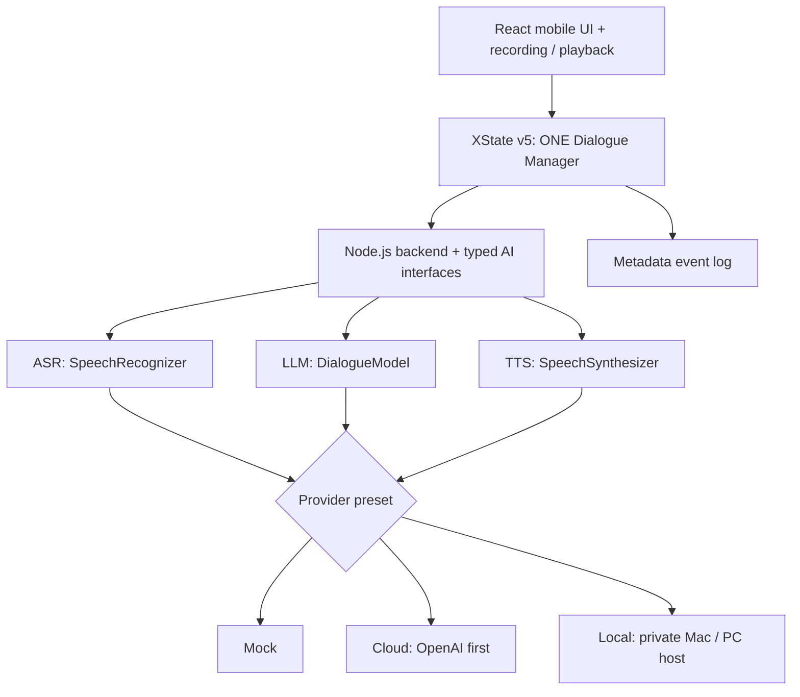
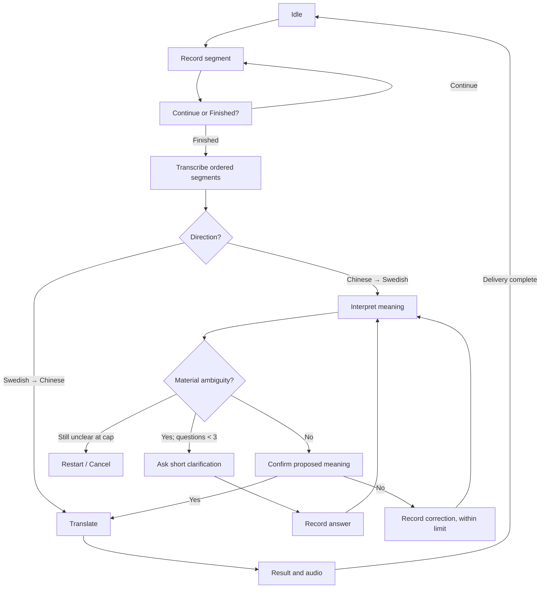

# Child-Friendly Chinese–Swedish Speech Translator
## Minimal V1 System Design — Provider-Independent Cursor Handoff

**Version:** 1.1 — 16 October 2026  
**Supersedes:** `Child_Translator_Minimal_V1_Cursor_System_Design_EN.md`  
**Scope:** **Adult-only prototype and feasibility tests**; no real child audio or personal data  
**Target:** iPhone Safari, React/TypeScript, XState v5, Node.js backend  
**Architecture:** **ONE UI + ONE dialogue Statechart + interchangeable Mock, Cloud, and Local AI providers.**

> **Cursor:** Implement one milestone at a time, starting with Mock only. The application must not contain separate Statecharts for Cloud and Local. Avoid production infrastructure, new product features, and real child data in V1.

---

## 1. Goal and fixed design decisions

Build a child-oriented **one-to-one, push-to-talk Chinese ↔ Swedish speech translator**, initially exercised with **adult speakers**. The interface is designed for pre-literate children, but V1 does **not** establish real child usability or child-speech ASR accuracy.

**Language directions:**

- **Chinese → Swedish (main workflow):** record → transcribe → interpret → clarify if needed → **always confirm Chinese intended meaning** → translate → show/play Swedish.
- **Swedish → Chinese (support workflow):** record → transcribe → translate directly → show **recognized Swedish original and Chinese translation** → play Chinese.

**Decisions carried over from Initial Design v0.2:**

1. **Every Chinese → Swedish translation needs explicit Yes** to the latest proposed meaning, even if the sentence seems clear.
2. At most **three semantic clarification questions per task**. Audio segments, ASR retries, and final confirmation do not consume this budget.
3. An unfinished task cannot be interrupted by a direction change without separate **Cancel and switch? Yes / No** confirmation.
4. Keep **one previous successfully delivered message** as session-only context, across directions. Never keep full history by default.

**Additional observed UX needs:** 30-second timer **per recording segment**; continue recording fragmented sentences across multiple segments; very large icons and brief spoken instructions (text not required for operation); adult-readable Swedish source transcript.

**Out of scope:** child testing, hardware device, school deployment, voice anonymization, always-on recording, model training, user accounts, permanent chat history, complex analytics, public hosting, and production legal-compliance certification. A later child-study protocol needs separate review.

---

## 2. High-level architecture



**Never duplicate** UI states, XState guards, clarification policy, memory semantics, or evaluation rules per AI provider. The machine makes dialogue decisions; models return structured proposals and translations.

| Preset | ASR | Understanding / translation | TTS | Purpose |
|---|---|---|---|---|
| `mock` | Deterministic fake | Deterministic fake | Prepared clips/fake playback | First: validate UI and dialogue flow |
| `cloud` | Cloud speech API | Cloud LLM | Cloud speech API | Adult-only real AI pilot |
| `local` | Local Whisper-family ASR | Locally served multilingual LLM | Local TTS | Optional private inference feasibility |

Design ASR, LLM and TTS as **three independent interfaces** so hybrid configurations remain possible later. **Do not build a full provider-combination selector in V1.** A developer-only setting selects a preset while **idle** and freezes it for a complete task.

**Privacy boundary:** Only adult speech and non-identifying/synthetic inputs are used for all real AI tests. A local server avoids sending content to model vendors but does not automatically resolve applicable research or privacy responsibilities.

---

## 3. Five child-oriented screens

| Screen | Core UI | Behavior |
|---|---|---|
| **Home** | Two prominent direction buttons + microphone | Choose Chinese → Swedish or Swedish → Chinese |
| **Recording** | Big microphone/Stop, animated **30-second countdown** | Manual stop or timeout ends **one segment**, not a task |
| **Continue / Finished** | 🎤➕ Continue, ✅ Finished | Add a segment, or submit the entire spoken message |
| **Clarify / Confirm** | 🔊 Replay; 🎤 Answer **or** ✅ Yes / ❌ No | One short question/decision at a time |
| **Result** | Big 🔊 Play/Replay, New turn / Re-record, text for adults | Display source text and translation; play target language |

UI rules:

- Make primary tap targets very large (aim for ~80 px); simple icons, clear shape and color cues, very little text.
- Child operation must **not depend on reading**. Spoken prompts include “现在可以说啦”, “还想继续说吗？”, “你是说……，对吗？”.
- Provide Replay for spoken questions. Do not overlap recorded microphone audio and app-spoken audio.
- Confirmation Yes/No and direction-switch Yes/No may look similar, but must carry **different machine events**.
- Do not assume Safari audio autoplay always succeeds; provide an explicit Play button.
- **ZH → SV result:** confirmed Chinese meaning + Swedish text + Swedish audio.
- **SV → ZH result:** recognized Swedish ASR original + Chinese translation + Chinese audio. The Swedish-speaking adult can inspect ASR recognition; this does **not** establish Chinese translation correctness.

---

## 4. Recording and dialogue flow

### 4.1 Segmented recording

1. One translation **task** can contain multiple audio **segments**. Each segment has a **30-second** countdown.
2. Pauses and silence do **not** automatically stop a segment. Stop or timeout ends only the current segment.
3. After each segment, choose **Continue** (another 30 seconds within the same task) or **Finished** (submit all segments).
4. On Finished, transcribe segments **in order**, keeping their boundaries. Do not invent words between fragments.
5. A clarification answer or correction reuses this recording UI but is tagged as a separate **input purpose** within the same task.
6. Keep audio temporarily in memory and discard on completion, cancellation, or session end; do not archive audio or transcripts in evaluation logs.

**Example:** “老师……” / “他把我的……” / “水壶拿走了。” → three segments, **one** message, **one** translation task.

**Safari checks:** microphone permission and secure HTTPS context; `MediaRecorder` support/MIME feature detection (do not assume WebM); supported backend audio formats; physical iPhone testing.

### 4.2 Conceptual Statechart



Implement **one** XState v5 machine with `setup`, typed `context` and events, `assign`, guards, and invoked async actors. Add globally reachable `confirmingSwitch`, `recoverableError`, and `fallback` states; the diagram only shows the main path. Reuse recording components for INITIAL, CLARIFICATION, and CORRECTION rather than building separate apps.

### 4.3 Essential policy

**Chinese → Swedish:**

- The LLM proposes either a short clarification or a tentative meaning. XState chooses which transition is allowed.
- Ask only when missing information **materially affects meaning**. Keep questions brief, neutral and understandable without reading.
- Increment the counter when a semantic question is **actually presented**. Never show question 4; after three unresolved questions, restart/cancel rather than guess.
- **Always** play a proposed Chinese meaning and wait for Yes before final translation.
- Confirmation No invalidates that proposed meaning; collect a correction. Limit to **two correction attempts** initially (provisional), then restart/cancel.
- Preserve original input and question/answer turns separately; a clarification answer is not a new task.

**Swedish → Chinese:** Transcribe adult Swedish, translate directly into clear Chinese, show recognized Swedish + Chinese result, and play Chinese. Do not enter the child meaning-confirmation flow.

**Direction switching:** While a task is active, request independent cancellation confirmation. **No** restores a safe checkpoint, retaining earlier segments/counters; an interrupted recording may need restarting. **Yes** cancels the unfinished task and starts a fresh task in the requested direction, while retaining only last successfully delivered message.

**Async safety:** Tag every request with `taskId` and `requestId`; ignore outdated completions after a switch/cancel, even if a network cancellation fails. Incomplete tasks never update session memory.

**Result delivery:** Do not remember a message just because an API returned a translation. Remember it only after the result was shown and target speech playback finished, or the adult tester explicitly accepted a text-only result after a TTS failure. Record whether the delivery was audio or text-only. Clear memory at `END_SESSION`. Previous message is optional context, never a factual assumption; use the **same prompt-memory setting** for Cloud/Local comparisons.

**Failures:** Empty ASR → re-record (provisional **two ASR retries**). Invalid model JSON / network failure / timeout → retry or cancel. TTS failure → retain readable text and allow manual replay or an adult text-only fallback. Never mark failed tasks as successful.

### 4.4 Compact Information State

```typescript
type Direction = 'ZH_TO_SV' | 'SV_TO_ZH';
type InputPurpose = 'INITIAL' | 'CLARIFICATION' | 'CORRECTION';
type ProviderPreset = 'mock' | 'cloud' | 'local';

type DialogueInput = {
  purpose: InputPurpose;
  textParts: string[];        // ordered segments; volatile
  inReplyTo?: string;         // clarification question, if any
};
type LastDelivered = {
  taskId: string;
  direction: Direction;
  source: string;             // confirmed Chinese meaning or Swedish ASR
  translation: string;
};
type Task = {
  id: string;
  direction: Direction;
  preset: ProviderPreset;     // frozen for task lifetime
  inputPurpose: InputPurpose;
  segmentInfo: { id: string; durationMs: number; purpose: InputPurpose }[];
  dialogueInputs: DialogueInput[];
  proposedMeaning: string | null;
  currentQuestion: string | null;
  confirmedMeaning: string | null;
  translatedText: string | null;
  clarificationCount: number;
  correctionCount: number;
  asrRetryCount: number;
};
type MachineContext = {
  sessionId: string;
  task: Task | null;
  lastDelivered: LastDelivered | null;
  pendingDirection: Direction | null;
  safeReturnState: string | null;
  activeRequestId: string | null;
};
const LIMITS = {
  segmentSeconds: 30,
  semanticClarifications: 3,
  correctionAttempts: 2,
  asrRetries: 2,
};
```

Keep audio blobs in a separate **volatile audio store**, not persistent XState snapshots. The actual machine should define typed UI events (`START_TASK`, `STOP_SEGMENT`, `SEGMENT_TIMEOUT`, `CONTINUE_SPEAKING`, `FINISH_INPUT`, `CONFIRM_YES`, `CONFIRM_NO`, `SWITCH_REQUESTED`, `SWITCH_YES`, `SWITCH_NO`, `DELIVERY_FINISHED`, `RETRY`, `CANCEL`, `END_SESSION`) and typed async completion/error events.

---

## 5. Provider contracts — interchangeable ASR, LLM, TTS

These are **design-level** TypeScript contracts; adapt transport encoding between browser and Node without changing semantics.

```typescript
type Language = 'zh' | 'sv';
type AudioData = { bytes: Uint8Array; mimeType: string; durationMs?: number };
type RequestMeta = { taskId: string; requestId: string; signal?: AbortSignal };

type InterpretationResult =
  | { kind: 'ASK_CLARIFICATION'; questionZh: string; reasonCode: string }
  | { kind: 'PROPOSE_MEANING'; meaningZh: string }
  | { kind: 'UNRESOLVED'; reasonCode: string };

interface SpeechRecognizer {
  transcribe(audio: AudioData, language: Language, meta: RequestMeta): Promise<string>;
}
interface DialogueModel {
  interpretChinese(input: {
    dialogueInputs: DialogueInput[];
    remainingClarifications: number;
    previousDelivered?: LastDelivered | null;
  }, meta: RequestMeta): Promise<InterpretationResult>;
  translate(input: {
    text: string;
    direction: Direction;
    previousDelivered?: LastDelivered | null;
  }, meta: RequestMeta): Promise<string>;
}
interface SpeechSynthesizer {
  synthesize(text: string, language: Language, meta: RequestMeta): Promise<AudioData>;
}
type ProviderBundle = {
  asr: SpeechRecognizer;
  dialogue: DialogueModel;
  tts: SpeechSynthesizer;
};
```

**Mandatory:** Validate JSON and schema from any LLM before dispatching XState events. Models cannot change counters, skip required confirmation, or bypass guards. Backend checks payload size, text length, timeouts and errors. No provider API key or private inference endpoint is exposed to the browser.

### 5.1 Mock (implement first)

Deterministic fake ASR, interpretation, translation and audio output. Support clear Chinese, ambiguity, clarification answer, confirmation No, Swedish input, recoverable error, and stale responses. **Exercise the real machine**, not shortcuts.

### 5.2 Cloud (second)

Use a Node-side Cloud bundle (initial example: OpenAI API) for ASR, structured interpretation/translation and TTS. Pin model identifiers and prompt versions for reproducible adult tests. Preserve ordered segment transcripts, keep credentials server-side, and support retries and timeouts. **Adult voices and non-identifying input only.** Verify current vendor endpoints, formats, limits and usage conditions at integration time; do not assume a data-retention setting from code alone.

### 5.3 Local (test feasibility before full integration)

Run inference on an existing **Mac / PC**, not necessarily on the iPhone:

| Function | Initial local candidate | Gate |
|---|---|---|
| ASR | Multilingual Whisper via `whisper.cpp` or `faster-whisper` | Actual Chinese and Swedish adult speech accuracy and speed |
| LLM + first-pass translation | Quantized multilingual model via Ollama, initially a Qwen3 8B-class candidate | **Text-only** Swedish ↔ Chinese quality + appropriate clarification |
| Optional translation upgrade | Separate multilingual machine translation model | Only if the LLM's Swedish fidelity is inadequate |
| TTS | Piper or another offline engine | Verify appropriate **both Chinese and Swedish voices** and acceptable audio |

The Local preset reaches services through the backend. Keep the inference host on a trusted local network for V1; do not publish unauthenticated Ollama/Whisper endpoints. If local TTS cannot support both languages, report the limitation; **do not silently route the Local preset to a cloud TTS**.

**Hardware:** benchmark existing RAM/VRAM and warm/cold latency before buying anything. A quantized 8B is a starting experiment, **not proof** of good Chinese–Swedish dialogue or translation; a 14B model may help quality but also increases resources and latency.

**Stop/go rule:** use the **same ~20 fixed text examples** on Cloud and Local before integrating local ASR/TTS. If local text quality fails, pause Local integration and keep the single UI/Statechart functioning with Cloud and Mock.

### 5.4 Minimal backend routes

`GET /api/health`, `POST /api/asr` (one segment), `POST /api/interpret`, `POST /api/translate`, `POST /api/tts`, `POST /api/events`, developer-only `GET /api/events/export` (CSV).

Freeze provider preset for each active task; change via developer settings **only while idle**. Use request IDs to reject stale responses and redact audio/transcripts/translations from standard server logs.

---

## 6. Evaluation — small adult pilot

The goal is to choose a **technically feasible AI provider** and verify the dialogue flow; it is **not** a child-usability or child-speech study. Do not add Cloud-versus-Local as a new main Research Question automatically.

**Automated metadata:** `sessionId`, `taskId`, `scenarioId`, `providerPreset`, non-secret `modelTag`, `version`, `direction`, `eventType`, `elapsedMs`, optional `segmentDurationMs`, `clarificationCount`, `stageDurationMs`, `errorCategory`, `deliveryMode`. Never log raw audio, transcript, translation, prompt text or `lastDelivered` content persistently.

**Event names:** `TASK_STARTED`, `RECORDING_STARTED`, `RECORDING_STOPPED`, `SEGMENT_TIMEOUT`, `CONTINUE_SELECTED`, `INPUT_FINISHED`, `ASR_COMPLETED`, `CLARIFICATION_PRESENTED`, `CONFIRMATION_YES`, `CONFIRMATION_NO`, `TRANSLATION_READY`, `PLAYBACK_COMPLETED`, `TASK_COMPLETED`, `TASK_CANCELLED`, `SWITCH_REQUESTED`, `SWITCH_YES`, `SWITCH_NO`, `ERROR`, `SESSION_ENDED`.

**Automatic metrics:** technical completion rate; segment/timeout counts; clarification and rejected-confirmation counts; request latency by ASR / interpretation / translation / TTS; total successful-task time; error count. A technically delivered result is **not** proof of communication success.

**Manual adult sheet (one row/task):** `scenarioId`, `providerPreset`, `referenceMeaning`, `meaningScore` (0 wrong / 1 partial / 2 key meaning correct), `recipientUnderstood` (yes/no/not assessed), `asrIssue`, `taskOutcome`, `uiDifficultyNote`. Human judgment must be independent of the model's own confirmation and ideally from a bilingual observer.

**Comparable provider test:**

1. Text-only: **20 fixed non-identifying examples** — 5 clear Chinese→Swedish, 10 fragmented/ambiguous Chinese, 5 clear Swedish→Chinese. Compare meaning preservation, clarification behavior and LLM latency; keep memory-policy and prompt contracts identical.
2. Adult speech: use comparable scenarios on real iPhone with full ASR→LLM→TTS, recording stage latency and failures. Pin models/prompt versions. Do **not** conflate ASR problems with model translation problems.

---

## 7. Acceptance scenarios (Mock first; then adult integration)

| ID | Scenario | Required result |
|---|---|---|
| T01 | “我想去厕所。” | Skip unnecessary clarification, **still** confirm meaning |
| T02 | “老师……” / “他把我的……” / “水壶拿走了。” | Three segments, one task, ordered transcript |
| T03 | Recording reaches 30 seconds | Stop segment only; offer Continue / Finished |
| T04 | “他拿走了我的那个。” | Short neutral question; no invented referent |
| T05 | Three clarification attempts fail | No fourth question; restart/cancel |
| T06 | Confirmation No | Rejected meaning invalid; correction flow |
| T07 | Swedish “Lägg boken på bordet.” | Swedish original + Chinese result + speech |
| T08 | Direction switch mid-recording or during API | Separate Switch Yes / No; safe recovery |
| T09 | Stale provider response after cancellation | Ignore response and don't update memory |
| T10 | Successful task followed by cancelled task | Retain only last **delivered** message |
| T11 | ASR empty, permission denied, network error, malformed JSON, TTS failure | Recover or cancel; no false success |
| T12 | End session + export metadata | Volatile content cleared; CSV has no conversation content |
| T13 | Change provider while idle / mid-task | Only idle can change; task preset frozen |
| T14 | Same fixed text task on Cloud vs Local | Same policy/contracts; log differences in quality and latency |

**Machine unit tests must cover:** mandatory latest-meaning confirmation, clarification cap, correction cap, separate switch confirmation, rejection of stale requests, segment timing, session-memory lifecycle, direct Swedish path, provider freeze, recoverable failures.

---

## 8. Development milestones (implement in order)

1. **Mock UI + XState** — Five screens, timer, segmented-input logic, small context, Mock bundle, machine tests. **Stop and verify before anything else.**
2. **Real iPhone microphone** — `getUserMedia`, `MediaRecorder`, HTTPS, MIME compatibility, recording segments and playback.
3. **Cloud adult pilot** — Node cloud adapters, real adult ASR / LLM / TTS, validated structured output, retries, stage timing.
4. **Local text-only feasibility** — Run quantized local multilingual LLM; compare the same 20 text scenarios against Cloud **before** wiring local audio.
5. **Local speech integration (conditional)** — Add local ASR and both-language local TTS; connect under the **same** interface and Statechart. If text feasibility fails, skip and document it.
6. **Adult evaluation + selection** — Export metadata, execute T01–T14, human-score the fixed test set, compare provider quality, latency, stability and setup burden. Choose one provider for subsequent dialogue-policy research.

**Core Minimal V1 is complete with Milestones 1–3**. Local is an optional, independently validated technical path, not a blocker.

### Suggested repository layout

```text
child-translator/
  docs/SYSTEM_DESIGN.md       # THIS file; only authoritative policy document
  apps/web/src/
    ui/                       # screens and adult text panel
    dialogue/                 # XState machine + types
    audio/                    # recorder / playback / volatile audio store
    services/                 # typed backend client
  apps/server/src/
    routes/
    providers/contracts.ts
    providers/mock/
    providers/cloud/
    providers/local/
    evaluation/               # metadata-only event logging, CSV export
  tests/machine/
  tests/integration/
  .env.example
  README.md
```

Optional future `CLOUD_PROVIDER.md` and `LOCAL_PROVIDER.md` may describe setup/model specifics. They must **not** redefine the Statechart, core policy, UI flow, or metrics.

---

## 9. Paste into Cursor Agent now

> Read `docs/SYSTEM_DESIGN.md` fully. **Implement Milestone 1 only.** Create one mobile-first React/TypeScript app and one XState v5 machine for the Chinese–Swedish translator. Implement the child-friendly five-screen UI, per-segment 30-second timer, Continue/Finished, Chinese clarification (max three), mandatory confirmation, Swedish direct translation, independent direction-switch confirmation, one-message volatile memory, and typed ASR/DialogueModel/TTS interfaces. Implement a deterministic Mock preset; add machine unit tests for the acceptance invariants. Do **not** integrate OpenAI, Ollama, Whisper, or Piper yet. Do not build separate Cloud/Local applications. Do not handle actual child data. Report how to run the app, test results and known limitations, then **stop after Milestone 1**.

**References:** [XState v5](https://stately.ai/docs/setup), [XState invoked actors](https://stately.ai/docs/invoke), [getUserMedia](https://developer.mozilla.org/en-US/docs/Web/API/MediaDevices/getUserMedia), [MediaRecorder MIME detection](https://developer.mozilla.org/en-US/docs/Web/API/MediaRecorder/isTypeSupported_static).

---

### Change summary from Minimal V1.0

- Preserves **all four** user-approved dialogue decisions and the newer child-oriented UI/recording requirements.
- Introduces **three independently swappable service contracts** and `mock` / `cloud` / `local` presets, instead of hardwiring the app to OpenAI.
- Keeps **one** Statechart and **one** Evaluation Logger; provider can change only between tasks.
- Adds a **text-only local feasibility test before local speech integration** to avoid unnecessary deployment work.
- Separates provider engineering comparison from eventual child usability and dialogue-management research.
